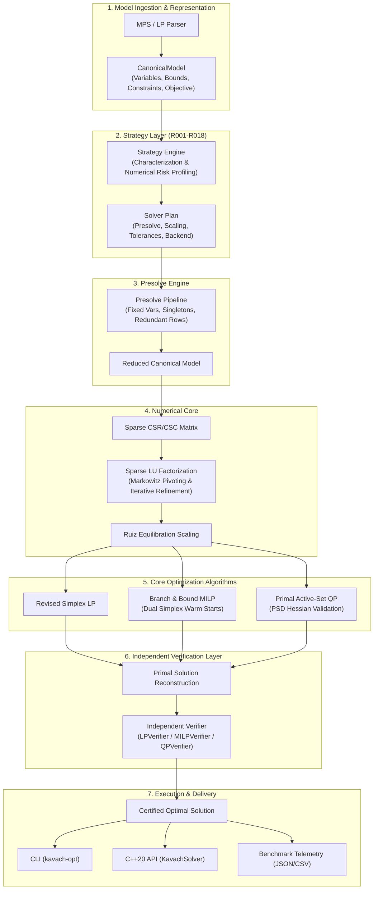

# Kavach-Opt (कवच-Opt)

## Sovereign Indigenous Optimization Solver Core
### Smart India Hackathon (SIH26119) · Problem Statement: Indigenous Optimization Solver Core

---

## 1. What is Kavach-Opt?

**Kavach-Opt** is a from-scratch, sparse, numerically self-verifying mathematical optimization solver core engineered in modern C++20 from first principles. It provides an indigenous, sovereign alternative to foreign proprietary commercial solvers (CPLEX, Gurobi, FICO Xpress) for industrial planning, supply chain optimization, and refinery operations.

### Key Engineering Pillars
1. **Mathematical Sovereignty**: Zero foreign optimization libraries (CPLEX, Gurobi, HiGHS, GLPK, CBC, SCIP) in the solving path.
2. **Independent Verification Layer**: Decoupled recomputation of primal feasibility, dual feasibility, complementary slackness, and KKT residuals—never trusting the solver's self-reported status.
3. **Sparse Numerical Core**: High-performance Compressed Sparse Row (CSR) and Column (CSC) formats with Sparse LU factorization, Markowitz threshold pivoting, iterative refinement, and Ruiz equilibration scaling.
4. **Honest Hardware Acceleration**: CPU-first architecture with a scoped CUDA kernel for batched sparse matrix-vector multiplication (SpMV) featuring transfer-inclusive profiling, empirical crossover gates, and automatic CPU fallback.
5. **Deterministic Intelligence**: Rule-based strategy layer (Rules `R001`–`R018`) providing explainable, auditable solver configuration and numerical risk mitigation without black-box machine learning.

---

## 2. Supported Capabilities & Boundaries

| Problem Class / Capability | Support Status | Algorithmic Approach |
|:---|:---:|:---|
| **Linear Programming (LP)** | **SUPPORTED** | Two-Phase Primal Revised Simplex with Bland anti-cycling, scaling, and presolve. |
| **Mixed-Integer Linear Programming (MILP)** | **SUPPORTED** | Branch-and-Bound, most-fractional branching, best-bound search, dual simplex warm starts. |
| **Convex Quadratic Programming (QP)** | **SUPPORTED** | Primal active-set method, positive semi-definite (PSD) Hessian validation, KKT convergence. |
| **Sparse LU Linear System Solver** | **SUPPORTED** | Markowitz threshold pivoting with iterative refinement. |
| **Presolve & Reconstruction** | **SUPPORTED** | Fixed-variable elimination, empty row/col removal, singleton bound tightening, redundancy removal. |
| **Independent Verification** | **SUPPORTED** | Decoupled verification certifying primal/dual residuals, slackness, and integrality. |
| **Multicore CPU Execution** | **SUPPORTED** | Standard C++20 thread pool distributing batched SpMV workloads. |
| **CUDA GPU Acceleration** | **SUPPORTED (SCOPED)** | Single scoped CUDA kernel for batched CSR SpMV with transparent CPU fallback. |
| **Rule-Based Solver Strategy** | **SUPPORTED** | Autonomous characterization and deterministic rule-based parameter selection (`R001`–`R018`). |
| **Mixed-Integer QP (MIQP)** | **NOT IMPLEMENTED** | Models with quadratic objectives and integer variables are explicitly rejected. |
| **Nonlinear Programming (NLP / MINLP)** | **NOT IMPLEMENTED** | General nonlinear equations are explicitly rejected. |
| **Non-Convex QP** | **NOT IMPLEMENTED** | Only strictly convex QP ($Q \succeq 0$) is supported; non-PSD Hessians are rejected. |

*For complete capability details and architectural boundaries, see [Scope and Limitations](docs/SCOPE_AND_LIMITATIONS.md) and [Capability Matrix](docs/CAPABILITY_MATRIX.md).*

---

## 3. System Architecture



---

## 4. Quick Start & Build Instructions

### Prerequisites
- C++20 compliant compiler (`clang++` 14+ or `g++` 12+)
- CMake 3.20+ and Ninja build system
- Python 3.8+ (for dependency audits and benchmark helpers)

### Building the Project
```bash
# Configure Release build
cmake -B build-release -G Ninja -DCMAKE_BUILD_TYPE=Release

# Build solver library, CLI, and test suite
cmake --build build-release

# Run complete CTest suite (all unit & adversarial tests)
ctest --test-dir build-release --output-on-failure
```

### Enabling AddressSanitizer & UndefinedBehaviorSanitizer
```bash
cmake -B build-asan -G Ninja -DCMAKE_BUILD_TYPE=Debug -DKAVACH_ENABLE_SANITIZERS=ON
cmake --build build-asan
ctest --test-dir build-asan --output-on-failure
```

---

## 5. Usage Examples

### 5.1. Solving a Linear Program via CLI
```bash
# Solve Netlib benchmark problem
./build-release/kavach-opt solve benchmarks/netlib/afiro.mps

# Solve with concise strategy plan
./build-release/kavach-opt solve benchmarks/netlib/afiro.mps --show-strategy

# Solve with JSON telemetry
./build-release/kavach-opt solve benchmarks/netlib/afiro.mps --json
```

### 5.2. Independent Verification of a Model
```bash
./build-release/kavach-opt verify benchmarks/netlib/afiro.mps
```

### 5.3. Presolve Inspection & Reduction Reporting
```bash
./build-release/kavach-opt presolve benchmarks/netlib/afiro.mps --report
```

### 5.4. MRPL Industrial Case Study Execution
```bash
# Run baseline and 4 what-if operational scenarios
./build-release/kavach-opt mrpl --no-highs
```

### 5.5. Strategy Inspection & Mathematical Explanation
```bash
./build-release/kavach-opt solve benchmarks/netlib/beaconfd.mps --explain-strategy
```

### 5.6. Automated Benchmark Suite Execution
```bash
./build-release/kavach-opt benchmark --suite netlib --seed 42 --output benchmark_results
```

---

## 6. Programmatic C++20 API Usage

```cpp
#include <iostream>
#include "api/solver.hpp"
#include "model/model.hpp"

int main() {
    // 1. Formulate canonical model
    kavach::model::CanonicalModel model("simple_lp");
    model.set_objective_sense(kavach::model::ObjectiveSense::MAXIMIZE);

    auto x1 = model.add_variable("x1", kavach::model::VariableType::CONTINUOUS, 0.0, 100.0);
    auto x2 = model.add_variable("x2", kavach::model::VariableType::CONTINUOUS, 0.0, 100.0);
    model.set_objective_linear_coefficient(x1, 3.0);
    model.set_objective_linear_coefficient(x2, 2.0);

    kavach::model::SparseLinearExpression c1;
    c1.add_term(x1, 2.0);
    c1.add_term(x2, 1.0);
    model.add_constraint("capacity", std::move(c1), kavach::model::ConstraintSense::LESS_EQUAL, 100.0);

    // 2. Instantiate solver and solve
    kavach::api::KavachSolver solver;
    kavach::api::SolverResult result = solver.solve(model);

    // 3. Inspect certified solution
    if (result.status == kavach::core::SolverStatus::OPTIMAL && result.verification_report.passed) {
        std::cout << "Optimal Objective: " << result.objective_value << "\n";
        std::cout << "x1: " << result.primal_solution[x1] << ", x2: " << result.primal_solution[x2] << "\n";
    }
    return 0;
}
```
*A complete standalone executable example is available in [`examples/api_example.cpp`](examples/api_example.cpp) and builds as `kavach_api_example`.*

---

## 7. Verification Philosophy

Kavach-Opt adheres to a strict verification invariant:
$$\text{Status} = \text{OPTIMAL} \iff \text{Independent Verification} = \text{PASS}$$

The solver's internal basis state is never trusted as self-authenticating. A dedicated, decoupled verification layer (`LPVerifier`, `MILPVerifier`, `QPVerifier`) independently takes the original problem input ($A, b, c$) and computes:
1. **Primal Feasibility**: $\|Ax - b\|_\infty \le \epsilon_{\text{feas}}$ and $l \le x \le u$.
2. **Dual Feasibility**: $\|A^T y + r - c\|_\infty \le \epsilon_{\text{opt}}$ and sign conditions on $y$.
3. **Complementary Slackness**: $x_j \cdot r_j \le \epsilon_{\text{cs}}$ and $y_i \cdot (Ax - b)_i \le \epsilon_{\text{cs}}$.
4. **Integrality (MILP)**: $|x_j - \text{round}(x_j)| \le \epsilon_{\text{int}}$ for all discrete variables.
5. **KKT Stationarity (QP)**: $\|Qx + c + A^T y + r\|_\infty \le \epsilon_{\text{kkt}}$.

If any residual exceeds numerical tolerances, the result is rejected with `VERIFICATION_FAILED`.

---

## 8. Hardware Acceleration & CPU Fallback

Kavach-Opt implements an honest, transparent hardware acceleration model:
- **CPU-First Design**: The core optimization algorithms, Sparse LU factorizations, and tree searches execute on the CPU.
- **Batched SpMV Parallelism**: Multicore CPU thread pool distributes independent matrix-vector products across cores.
- **Scoped CUDA Acceleration**: CUDA is utilized exclusively for large-scale batched CSR SpMV operations ($Y_k = A \cdot X_k$).
- **Transfer-Inclusive Profiling**: Speedup claims require Host-to-Device (H2D) and Device-to-Host (D2H) memory transfer times to be factored into the measurement.
- **Transparent CPU Fallback**: If CUDA is not detected or `--no-gpu` is supplied, execution transparently falls back to CPU multicore with zero errors.

*For complete hardware crossover benchmarks and architectural details, see [GPU Claim Audit](docs/GPU_CLAIM_AUDIT.md).*

---

## 9. Repository Structure

```text
SIH26119/
├── CMakeLists.txt                 # Root CMake build configuration (C++20, warnings, sanitizers)
├── README.md                      # Technical entry point
├── SIH26119_Kavach-Opt_Blueprint_v2.md # Original architectural blueprint
├── benchmark_results/             # Versioned JSON/CSV/markdown benchmark artifacts
│   ├── miplib/                    # MIPLIB subset benchmark results
│   ├── netlib/                    # Netlib LP benchmark results
│   ├── qp/                        # Convex QP benchmark results
│   └── strategy/                  # Strategy decision audit JSONs
├── benchmarks/                    # Standardized benchmark models and manifests
│   ├── manifests/                 # JSON benchmark manifests
│   ├── miplib/                    # MIPLIB models (knapsack.lp, facility_loc.lp)
│   ├── netlib/                    # Netlib LP models (afiro.mps, beaconfd.mps, etc.)
│   └── qp/                        # Convex QP models (portfolio.lp, constrained_ls.lp)
├── docs/                          # Comprehensive technical documentation (20+ specs)
│   ├── CAPABILITY_MATRIX.md       # Implemented vs unsupported capability matrix
│   ├── EVIDENCE_MATRIX.md         # End-to-end claim traceability matrix
│   ├── FINAL_DEMO_GUIDE.md        # 14-step judge walkthrough & presentation guide
│   ├── GPU_CLAIM_AUDIT.md         # Scoped GPU kernel and CPU fallback audit
│   ├── MRPL_CASE_STUDY.md         # Refinery case study report and economics
│   ├── REPRODUCIBILITY.md         # Deterministic reproduction commands
│   ├── RELEASE_CHECKLIST.md       # 27-item release readiness gate
│   ├── SCOPE_AND_LIMITATIONS.md   # Explicit technical boundaries
│   ├── SOLVER_STRATEGY.md         # Rule-based strategy engine specification
│   └── VERIFICATION.md            # Independent verification layer architecture
├── examples/                      # Example models and programmatic API code
│   ├── api_example.cpp            # C++ API usage demonstration
│   └── mrpl/                      # MRPL case study generator and model files
├── reports/                       # System health and audit artifacts
│   ├── final_system_audit.json    # Machine-readable audit JSON
│   └── final_system_audit.md      # Judge-readable audit markdown
├── src/                           # Complete C++20 solver implementation
│   ├── algorithms/                # LP Revised Simplex, MILP B&B, Active-Set QP
│   ├── api/                       # Public solver facade (KavachSolver)
│   ├── backend/                   # CPU Thread Pool and CUDA backends
│   ├── benchmark/                 # Benchmark harness and reporting
│   ├── case_study/                # MRPL industrial refinery case study
│   ├── cli/                       # Command-line interface executable (kavach-opt)
│   ├── core/                      # Logger, Random, Status, Tolerances, Version
│   ├── io/                        # MPS and Native LP format parsers
│   ├── model/                     # CanonicalModel representation
│   ├── numerics/                  # Sparse matrices, Sparse LU, Scaling
│   ├── presolve/                  # Multi-pass presolve and reconstruction
│   ├── strategy/                  # Rule-based strategy engine (R001-R018)
│   └── verification/              # Independent LP, MILP, and QP verifiers
├── tests/                         # Comprehensive unit and adversarial test suites
│   └── unit/                      # Phases 0 to 14 unit test suites (329 tests)
└── tools/                         # Maintenance and verification scripts
    ├── check_dependencies.py      # Dependency sovereignty audit script
    └── generate_strategy_decisions.py # Strategy decisions generator
```

---

## 10. Reproducibility & Citation

Kavach-Opt enforces deterministic reproducibility across all supported platforms. All results reported in documentation and benchmark artifacts can be reproduced using the exact commands in [`docs/REPRODUCIBILITY.md`](docs/REPRODUCIBILITY.md).

```bash
# Verify sovereignty
python3 tools/check_dependencies.py

# Verify formatting
find src tests examples -name '*.cpp' -o -name '*.hpp' | xargs clang-format --dry-run --Werror

# Verify test suite
ctest --test-dir build-release --output-on-failure
```

*License & Copyright (c) 2026 Sovereign Indigenous Optimization Solver Core Team.*
