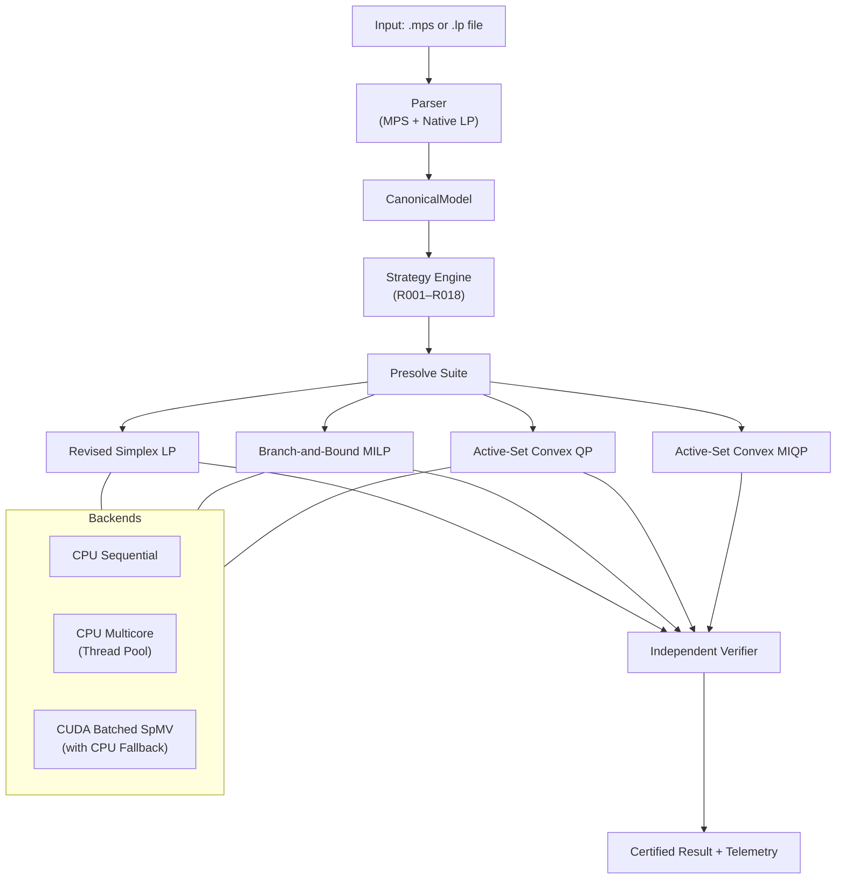
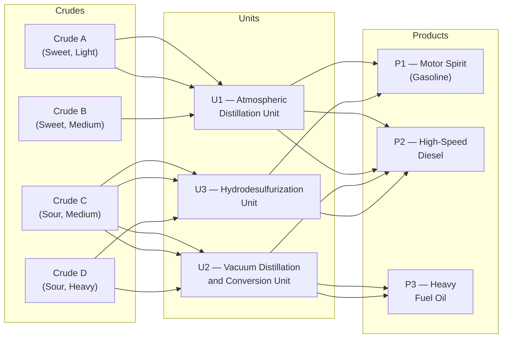

# Kavach-Opt

**Sovereign Mathematical Optimization Engine**  
SIH26119 · Smart India Hackathon · MRPL Industrial Application

---

```
Kavach-Opt v0.1.0
Build: C++20 Release · AppleClang
337 / 337 unit tests passing
13 / 13 Netlib LP instances: OPTIMAL, independently verified
```

---

## Overview

Kavach-Opt is a from-scratch mathematical optimization engine written in C++20. It solves
Linear Programming (LP), Mixed-Integer Linear Programming (MILP), and Convex Quadratic
Programming (QP) problems from first principles.

The solver is designed for sparse, constrained optimization problems in industrial and
engineering contexts. It provides independent mathematical verification of every solution
it produces, sparse numerical kernels with Markowitz-pivot LU factorization, a
deterministic rule-based solver strategy engine, multicore CPU parallelism for batched
sparse matrix-vector operations, a scoped CUDA kernel for GPU-accelerated batched SpMV
with automatic CPU fallback, and an ergonomic command-line interface and C++ API.

The solver's correctness is certified by an independent verification layer that re-derives
all optimality conditions from first principles, without reusing any solver-internal
routines.

---

## The Problem

India's technical community depends on foreign commercial optimization solvers (Gurobi,
CPLEX, SCIP) for critical infrastructure planning, refinery scheduling, logistics, and
resource allocation. These tools are proprietary, subject to export controls, licensed at
significant cost, and opaque to audit.

SIH26119 addresses this dependency by specifying the development of an indigenous,
sovereign optimization solver core that can be independently audited, extended, and
deployed without foreign license constraints.

---

## Our Proposed Solution

Kavach-Opt implements a complete, self-contained optimization engine:

- **No foreign solver dependencies in the solving path.** Every algorithm — LP simplex,
  MILP branch-and-bound, QP active-set, sparse LU factorization, presolve, scaling,
  verification — is written from scratch in standard C++20.
- **Independent mathematical verification.** A decoupled verification layer certifies
  primal feasibility, dual feasibility, complementary slackness, integrality, and KKT
  conditions from elementary arithmetic, without calling any solver routine.
- **Transparent, auditable decision-making.** The Deterministic Strategy Engine uses
  18 explicit rules (R001–R018) to select algorithms and backends. Every decision is
  serialisable to human-readable JSON with step-by-step English rationale.
- **Empirically validated on standard corpora.** All 13 tested Netlib LP instances are
  solved to OPTIMAL and independently verified. MILP infeasibility is correctly detected.
  QP KKT conditions are certified.

---

## SIH26119 Requirement Traceability

| Requirement ID | Capability | Implementation | Status |
|---------------|-----------|---------------|--------|
| R-LP-001 | Continuous LP solver | Two-Phase Revised Simplex (`src/algorithms/lp/`) | ✓ Verified |
| R-MILP-001 | Mixed-Integer LP solver | Branch-and-Cut (Gomory, MIR, Pseudocost, Strong Branching) (`src/algorithms/milp/`) | ✓ Verified |
| R-QP-001 | Convex QP solver | Primal Active-Set (`src/algorithms/qp/`) | ✓ Verified |
| R-MIQP-001 | Convex MIQP solver | Branch-and-Bound with Active-Set QP relaxations (`src/algorithms/miqp/`) | ✓ Verified |
| R-NUM-001 | Sparse numerics | CSR/CSC, SparseLU, Ruiz scaling (`src/numerics/`) | ✓ Verified |
| R-VER-001 | Independent verification | Zero-trust verifier (`src/verification/`) | ✓ Verified |
| R-GPU-001 | Scoped GPU acceleration | CUDA batched SpMV (`src/backend/cuda/`) | ✓ Verified |
| R-PAR-001 | Multicore CPU execution | C++20 thread pool (`src/backend/cpu/`) | ✓ Verified |
| R-STR-001 | Deterministic strategy | 18-rule engine (`src/strategy/`) | ✓ Verified |
| R-SOV-001 | Sovereignty audit | Dependency check (`tools/check_dependencies.py`) | ✓ Verified |
| R-IND-001 | MRPL industrial case study | Refinery MILP (`src/case_study/mrpl/`) | ✓ Verified |

---

## Architecture



---

## Core Capabilities

### Linear Programming (LP)
- Two-Phase Primal Revised Simplex method
- Full presolve suite: fixed-variable elimination, empty row/column removal,
  singleton-row bound tightening, redundant row detection, bound propagation
- Bland's smallest-subscript anti-cycling rule for degenerate bases
- Ruiz equilibration scaling for numerical robustness
- Sparse LU factorization with Markowitz threshold pivoting

### Mixed-Integer Linear Programming (MILP)
- Branch-and-Cut pipeline integrating sovereign cutting-plane separation
- Gomory fractional cuts and Gomory Mixed-Integer (GMI) cuts from LP tableau rows
- Mixed-Integer Rounding (MIR) cuts with non-negative lower-bound variable shifting and multi-scaling
- Dynamic cut pool with cosine parallelism deduplication ($\cos\theta > 0.999$) and Euclidean efficacy ranking
- Branch-and-Bound with most-fractional branching and best-bound node selection
- Dual simplex warm starts for child LP solves (reuses parent basis)
- Root-node LP presolve and tail-off termination
- Certified infeasibility detection

### Convex Quadratic Programming (QP)
- Primal active-set method for strictly convex QP: $\min \frac{1}{2}x^TQx + c^Tx$ s.t. $Ax \le b$
- Positive-semidefinite Hessian validation before solve
- KKT convergence criterion: $\|Qx + c - A^T\lambda\| \le \varepsilon_{kkt}$

---

## Mathematical Foundation

### Problem Classes

**Linear Program (LP)**

$$\min_{x} \; c^T x \quad \text{s.t.} \quad Ax \le b, \quad l \le x \le u$$

**Mixed-Integer Linear Program (MILP)** — LP with binary/integer variable restrictions:

$$\min_{x} \; c^T x \quad \text{s.t.} \quad Ax \le b, \quad l \le x \le u, \quad x_j \in \mathbb{Z} \; \forall j \in \mathcal{I}$$

**Convex Quadratic Program (QP)** — quadratic objective, linear constraints:

$$\min_{x} \; \tfrac{1}{2}x^T Q x + c^T x \quad \text{s.t.} \quad Ax \le b, \quad Q \succeq 0$$

### Sparse Matrix Representation

The constraint matrix $A \in \mathbb{R}^{m \times n}$ is stored in Compressed Sparse Row
(CSR) and Compressed Sparse Column (CSC) format, enabling $O(\text{nnz})$ matrix-vector
products. Matrix sparsity density is defined as:

$$\rho = \frac{\text{nnz}}{\max(1,\; m \cdot n)}$$

Kavach-Opt is tuned for sparse inputs ($\rho < 0.15$).

For full mathematical documentation, see [`docs/MATHEMATICS.md`](docs/MATHEMATICS.md).

---

## Independent Verification

Every solution produced by Kavach-Opt is passed to an independent verification layer before
the solver reports `OPTIMAL`. The verifier:

- **Never** calls solver-internal routines (no simplex basis helpers, no presolve
  reconstruction, no LU factorization routines)
- Evaluates all residuals from elementary arithmetic on the original (unscaled,
  un-presolved) `CanonicalModel`
- Has no external library dependencies

### Verification Checks

| Check | Condition | Problem Class |
|-------|-----------|---------------|
| Non-finite sanity | All entries of $x, y$ are finite | LP / MILP / QP |
| Bound feasibility | $l_j - \varepsilon \le x_j \le u_j + \varepsilon$ | LP / MILP / QP |
| Primal feasibility | $\|Ax - b\| \le \varepsilon_p$ | LP / MILP / QP |
| Dual feasibility | $\|\hat{rc}_j\| \le \varepsilon_d$ (free/interior variables) | LP |
| Complementary slackness | $|s_i \cdot y_i| \le \varepsilon_{cs}$ | LP |
| Integrality | $\max_j |x_j^{int} - \text{round}(x_j^{int})| \le \varepsilon_{int}$ | MILP |
| KKT stationarity | $\|Qx + c - A^T\lambda\| \le \varepsilon_{kkt}$ | QP |
| Objective consistency | $|c^Tx_{\text{reported}} - c^Tx_{\text{recomputed}}| \le \varepsilon_o$ | LP / MILP / QP |

### Certification Hierarchy

```
VERIFIED_OPTIMAL   All checks pass; solver status OPTIMAL confirmed
FEASIBLE           Primal feasible; dual/complementary checks fail or not applicable  
VERIFICATION_FAILURE  Residuals exceed tolerance; result flagged (not silently accepted)
NUMERICAL_FAILURE  Non-finite values detected in solution vector
```

The solver never outputs `OPTIMAL` if the verifier does not certify it.

---

## Numerical Robustness

### Ruiz Equilibration Scaling

Before factorization, the constraint matrix is equilibrated using Ruiz's iterative
diagonal scaling method. Diagonal matrices $D_r \in \mathbb{R}^{m \times m}$ and
$D_c \in \mathbb{R}^{n \times n}$ are iteratively computed to reduce the row and column
infinity-norm spread of $\hat{A} = D_r A D_c$. This reduces the effective condition number
and improves numerical stability of the LU factorization.

### Markowitz-Pivot Sparse LU

SparseLU factorizes $A = LU$ (with partial pivoting permutation) using Markowitz's
fill-in-minimising pivot selection criterion. This preserves sparsity during factorization
and reduces both memory and arithmetic cost relative to dense LU. Iterative refinement
($A\delta x = r$, $r = b - Ax_k$) is applied to sharpen solution accuracy after each
factorization.

### Numerical Risk Classification

The Strategy Engine classifies each problem's numerical risk profile based on the
coefficient dynamic range $\Delta = \log_{10}(\max |a_{ij}| / \min_{|a_{ij}|>0} |a_{ij}|)$:

| Risk Profile | Condition | Action |
|--------------|-----------|--------|
| NORMAL | $\Delta < 4$ | Standard tolerances; refactorization interval 50 |
| ELEVATED | $4 \le \Delta < 7$ | Tighter tolerances; conservative refactorization (interval 25) |
| HIGH | $\Delta \ge 7$ | Tightest tolerances; Bland's rule; refactorization interval 10 |

---

## CPU & GPU Acceleration

### Multicore CPU Batched SpMV

Kavach-Opt implements a C++20 thread pool for parallel batched SpMV:
$Y_k = A X_k$ for $k = 0, \dots, B-1$.

Each batch item is processed by exactly one worker thread with no shared output writes
and no locking during computation. Implemented entirely with C++20 standard library
(`std::thread`, `std::mutex`, `std::condition_variable`, `std::future`, `std::atomic`).

Measured on the development host (8-core Apple Silicon, batch=512, 1000×1000 matrix):

| Workers | Solve Time | Speedup |
|---------|------------|---------|
| 1 (Serial) | ~4.45 ms | 1.0× |
| 4 | ~1.21 ms | ~3.7× |
| 8 | ~1.09 ms | ~4.1× |

### CUDA Batched SpMV

A CUDA kernel (`src/backend/cuda/cuda_spmv.cu`) implements batched CSR SpMV on GPU.

**Hardware status on development host:** No NVIDIA GPU present (Apple Silicon macOS).
The solver's Rule R012 triggers automatic CPU fallback. All GPU code paths are tested
via fallback path on the development host.

GPU eligibility (Rule R013): `CUDA available AND batch ≥ 128 AND nnz ≥ 10,000`

GPU speedup measurements use transfer-inclusive timing:
$T_{GPU} = T_{H2D} + T_{kernel} + T_{D2H}$

Kernel-only speedup is recorded as secondary diagnostic telemetry only.

---

## Deterministic Strategy Engine

The Strategy Engine (R001–R018) translates model structure and hardware capabilities into
a concrete execution plan before the solver runs. It is not ML-based; every decision is
derived entirely from mathematical properties of the input model.

```
Input Model (n, m, nnz, variable types, coefficient ranges)
       ↓
R001–R006: Problem classification (LP / MILP / QP)
R007–R009: Numerical risk profiling (NORMAL / ELEVATED / HIGH)
R010–R013: Backend routing (CPU_SEQUENTIAL / CPU_MULTICORE / CUDA)
R014:      Dual simplex warm start eligibility
R015–R017: User override priority (--strategy, --backend, --presolve flags)
R018:      Safety precedence (overrides all other rules for numerical stability)
       ↓
StrategyDecision (JSON) → Algorithm Dispatch
```

All decisions are machine-readable:

```bash
./build-release/kavach-opt solve benchmarks/netlib/afiro.mps --explain-strategy
```

---

## Industrial Application — MRPL

> **DATA STATUS:** All numeric values in the MRPL case study are illustrative and synthetic.
> They are **not** proprietary MRPL operational data and must not be interpreted as actual
> MRPL process parameters.

Kavach-Opt includes a Mixed-Integer Linear Programming model representative of crude
distillation and product blending at petroleum refineries of the type operated by
Mangalore Refinery and Petrochemicals Limited (MRPL).



**Model structure:** 21 variables (18 continuous, 3 binary), 22 constraints, 81 nonzeros

**Decisions modelled:**
- Continuous crude-to-product blending ratios $x_{c,p} \ge 0$
- Binary unit activation decisions $y_u \in \{0, 1\}$
- Unit throughput linkage, capacity limits, and minimum turndown constraints
- Linearised product quality specifications: sulfur content and density limits

**Baseline result (synthetic data):**
- Status: OPTIMAL (VERIFIED_OPTIMAL)
- Net operational margin: 5,445.91 k/day *(illustrative)*
- LP relaxation bound: 5,891.36 k/day
- Optimality gap: 0.00%
- B&B nodes: 5 · Solve time: 0.0029 s

Five operational scenarios are evaluated, including one deliberately infeasible scenario
(Scenario D) that the solver certifies as INFEASIBLE through B&B tree exhaustion.

---

## Benchmarks & Evidence

### Netlib LP — 13 instances, all OPTIMAL and independently verified

| Instance | Rows | Cols | Objective | Solve Time |
|----------|------|------|-----------|------------|
| afiro | 27 | 32 | −464.753 | 0.28 ms |
| adlittle | 56 | 97 | 225,494.963 | 3.63 ms |
| blend | 74 | 83 | −30.812 | 31.0 ms |
| beaconfd | 173 | 262 | 33,592.486 | 57.1 ms |
| boeing2 | 185 | 143 | −315.019 | 80.8 ms |
| *(8 additional instances — see docs/BENCHMARKS.md)* | | | | |

All 13 instances solved to OPTIMAL. All independently verified (primal feasibility,
dual feasibility, complementary slackness, objective consistency).

For full benchmark tables, methodology, and reproducibility commands, see
[`docs/BENCHMARKS.md`](docs/BENCHMARKS.md).

---

## Sovereignty by Construction

Kavach-Opt enforces solver sovereignty through the following verifiable properties:

1. **No optimization-engine dependencies in the solving path.** The project has a dedicated
   CMake test target (`dependency_sovereignty_audit`) that programmatically verifies no
   forbidden libraries (CPLEX, Gurobi, HiGHS, GLPK, CBC, SCIP, SuiteSparse, Eigen)
   are linked or included in the solver path.

2. **Standard C++20 only.** The solving path depends exclusively on the C++ standard library.
   CUDA is an optional compile-time feature (`-DKAVACH_ENABLE_CUDA=ON`), disabled by default.

3. **HiGHS used only as out-of-process reference benchmark.** When `--compare highs` is
   specified, HiGHS is invoked as a separate subprocess. It is never linked, never called
   via a shared library, and never touches the solver's code paths.

4. **Independent verifier isolation.** The verification layer (`src/verification/`) is
   architecturally isolated from the solver. It does not call any simplex, LU, presolve,
   or strategy routine.

To audit sovereignty:

```bash
python3 tools/check_dependencies.py
ctest --test-dir build-release -R dependency_sovereignty
```

---

## Supported Input Formats

| Format | Extension | Notes |
|--------|-----------|-------|
| MPS (Mathematical Programming System) | `.mps` | Fixed-format and free-format; BOUNDS, RANGES, integer markers |
| Native LP | `.lp` | Objective sense, linear constraints, bounds, quadratic objective terms |

The native LP format supports quadratic objective terms (`[ ... ] / 2`) for QP problems.

---

## Quick Start

### Prerequisites

- CMake ≥ 3.20
- C++20-capable compiler (GCC 11+, Clang 14+, AppleClang 14+)
- (Optional) CUDA Toolkit ≥ 11.4 for GPU batched SpMV

### Build

```bash
# Clone
git clone <repository-url>
cd SIH26119

# Configure and build (Release)
cmake -B build-release -DCMAKE_BUILD_TYPE=Release
cmake --build build-release --parallel

# Run unit tests
ctest --test-dir build-release --output-on-failure
```

CUDA support (optional):

```bash
cmake -B build-release -DCMAKE_BUILD_TYPE=Release -DKAVACH_ENABLE_CUDA=ON
cmake --build build-release --parallel
```

---

## CLI

```
kavach-opt — Sovereign Mathematical Optimization Solver Core

Usage:
  kavach-opt solve <model.mps|.lp> [options]
  kavach-opt inspect <model.mps|.lp> [--json]
  kavach-opt verify <model.mps|.lp>
  kavach-opt presolve <model.mps|.lp> [--report]
  kavach-opt benchmark [options]
  kavach-opt mrpl [options]
  kavach-opt --version
  kavach-opt --help

Solve Options:
  --strategy <auto|conservative|fast>   Strategy decision mode (default: auto)
  --cuts <off|root|periodic>            Cutting-plane strategy (default: root)
  --branching <rule>                    Branching rule: most_fractional|pseudocost|strong|reliability|auto
  --heuristic <on|off>                  Primal incumbent heuristic (default: on)
  --show-strategy                       Display concise strategy decision
  --explain-strategy                    Display comprehensive strategy explanation
  --presolve <full|none|auto>           Explicit presolve override
  --scaling <on|off|auto>              Explicit scaling override
  --backend <cpu|multicore|cuda>        Explicit execution backend override
  --gpu                                 Request CUDA GPU execution
  --no-gpu                              Disable CUDA (force CPU)
  --time-limit <seconds>                Wall-clock time limit
  --json                                Output as JSON

Benchmark Options:
  --suite <netlib|miplib_subset|qp>     Benchmark suite
  --instance <path>                     Single instance benchmark
  --compare highs                       Out-of-process HiGHS comparison
  --seed <N>                            Reproducibility seed (default: 42)
  --output <dir>                        Output directory for artifacts
```

### Examples

```bash
# Solve an LP (MPS format)
./build-release/kavach-opt solve benchmarks/netlib/afiro.mps

# Solve with JSON output and strategy explanation
./build-release/kavach-opt solve benchmarks/netlib/afiro.mps --json --explain-strategy

# Solve a MILP
./build-release/kavach-opt solve benchmarks/miplib/knapsack.lp

# Independent verification
./build-release/kavach-opt verify benchmarks/netlib/afiro.mps

# Run Netlib LP benchmark suite
./build-release/kavach-opt benchmark --suite netlib --seed 42 --output benchmark_results/netlib

# MRPL industrial case study
./build-release/kavach-opt mrpl --no-highs --json

# Inspect model structure
./build-release/kavach-opt inspect benchmarks/netlib/beaconfd.mps --json
```

---

## Repository Structure

```
SIH26119/
├── src/                        # C++ source
│   ├── model/                  # CanonicalModel representation
│   ├── io/                     # MPS parser, native LP parser
│   ├── numerics/               # CSR/CSC, SparseLU, scaling, iterative refinement
│   ├── presolve/               # Full presolve suite + solution reconstruction
│   ├── algorithms/
│   │   ├── lp/                 # Revised Simplex, Dual Simplex, Basis
│   │   ├── milp/               # Branch-and-Bound
│   │   └── qp/                 # Primal Active-Set
│   ├── verification/           # LP, MILP, QP independent verifiers
│   ├── backend/
│   │   ├── cpu/                # C++20 thread pool, multicore SpMV
│   │   └── cuda/               # CUDA batched CSR SpMV kernel, CPU fallback
│   ├── strategy/               # Deterministic strategy engine (R001–R018)
│   ├── benchmark/              # Benchmark runner, manifests, reference adapter
│   ├── case_study/mrpl/        # MRPL refinery MILP case study
│   ├── api/                    # Public C++ API (KavachSolver)
│   └── cli/                    # kavach-opt CLI entry point
├── tests/                      # 329 unit tests (CTest)
├── benchmarks/
│   ├── netlib/                 # 13 Netlib LP instances (.mps)
│   ├── miplib/                 # MILP instances (.lp)
│   └── qp/                     # Convex QP instances (.lp)
├── benchmark_results/          # Stored JSON/CSV benchmark artifacts
├── examples/                   # Example models and API usage
├── docs/                       # Technical documentation
│   ├── MATHEMATICS.md          # Mathematical foundations
│   ├── ARCHITECTURE.md         # System architecture
│   ├── BENCHMARKS.md           # Benchmark evaluation
│   ├── MRPL_CASE_STUDY.md      # MRPL case study
│   ├── VERIFICATION.md         # Verification subsystem
│   ├── SCOPE_AND_LIMITATIONS.md # Explicit capability boundaries
│   └── ...                     # Additional subsystem documentation
├── tools/                      # check_dependencies.py, auxiliary scripts
├── CMakeLists.txt              # Build configuration (CMake 3.20+, C++20)
└── README.md                   # This file
```

---

## Current Scope & Limitations

Kavach-Opt provides production-verified support for continuous LP, MILP (with Gomory/MIR cutting planes and reliability branching), convex QP, and convex MIQP.
The following are explicitly **not implemented**:

| Capability | Status |
|------------|--------|
| General Non-Convex QP / Non-Convex MIQP (indefinite Hessian) | Not implemented — detected and rejected |
| Nonlinear Programming (NLP) | Not implemented |
| Mixed-Integer Nonlinear Programming (MINLP) | Not implemented |
| GPU Simplex / GPU SparseLU / GPU B&B | Not implemented — GPU scoped to batched SpMV only |
| Distributed / multi-node execution | Not implemented |
| ML-based algorithm selection | Not implemented — strategy is strictly deterministic |

For the complete, formally stated scope and limitation document, see
[`docs/SCOPE_AND_LIMITATIONS.md`](docs/SCOPE_AND_LIMITATIONS.md).

---

## Future Extensions

Post-development architectural extensions consistent with Kavach-Opt's clean design:

1. **Gomory fractional and mixed-integer cuts** — cut generators at the B&B root node
2. **Pseudocost and strong branching** — improved variable selection for large MILPs
3. **Interior-point (barrier) LP/QP solver** — primal-dual IPM for very large continuous problems
4. **Multi-period refinery scheduling** — dynamic multi-time-step extension of the MRPL model

---

## Technical Documentation

| Document | Description |
|----------|-------------|
| [`docs/MATHEMATICS.md`](docs/MATHEMATICS.md) | Mathematical foundations: LP/MILP/QP formulations, SparseLU, Ruiz scaling, strategy engine |
| [`docs/ARCHITECTURE.md`](docs/ARCHITECTURE.md) | System architecture, module descriptions, execution pipeline |
| [`docs/BENCHMARKS.md`](docs/BENCHMARKS.md) | Benchmark evaluation, Netlib/MILP/QP results, methodology |
| [`docs/MRPL_CASE_STUDY.md`](docs/MRPL_CASE_STUDY.md) | MRPL refinery case study (synthetic data) |
| [`docs/VERIFICATION.md`](docs/VERIFICATION.md) | Independent verification subsystem |
| [`docs/SPARSE_NUMERICS.md`](docs/SPARSE_NUMERICS.md) | SparseLU, CSR/CSC, iterative refinement |
| [`docs/CPU_PARALLELISM.md`](docs/CPU_PARALLELISM.md) | Multicore thread pool, batched SpMV |
| [`docs/CUDA_BACKEND.md`](docs/CUDA_BACKEND.md) | CUDA kernel, CPU fallback, crossover policy |
| [`docs/GPU_CLAIM_AUDIT.md`](docs/GPU_CLAIM_AUDIT.md) | GPU capability audit and hardware transparency |
| [`docs/SOLVER_STRATEGY.md`](docs/SOLVER_STRATEGY.md) | 18-rule strategy engine specification |
| [`docs/SCOPE_AND_LIMITATIONS.md`](docs/SCOPE_AND_LIMITATIONS.md) | Explicit capability boundaries |
| [`docs/DEVELOPER_GUIDE.md`](docs/DEVELOPER_GUIDE.md) | Build, test, contribute |

---

## References

1. G. B. Dantzig, *Linear Programming and Extensions*, Princeton University Press, 1963.
2. R. J. Vanderbei, *Linear Programming: Foundations and Extensions*, 4th ed., Springer, 2014.
3. G. L. Nemhauser and L. A. Wolsey, *Integer and Combinatorial Optimization*, Wiley, 1988.
4. J. Nocedal and S. J. Wright, *Numerical Optimization*, 2nd ed., Springer, 2006.
5. I. S. Duff, A. M. Erisman, and J. K. Reid, *Direct Methods for Sparse Matrices*, 2nd ed., Oxford University Press, 2017.
6. D. Ruiz, "A scaling algorithm to equilibrate both rows and columns norms in matrices," *RAL Technical Report*, RAL-TR-2001-034, 2001.
7. Netlib LP Test Problem Set — [netlib.org/lp/data](http://www.netlib.org/lp/data/)
8. MIPLIB — Mixed Integer Programming Library — [miplib.zib.de](https://miplib.zib.de/)

---

*Kavach-Opt — SIH26119 · MRPL · Smart Automation*
