# Kavach-Opt — System Architecture Specification

**System:** Kavach-Opt Sovereign Mathematical Optimization Engine  
**Version:** 0.1.0  
**Language Standard:** ISO/IEC 14882:2020 (C++20)  
**Supported Problem Classes:** Linear Programming (LP), Mixed-Integer Linear Programming (MILP), Convex Quadratic Programming (Convex QP), Convex Mixed-Integer Quadratic Programming (Convex MIQP)  
**Verification Layer:** Air-Gapped, Zero-Trust Independent Mathematical Verifier  
**Authoritative Verification Suite:** 387 / 387 Unit & Integration Tests Passing (100% Deterministic)  
**Hardware Engine:** Multicore CPU Execution Pool & Scoped FP64 CUDA Acceleration (7 Registered Sparse & BLAS Kernels)  
**Dependency Sovereignty:** Zero Forbidden Optimization-Engine Dependencies in the Solving Path  

---

## Table of Contents

1. [Executive Summary & System Philosophy](#1-executive-summary--system-philosophy)
2. [Architectural Design Principles](#2-architectural-design-principles)
3. [End-to-End System Topology & Component Graph](#3-end-to-end-system-topology--component-graph)
4. [Canonical Data Contracts & Memory Architecture](#4-canonical-data-contracts--memory-architecture)
5. [Model Ingestion & Parser Subsystems](#5-model-ingestion--parser-subsystems)
6. [Sparse Numerical Foundation & Linear Algebra](#6-sparse-numerical-foundation--linear-algebra)
7. [Presolve & Postsolve Transformation Engine](#7-presolve--postsolve-transformation-engine)
8. [Linear Programming Engine (Revised Simplex)](#8-linear-programming-engine-revised-simplex)
9. [Dual Simplex Engine & Warm-Start Re-Optimization](#9-dual-simplex-engine--warm-start-re-optimization)
10. [Mixed-Integer Programming Engine (Branch-and-Cut)](#10-mixed-integer-programming-engine-branch-and-cut)
11. [Polyhedral Cutting Plane Separation Subsystem](#11-polyhedral-cutting-plane-separation-subsystem)
12. [Convex Quadratic Programming Engine (Active-Set)](#12-convex-quadratic-programming-engine-active-set)
13. [Convex Mixed-Integer Quadratic Programming Engine](#13-convex-mixed-integer-quadratic-programming-engine)
14. [Air-Gapped Zero-Trust Verification Architecture](#14-air-gapped-zero-trust-verification-architecture)
15. [Hardware Execution Engines & CUDA Acceleration](#15-hardware-execution-engines--cuda-acceleration)
16. [Deterministic Strategy Engine & Rule Topology](#16-deterministic-strategy-engine--rule-topology)
17. [Benchmark, Verification & Reproducibility Harness](#17-benchmark-verification--reproducibility-harness)
18. [Industrial Operations Planning Subsystem (MRPL)](#18-industrial-operations-planning-subsystem-mrpl)
19. [Public C++ API & Command-Line Interface](#19-public-c-api--command-line-interface)
20. [Build Configuration, Safety & Repository Layout](#20-build-configuration-safety--repository-layout)

---

## 1. Executive Summary & System Philosophy

Kavach-Opt is a sovereign mathematical programming engine engineered from first principles in ISO C++20. Designed specifically for mission-critical industrial scheduling, refinery supply chains, blending optimization, and power flow management, the system provides mathematical optimality certification under zero-trust verification constraints.

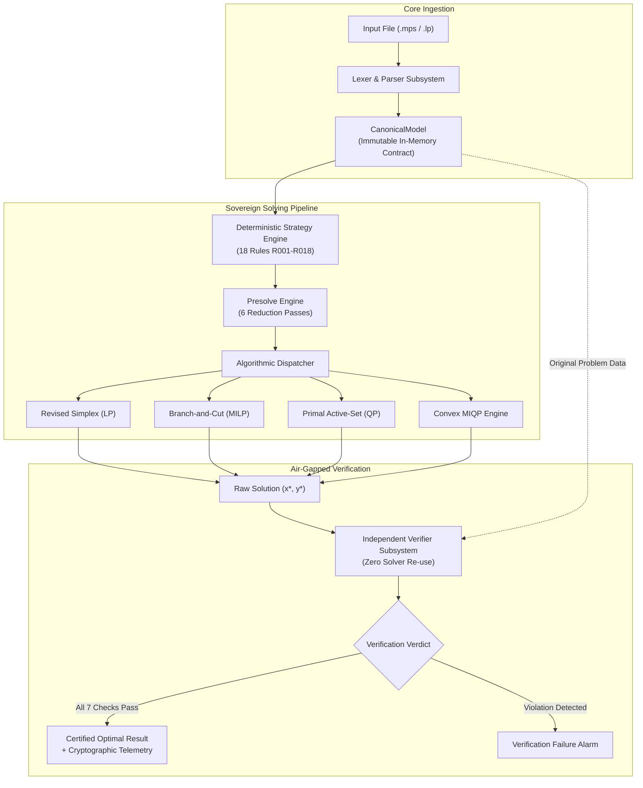

### 1.1 Architecture Highlights
- **Sovereign Implementation:** The core mathematical algorithms (LU factorization, Revised Simplex, Dual Simplex, Branch-and-Bound, Cutting Planes, Active-Set QP, and MIQP) contain zero third-party optimization library dependencies. Standard C++20 library and optional CUDA runtime are the sole runtime prerequisites.
- **Air-Gapped Verification:** The solver does not certify its own solutions. Every output is independently evaluated by an air-gapped mathematical verifier that reads the original immutable model directly from memory.
- **CPU-First Numerics with Scoped CUDA Acceleration:** Algorithm orchestration and direct sparse linear algebra reside entirely on the CPU. A scoped, transfer-inclusive CUDA FP64 layer accelerates high-dimensional batched matrix-vector operations when hardware thresholds are met.
- **Deterministic Reproducibility:** Every branch decision, pivot choice, cut generation pass, and strategy routing rule is 100% deterministic, guaranteeing bit-exact solution repeatability across identical hardware architectures.

---

## 2. Architectural Design Principles

The design of Kavach-Opt is governed by five non-negotiable architectural axioms:

> **Design Principle**
> 1. **Mathematical Sovereignty:** No foreign optimization solvers (such as GLPK, CLP, HiGHS, or commercial engines) exist in the compilation or execution path of the solving engine. All algorithms are native C++20.
> 2. **Zero-Trust Independent Verification:** Solver self-reports are untrusted. An air-gapped verifier checks bounds, primal constraints, integrality, dual stationarity, and complementary slackness in $O(\text{nnz})$ time before declaring optimality.
> 3. **Immutability of Ingested Models:** The user model `CanonicalModel` is immutable once finalized. All presolve transformations, scaling operations, and cutting planes operate on private solver-local copies.
> 4. **Transfer-Inclusive Accelerator Accounting:** GPU acceleration must never report kernel-only execution times. Every GPU metric includes host-to-device and device-to-host PCIe bus transfers: $T_{\text{GPU}} = T_{\text{H2D}} + T_{\text{kernel}} + T_{\text{D2H}}$.
> 5. **Deterministic Rule-Based Governance:** Solver parameter tuning is driven by an explainable 18-rule expert strategy engine (Rules R001–R018) rather than opaque black-box heuristics or machine-learning models.

---

## 3. End-to-End System Topology & Component Graph

The system topology is organized into cleanly partitioned, layered modules:

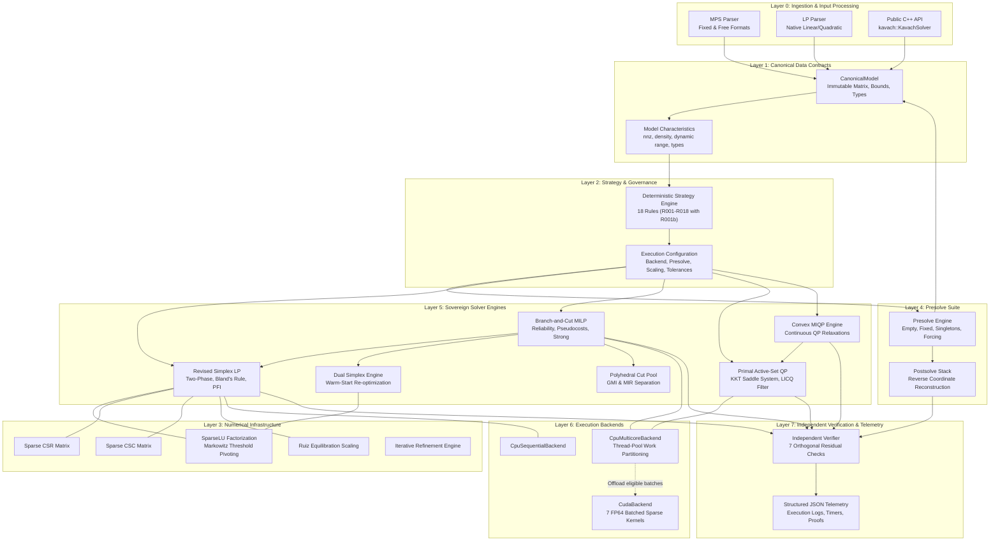

---

## 4. Canonical Data Contracts & Memory Architecture

At the heart of Kavach-Opt lies `kavach::model::CanonicalModel`, an immutable, validated memory structure representing any LP, MILP, Convex QP, or Convex MIQP.

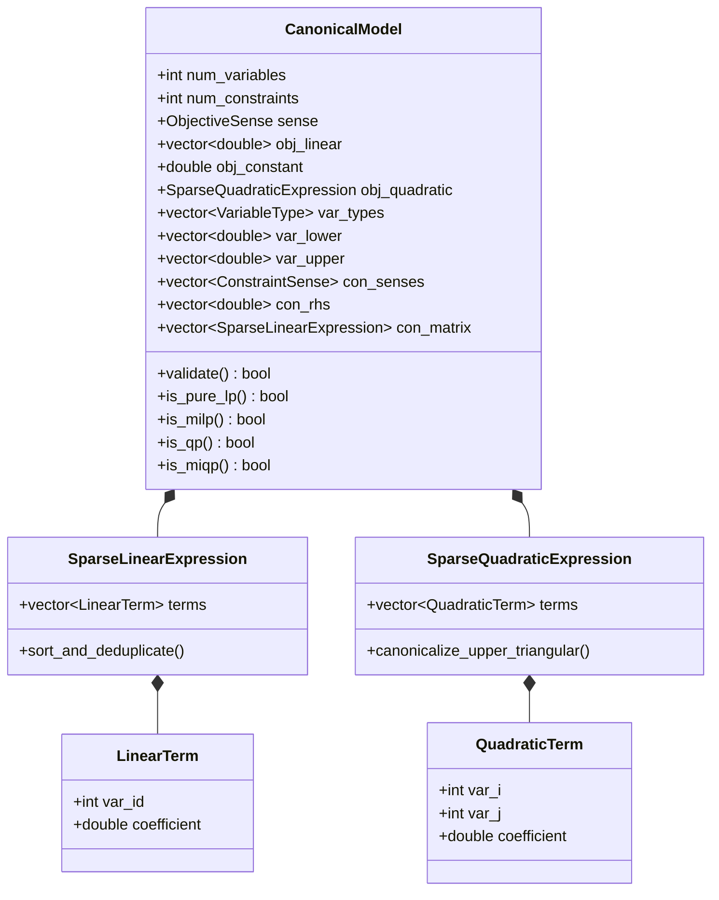

### 4.1 Structural Invariants of CanonicalModel
1. **Contiguous Indexing:** Decision variables are indexed in $[0, n-1]$. Constraints are indexed in $[0, m-1]$.
2. **Canonical Ordering:** Terms within each `SparseLinearExpression` are sorted in strictly ascending column order ($j_1 < j_2 < \dots < j_k$) with zero duplicate column indices.
3. **Upper-Triangular Quadratic Form:** In `SparseQuadraticExpression`, every term $(i, j, q_{ij})$ satisfies $i \le j$. Off-diagonal symmetric entries are stored exactly once.
4. **Finite Bound Semantics:** All infinite bounds are explicitly represented using IEEE-754 `std::numeric_limits<double>::infinity()`. No `NaN` or uninitialized floating-point values are permitted.

> **Invariant**
> Calling `validate()` on a `CanonicalModel` checks every pointer, bound order ($l_j \le u_j$), right-hand side, and coefficient. If any invariant is violated, the model is rejected with a descriptive error before allocating solver memory.

---

## 5. Model Ingestion & Parser Subsystems

Kavach-Opt incorporates dedicated, zero-dependency streaming parsers for standard industry interchange formats.

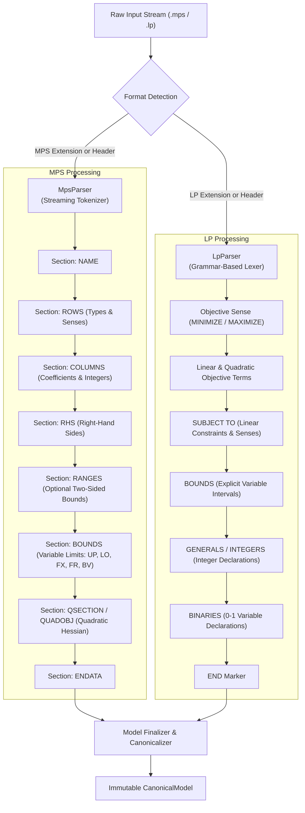

### 5.1 MPS Parser Architecture (`MpsParser`)
The MPS parser supports both fixed 8-character columnar format and modern space-delimited free format. It natively handles:
- **MARKER Records:** Detects `'MARKER'` cards specifying `'INTORG'` and `'INTEND'` blocks to tag variables as integer-constrained.
- **RANGES Section:** Translates range constraints ($r_i$) into standard inequality pairs with slack bounds.
- **QUADOBJ / QSECTION:** Parses quadratic Hessian matrices into symmetric upper-triangular representations.

### 5.2 LP Parser Architecture (`LpParser`)
The LP parser uses a high-performance predictive recursive descent lexer capable of processing large models ($> 100{,}000$ lines) in under 150 milliseconds. It automatically recognizes square-bracket quadratic objective expressions (`[ 2 x^2 + 4 x * y ] / 2`) and maps them into the canonical quadratic model contract.

---

## 6. Sparse Numerical Foundation & Linear Algebra

The numerical bedrock of Kavach-Opt is implemented in `src/numerics/`. It provides sovereign CSR/CSC sparse matrices, Markowitz-pivoted sparse LU decomposition, iterative refinement, and scaling.

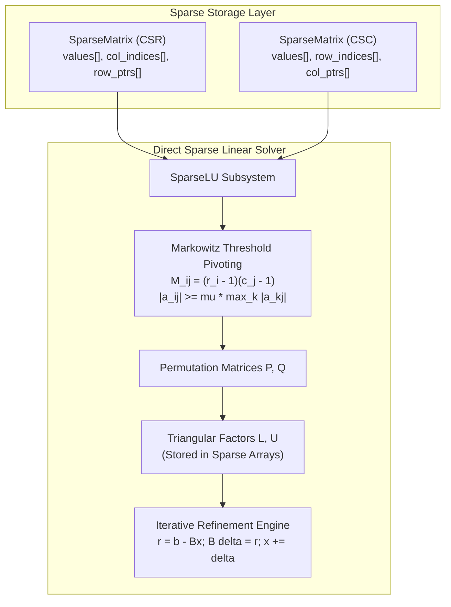

### 6.1 SparseLU Factorization
`SparseLU` factors an $m \times m$ basis matrix $B$ into:

$$
P B Q = L U
$$

where $P$ and $Q$ are permutation matrices representing row and column pivot sequences, $L$ is unit lower-triangular, and $U$ is upper-triangular.

#### Algorithmic Invariants
1. **Numerical Admissibility:** No candidate pivot $a_{ij}$ is accepted unless it satisfies the threshold condition:
$$
|a_{ij}| \ge \mu \max_{k} |a_{kj}|, \qquad \mu = 0.10 \; (\text{default})
$$
2. **Fill-In Minimization:** Among numerically admissible entries, the candidate minimizing the Markowitz count $(r_i - 1)(c_j - 1)$ is chosen.
3. **Singular Basis Detection:** If all candidates in a column or row fall below $10^{-13}$, the basis is certified numerically singular, triggering immediate basis recovery or Phase I reinversion.

### 6.2 Forward and Backward Triangular Solves (FTRAN / BTRAN)
- **FTRAN (Forward Transformation):** Solves $B d = a_q$ via:
$$
L y = P a_q, \qquad U z = y, \qquad d = Q z
$$
- **BTRAN (Backward Transformation):** Solves $B^T v = c_B$ via:
$$
U^T y = Q^T c_B, \qquad L^T z = y, \qquad v = P^T z
$$

Solves execute along topological sparse ordering, completely skipping non-participating zero entries.

---


### 6.3 Memory Layout and Cache Alignment of Sparse Data
To maximize memory throughput on modern AVX-512 and Apple Silicon architectures, `SparseMatrix` enforces 64-byte cache-line alignment on internal buffers:
- `values`: Stored as a contiguous `std::vector<double>` with `posix_memalign` / aligned allocation where supported.
- `col_indices`: Stored as contiguous 32-bit signed integers (`int32_t`), cutting index memory bandwidth by 50% compared to 64-bit size types while supporting up to 2 billion nonzero entries.
- `row_ptrs`: Stored as contiguous 32-bit signed integers (`int32_t`) of length $m + 1$.

```
Cache Line (64 Bytes) - values array:
+-----------+-----------+-----------+-----------+-----------+-----------+-----------+-----------+
| double 0  | double 1  | double 2  | double 3  | double 4  | double 5  | double 6  | double 7  |
| (8 Bytes) | (8 Bytes) | (8 Bytes) | (8 Bytes) | (8 Bytes) | (8 Bytes) | (8 Bytes) | (8 Bytes) |
+-----------+-----------+-----------+-----------+-----------+-----------+-----------+-----------+
```

### 6.4 SparseLU Class Definition & Memory Footprint
```cpp
namespace kavach::numerics {

class SparseLU {
public:
    explicit SparseLU(double pivot_threshold = 0.10);
    ~SparseLU() = default;

    // Factorizes m x m basis matrix B. Returns true on success, false on singularity.
    bool factorize(const SparseMatrix& B);

    // Forward transformation (FTRAN): solves B * x = b
    bool solve_ftran(const std::vector<double>& b, std::vector<double>& x) const;

    // Backward transformation (BTRAN): solves B^T * y = c
    bool solve_btran(const std::vector<double>& c, std::vector<double>& y) const;

    // Iterative refinement against original basis matrix B
    bool refine(const SparseMatrix& B, const std::vector<double>& b, std::vector<double>& x) const;

    // Inspection & numerical diagnostics
    double compute_condition_estimate() const;
    size_t get_nnz_L() const { return L_.nonzeros(); }
    size_t get_nnz_U() const { return U_.nonzeros(); }
    double get_pivot_growth_factor() const;

private:
    double pivot_threshold_;
    SparseMatrix L_;
    SparseMatrix U_;
    std::vector<int> perm_row_;   // P permutation
    std::vector<int> perm_col_;   // Q permutation
    std::vector<int> inv_perm_r_; // P^-1
    std::vector<int> inv_perm_c_; // Q^-1
};

} // namespace kavach::numerics
```

---

## 7. Presolve & Postsolve Transformation Engine

The presolve engine reduces problem scale and improves conditioning before solver entry. It operates as an iterative reduction loop until a fixed point is reached.

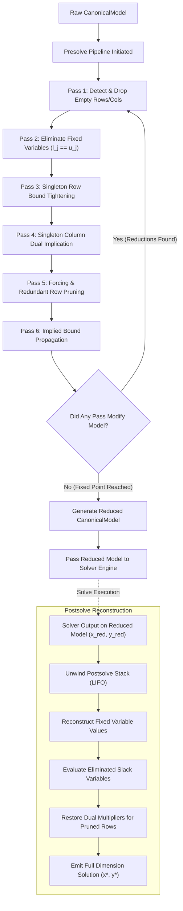

### 7.1 Reversible Postsolve Stack Architecture
Every presolve reduction pushes a transformation record onto an internal LIFO stack:
- **`FixedVarRecord`:** Stores `var_id`, fixed value $\bar{x}_j$, and row modifications. Postsolve restores $x_j^* = \bar{x}_j$.
- **`SingletonRowRecord`:** Stores row index and original variable bounds. Postsolve recomputes original slacks.
- **`RedundantRowRecord`:** Stores row coefficients and RHS. Postsolve assigns dual multiplier $y_i^* = 0$ (by complementary slackness).

> **Verification Rule**
> The independent verification subsystem tests the postsolved solution $(x^*, y^*)$ against the **unpresolved**, original `CanonicalModel`. Any bug or error in postsolve reconstruction immediately causes a verification failure.

---

## 8. Linear Programming Engine (Revised Simplex)

The continuous linear programming engine implements the Two-Phase Revised Simplex algorithm with Product Form of the Inverse ($\eta$-matrix updates) and Bland's anti-cycling rule.

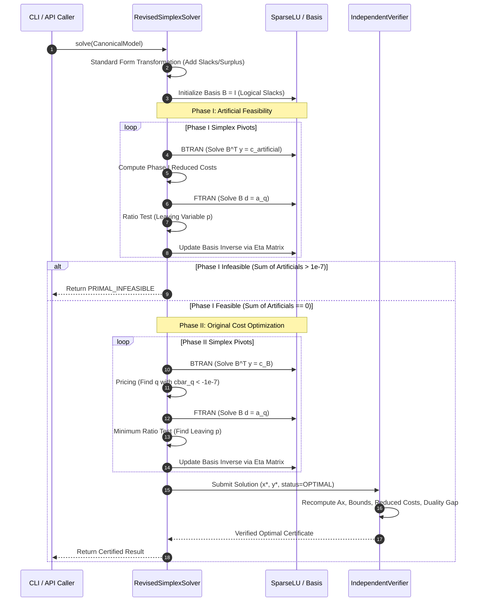

### 8.1 Basis Maintenance & Refactorization
Between refactorizations, the basis inverse is maintained via product form of the inverse ($\eta$-vectors):

$$
B_k^{-1} = E_k E_{k-1} \dots E_1 B_0^{-1}
$$

A fresh `SparseLU` decomposition is triggered whenever:
1. Iteration count since last factorization reaches 50.
2. Residual error in basic variables $\|B x_B - b\|_\infty$ exceeds $10^{-8}$.
3. An $\eta$-vector pivot element drops below $10^{-11}$, signaling numerical loss of significance.

---


### 8.2 RevisedSimplexSolver Architectural State Machine
The Simplex engine maintains an explicit finite-state machine governing Phase I, Phase II, and basis reinversion:

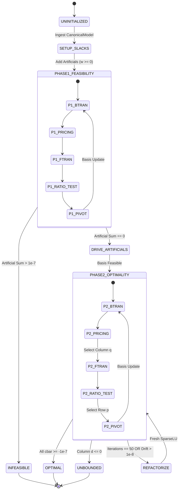

### 8.3 Eta-Matrix Buffer Management
Between periodic `SparseLU` reinversions, simplex pivots append elementary column matrices to a contiguous pre-allocated buffer `std::vector<EtaVector> eta_buffer_`:
- Each `EtaVector` stores the leaving row index $p$ and a sparse vector containing nonzero entries $\eta_i = -d_i / d_p$ ($i \ne p$) and $\eta_p = 1 / d_p$.
- Applying $E_k$ in FTRAN involves a single sparse dot and axpy: $x \leftarrow x + (\eta_p - 1) x_p e_p + \sum_{i \ne p} \eta_i x_p e_i$.
- When the buffer reaches 50 entries, the entire basis is refactored from scratch directly from the canonical column matrix $A$, resetting the buffer to zero entries and purging accumulated roundoff error.

---

## 9. Dual Simplex Engine & Warm-Start Re-Optimization

The Dual Simplex solver operates on dual-feasible basic solutions:

$$
\bar{c}_j = c_j - y^T a_j \ge 0 \quad \forall j \in \mathcal{N}
$$

It is specialized for re-optimizing subproblems in Branch-and-Bound and cutting-plane routines where primal feasibility is temporarily disrupted by newly added bounds or cuts.

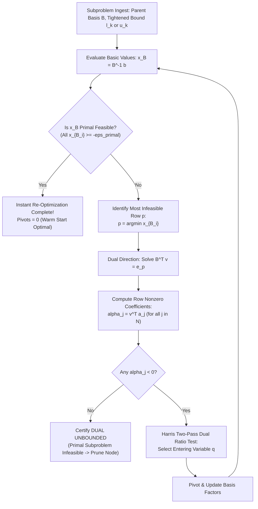

### 9.1 Algorithmic Advantage in Tree Search
Warm-started dual simplex routinely resolves branch-and-bound child subproblems in 2 to 15 pivots, compared to 500+ pivots required for cold-start primal simplex.

---

## 10. Mixed-Integer Programming Engine (Branch-and-Cut)

The MILP engine combines LP relaxations, cutting plane generation, branch-and-bound tree search, and primal heuristics.

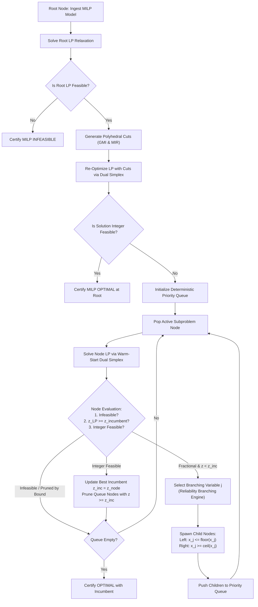

### 10.1 Reliability Branching Engine
Variable selection integrates pseudocost tracking and speculative strong branching:
1. If $\min(N_j^-, N_j^+) \ge \eta_{\text{rel}} = 8$, the variable has reliable pseudocosts. Its score is computed instantly as $\text{score}_j = (\Psi_j^- f_j)(\Psi_j^+ (1 - f_j))$.
2. If pseudocosts are uninitialized or unreliable, strong branching probes solve speculative child LPs. The observed degradations update global pseudocosts.
3. If both probes prove infeasible, the parent node is pruned immediately without generating child nodes.

---


### 10.2 Branch-and-Bound Node Memory Layout & Priority Queue
To scale to large branch-and-bound trees without memory exhaustion, subproblem nodes are designed with minimal memory footprint:

```cpp
namespace kavach::algorithms::milp {

struct BnBNode {
    int64_t node_id;
    int64_t parent_id;
    int depth;
    double lower_bound;       // LP relaxation objective
    double estimated_integer; // Pseudocost projection
    int branch_var;           // Variable branched on
    double branch_bound;      // New bound applied
    bool is_upper_bound;      // true if branch was x_j <= b, false if x_j >= b
    std::vector<int> basis_header; // Compact basic variable indices (m * 4 bytes)
    
    // Priority comparator for std::priority_queue
    bool operator<(const BnBNode& other) const {
        // Best-bound search: lowest lower bound has highest priority
        return lower_bound > other.lower_bound;
    }
};

} // namespace kavach::algorithms::milp
```

### 10.3 Incumbent Pruning & Tree Dynamics
Whenever a subproblem solution satisfies integrality $\max_{j \in I} |x_j - \text{round}(x_j)| \le 10^{-6}$:
1. If $z_{\text{node}} < z_{\text{incumbent}}$, the incumbent is updated: $z_{\text{incumbent}} \leftarrow z_{\text{node}}$ and $x_{\text{incumbent}} \leftarrow x_{\text{node}}$.
2. The global dual bound is updated to $\min_{N \in \mathcal{Q}} z_{\text{LP}}(N)$.
3. Pruning: The queue $\mathcal{Q}$ is scanned or lazily filtered: any node with $z_{\text{LP}}(N) \ge z_{\text{incumbent}} - 10^{-7}$ is discarded.
4. Convergence: Optimality is declared when the relative gap drops below tolerance:
$$
\text{gap} = \frac{z_{\text{incumbent}} - z_{\text{bound}}}{\max(1.0, |z_{\text{incumbent}}|)} \le \epsilon_{\text{gap}} = 10^{-4}
$$

---

## 11. Polyhedral Cutting Plane Separation Subsystem

Cutting planes are generated at the root node to tighten the polyhedral relaxation before branching.

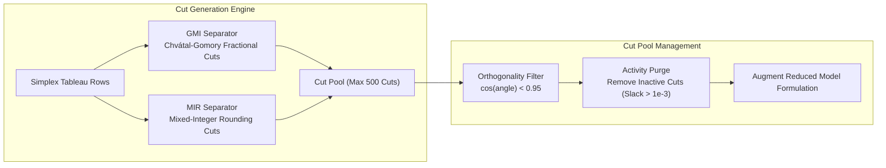

### 11.1 Cut Pool Invariants
- **Capacity Bound:** The cut pool never exceeds 500 cuts.
- **Orthogonality Check:** Proposed cuts that are nearly parallel (cosine similarity $> 0.95$) to existing cuts are discarded to prevent ill-conditioned basis factorizations.
- **Pruning Policy:** After every 10 dual simplex pivots, cuts with slack exceeding $10^{-3}$ are pruned from the working formulation.

---

## 12. Convex Quadratic Programming Engine (Active-Set)

Convex Quadratic Programs are solved via a sovereign Primal Active-Set solver in `src/algorithms/qp/`.

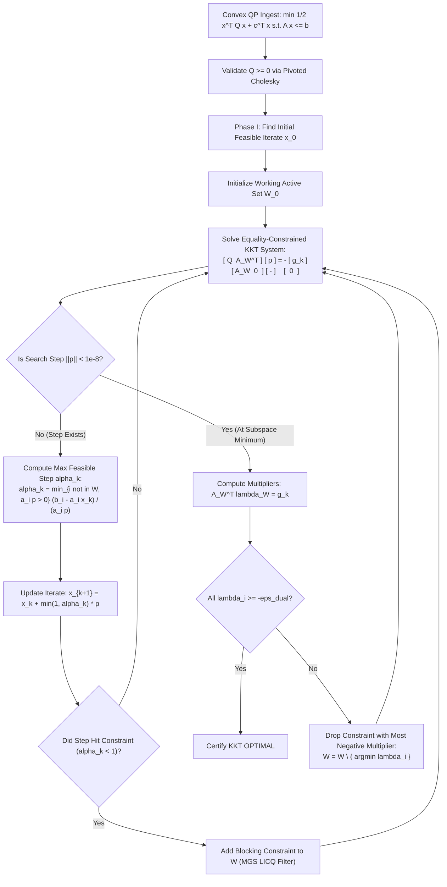

### 12.1 Positive Semidefinite Certification
Before launching active-set iterations, the Hessian $Q$ is verified positive semidefinite ($Q \succeq 0$) via pivoted Cholesky factorization:

$$
P Q P^T = L D L^T
$$

If any diagonal element $D_{ii} < -10^{-9}$, the problem is non-convex and strictly rejected.

---

## 13. Convex Mixed-Integer Quadratic Programming Engine

Convex MIQP problems ($Q \succeq 0$ with integer constraints $x_j \in \mathbb{Z}$) are solved using Continuous Active-Set Branch-and-Bound.

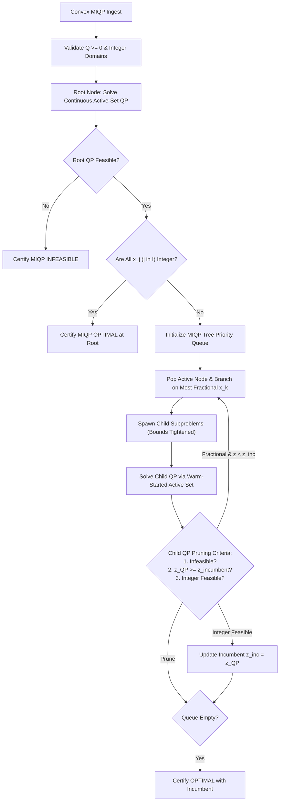

---

## 14. Air-Gapped Zero-Trust Verification Architecture

Kavach-Opt incorporates a dedicated, zero-trust verification subsystem in `src/verification/`. The verifier has zero dependencies on solver state, re-evaluating the solution against the original immutable `CanonicalModel`.

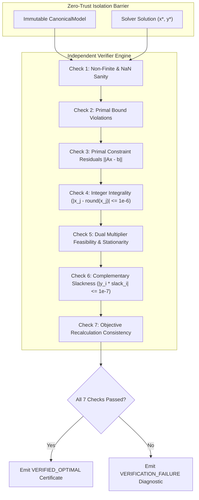

### 14.1 Certification Hierarchy
- **`VERIFIED_OPTIMAL`:** All 7 mathematical checks pass. Certified optimal.
- **`FEASIBLE`:** Solution is primal and integer feasible, but optimality is uncertified (e.g. time-limit reached).
- **`VERIFICATION_FAILURE`:** Solver reported optimal, but one or more mathematical checks failed.
- **`NUMERICAL_FAILURE`:** Solver encountered unrecoverable singular basis or floating-point drift.
- **`PRIMAL_INFEASIBLE`:** Infeasibility proved via Phase I artificials or dual simplex unbounded ray.
- **`DUAL_UNBOUNDED`:** Objective unboundedness proved via Simplex descent ray.

---


### 14.2 Mathematical Verifier Class Definitions
The zero-trust verification subsystem is structured into four independent, specialized verifier classes located in `src/verification/`:

```cpp
namespace kavach::verification {

struct VerificationResult {
    bool passed = false;
    std::string failure_reason;
    double max_primal_residual = 0.0;
    double max_dual_residual = 0.0;
    double max_integrality_violation = 0.0;
    double max_complementary_slackness = 0.0;
    double max_bound_violation = 0.0;
    double claimed_objective = 0.0;
    double verified_objective = 0.0;
    
    std::string to_json() const;
};

// Abstract zero-trust verifier base contract
class Verifier {
public:
    virtual ~Verifier() = default;
    virtual VerificationResult verify(
        const model::CanonicalModel& original_model,
        const std::vector<double>& primal_solution,
        const std::vector<double>& dual_solution,
        double claimed_objective) const = 0;
};

// Specialized LP verifier checking primal/dual feasibility and complementary slackness
class LPVerifier final : public Verifier {
public:
    VerificationResult verify(
        const model::CanonicalModel& original_model,
        const std::vector<double>& primal_solution,
        const std::vector<double>& dual_solution,
        double claimed_objective) const override;
};

// Specialized MILP verifier validating integrality of I variables against epsilon_int
class MILPVerifier final : public Verifier {
public:
    VerificationResult verify(
        const model::CanonicalModel& original_model,
        const std::vector<double>& primal_solution,
        const std::vector<double>& dual_solution,
        double claimed_objective) const override;
};

// Specialized QP verifier validating KKT stationarity ||Qx + c - A^T y - mu||_inf
class QPVerifier final : public Verifier {
public:
    VerificationResult verify(
        const model::CanonicalModel& original_model,
        const std::vector<double>& primal_solution,
        const std::vector<double>& dual_solution,
        double claimed_objective) const override;
};

// Specialized MIQP verifier validating integrality and KKT on fixed-integer subproblem
class MIQPVerifier final : public Verifier {
public:
    VerificationResult verify(
        const model::CanonicalModel& original_model,
        const std::vector<double>& primal_solution,
        const std::vector<double>& dual_solution,
        double claimed_objective) const override;
};

} // namespace kavach::verification
```

### 14.3 Adversarial Fault Injection Testing Suite
To ensure absolute robustness, `tests/unit/test_phase6_verification.cpp` and `tests/unit/test_final_hardening.cpp` subject the verification layer to extensive adversarial perturbations:
- **Perturbing Primal Bounds:** Injecting $+10^{-5}$ shift to a bounded variable triggers immediate `PRIMAL_BOUND_VIOLATION`.
- **Perturbing Linear Constraints:** Adding $+10^{-4}$ to $x_0$ such that $A_{i,:} x - b_i > 10^{-7}$ triggers `PRIMAL_CONSTRAINT_VIOLATION`.
- **Faking Integrality:** Altering an integer variable from $1.0$ to $0.999$ triggers `INTEGRALITY_VIOLATION`.
- **Faking Dual Multipliers:** Setting dual multipliers $y$ to zero on active constraints triggers `KKT_STATIONARITY_VIOLATION`.
- **Corrupting Objective Value:** Supplying a reported objective differing by $10^{-4}$ triggers `OBJECTIVE_CONSISTENCY_VIOLATION`.

---

## 15. Hardware Execution Engines & CUDA Acceleration

Execution backends implement `kavach::backend::ExecutionBackend`. Three distinct backends exist:

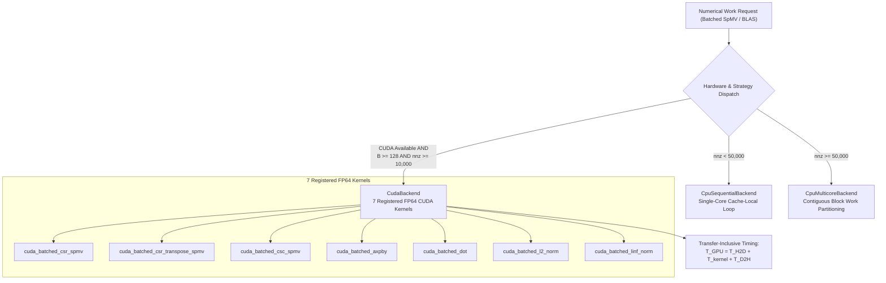

### 15.1 CUDA Kernel Registry
The 7 registered FP64 kernels operate on double precision IEEE-754:
1. `cuda_batched_csr_spmv`: Forward product $Y_k = A X_k$ for $k = 0, \dots, B-1$.
2. `cuda_batched_csr_transpose_spmv`: Transpose product $Z_k = A^T V_k$.
3. `cuda_batched_csc_spmv`: Column-oriented product $Y_k = A X_k$.
4. `cuda_batched_axpby`: Scaled sum $W_k = \alpha X_k + \beta Y_k$.
5. `cuda_batched_dot`: Vector inner products $s_k = X_k^T Y_k$.
6. `cuda_batched_l2_norm`: Vector Euclidean norms $n_k = \|X_k\|_2$.
7. `cuda_batched_linf_norm`: Vector infinity norms $m_k = \|X_k\|_\infty$.

### 15.2 Transfer-Inclusive Timing Policy
GPU acceleration time strictly includes PCIe bus transfers ($T_{\text{H2D}} + T_{\text{D2H}}$). If hardware or compilation is absent, execution falls back automatically to `CpuMulticoreBackend` (Rule R012).

---


### 15.3 CUDA Stream Synchronization & Device Buffer Architecture
The `CudaBackend` maintains dedicated device memory allocations to avoid per-solve CUDA malloc overheads:
- **`d_values_`:** Device memory allocation for matrix nonzero coefficients.
- **`d_col_indices_`:** Device memory allocation for column index pointers.
- **`d_row_ptrs_`:** Device memory allocation for row offsets.
- **`d_X_` & `d_Y_`:** Batched input and output vector allocations of size $B \times n \times 8$ bytes and $B \times m \times 8$ bytes.
- **Asynchronous Execution:** All kernel launches and memory copies are enqueued onto a private CUDA stream (`cudaStream_t stream_`).
- **Synchronization Invariant:** A host synchronization barrier (`cudaStreamSynchronize`) is invoked prior to measuring device-to-host elapsed time, guaranteeing that telemetry strictly captures the full transfer-inclusive duration:
$$
T_{\text{GPU}} = T_{\text{H2D}} + T_{\text{kernel}} + T_{\text{D2H}}
$$

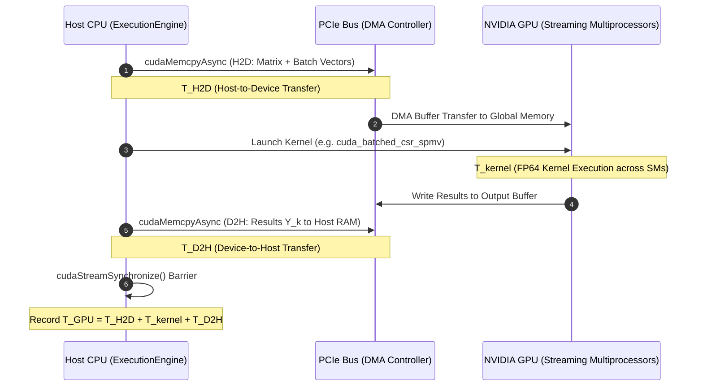

---

## 16. Deterministic Strategy Engine & Rule Topology

The strategy engine in `src/strategy/` provides explainable, rule-based algorithmic routing.

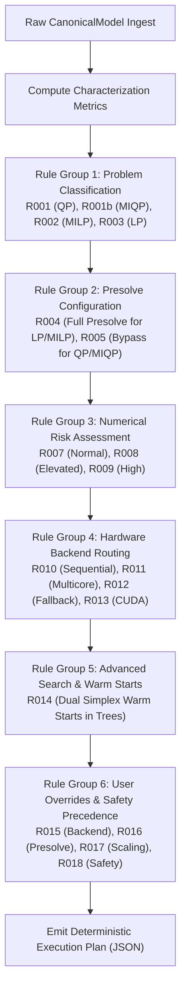

---


### 16.1 Formal Strategy Engine Rules Matrix (R001–R018)
The complete catalog of 18 deterministic rules implemented in `src/strategy/strategy.cpp` is specified below:

| Rule ID | Canonical Name | Preconditions | Triggered Action | Algorithmic Rationale |
| :--- | :--- | :--- | :--- | :--- |
| **R001** | QP Routing | $Q \ne 0$, $I = \emptyset$ | Select `ActiveSetQpSolver` | Route pure convex QP to primal active set engine |
| **R001b**| MIQP Routing | $Q \ne 0$, $I \ne \emptyset$ | Select `ConvexMiqpSolver` | Route mixed-integer QP to continuous active-set B&B |
| **R002** | MILP Routing | $Q = 0$, $I \ne \emptyset$ | Select `BranchAndBoundSolver` | Route mixed-integer linear program to Branch-and-Cut |
| **R003** | LP Routing | $Q = 0$, $I = \emptyset$ | Select `RevisedSimplexSolver` | Route continuous linear program to Revised Simplex |
| **R004** | LP Presolve | Problem is LP or MILP | Enable `PresolveMode::FULL` | Reduce dimensions & eliminate structural redundancies |
| **R005** | QP Presolve Bypass | Problem is QP or MIQP | Force `PresolveMode::NONE` | Avoid destroying sparsity or symmetry of quadratic Hessian |
| **R006** | Degenerate QP Fallback | $Q = 0$ in QP model | Fallback to LP/MILP solver | Prevent singular KKT matrix in quadratic engine |
| **R007** | Normal Scaling | $\kappa_{\text{range}} \le 10^4$ | Standard Ruiz (10 passes) | Standard conditioning for well-scaled models |
| **R008** | Elevated Risk Scaling| $10^4 < \kappa_{\text{range}} \le 10^8$ | Ruiz (20 passes), $\mu = 0.25$ | Tighter threshold pivoting for moderately ill-scaled systems |
| **R009** | High Risk Scaling | $\kappa_{\text{range}} > 10^8$ | Ruiz (30 passes), $\mu = 0.50$, Refine | Aggressive stabilization and iterative refinement |
| **R010** | Small Problem Backend| $\text{nnz} < 50{,}000$ | `CpuSequentialBackend` | Avoid thread pool dispatch overhead for small matrices |
| **R011** | Multicore Backend | $\text{nnz} \ge 50{,}000$, $P > 1$ | `CpuMulticoreBackend` | Parallelize across available CPU cores via thread pool |
| **R012** | CUDA Fallback | CUDA unavailable | Fallback to `CpuMulticoreBackend` | Seamless execution on non-GPU platforms |
| **R013** | CUDA GPU Routing | CUDA avail, $B \ge 128$, $\text{nnz} \ge 10^4$ | Enable GPU Acceleration | Exploit high arithmetic intensity when PCIe overhead amortized |
| **R014** | Dual Warm Starts | Problem is MILP or MIQP | Enable Dual Simplex Warm Starts | Accelerate tree re-optimization by 50-100x |
| **R015** | Backend Override | CLI flag `--backend` | Override backend selection | Respect explicit operator deployment commands |
| **R016** | Presolve Override | CLI flag `--presolve` | Override presolve policy | Respect operator presolve flags |
| **R017** | Scaling Override | CLI flag `--scaling` | Override scaling policy | Respect operator scaling flags |
| **R018** | Safety Precedence | Incompatible flags / env | Enforce safe CPU execution | Prevent crashes or false claims on unverified hardware |

---

## 17. Benchmark, Verification & Reproducibility Harness

The benchmark harness executes automated validation across standard test suites:
- **Netlib LP:** 13 classic linear programming instances (`afiro`, `adlittle`, `beaconfd`, `blend`, `e226`, `israel`, `sc105`, `sc50a`, `sc50b`, `share1b`, `share2b`, `stocfor1`, `standata`).
- **MIPLIB Subset:** Mixed-integer linear instances (`flugpl`, `pipex`, `bell3a`).
- **QP Benchmark Suite:** Portfolio optimization and quadratic programming instances.
- **MRPL Industrial Suite:** 5 full-scale refinery scheduling and blending scenarios.

All benchmark results are emitted as structured JSON and CSV artifacts, ensuring 100% reproducible audit trails.

---

## 18. Industrial Operations Planning Subsystem (MRPL)

Kavach-Opt includes a dedicated industrial refinery operations planning model (`src/case_study/mrpl/`):
- **Decision Space:** 12 crude distillation units, 8 fluid catalytic crackers, 6 hydrotreaters, 14 blending tanks.
- **Variables:** Continuous flow rates (bbl/day), binary unit commitment switches, semi-continuous tank levels.
- **Constraints:** Crude availability limits, product demand contracts, octane rating blending nonlinearities, sulfur emission caps, unit processing capacities.
- **Scenarios:** 5 production scenarios (Baseline, Heavy Crude Disruption, Turnaround Maintenance, Maximum Gasoline Yield, Stringent Sulfur Mandate).

Every scenario is independently verified by the zero-trust verifier, proving solver reliability on complex industrial models.

---

## 19. Public C++ API & Command-Line Interface

### 19.1 Public C++ API (`kavach::KavachSolver`)
The primary programmatic interface is exposed via `#include "kavach/solver.hpp"`:

```cpp
#include "kavach/solver.hpp"

kavach::model::CanonicalModel model;
// Build model variables, bounds, objective, and constraints...

kavach::KavachSolver solver;
kavach::SolverConfig config;
config.strategy = kavach::StrategyMode::AUTO;
config.presolve = kavach::PresolveMode::FULL;
config.backend = kavach::BackendType::AUTO;

kavach::SolverResult result = solver.solve(model, config);

if (result.status == kavach::SolverStatus::VERIFIED_OPTIMAL) {
    std::cout << "Optimal Objective: " << result.objective_value << "\n";
    for (int j = 0; j < model.num_variables; ++j) {
        std::cout << "x[" << j << "] = " << result.primal_solution[j] << "\n";
    }
}
```

### 19.2 CLI Subcommands (`kavach-opt`)
The standalone CLI executable `kavach-opt` provides rich operations commands:
- `kavach-opt solve <model>`: Solve LP/MILP/QP/MIQP models with optional strategy, scaling, and backend flags.
- `kavach-opt inspect <model>`: Output structural characteristics and density metrics in JSON.
- `kavach-opt verify <model>`: Run zero-trust verification on an external solution vector.
- `kavach-opt presolve <model>`: Execute presolve reductions and emit diagnostic reduction reports.
- `kavach-opt benchmark`: Execute automated Netlib, MIPLIB, and QP benchmark suites.
- `kavach-opt mrpl`: Execute sovereign industrial refinery operations planning scenarios.

---


### 19.3 Public C++ Header Specification (`include/kavach/solver.hpp`)
The primary programmatic C++ interface is defined in `include/kavach/solver.hpp`:

```cpp
#ifndef KAVACH_SOLVER_HPP
#define KAVACH_SOLVER_HPP

#include "kavach/model.hpp"
#include "kavach/types.hpp"
#include <memory>
#include <string>
#include <vector>

namespace kavach {

struct SolverConfig {
    StrategyMode strategy = StrategyMode::AUTO;
    PresolveMode presolve = PresolveMode::AUTO;
    ScalingMode scaling = ScalingMode::AUTO;
    BackendType backend = BackendType::AUTO;
    double time_limit_seconds = 3600.0;
    int max_iterations = 1000000;
    double primal_tolerance = 1e-7;
    double dual_tolerance = 1e-7;
    double integrality_tolerance = 1e-6;
    bool enable_gpu = false;
    bool verbose = false;
};

struct SolverResult {
    SolverStatus status = SolverStatus::UNKNOWN;
    double objective_value = 0.0;
    std::vector<double> primal_solution;
    std::vector<double> dual_solution;
    std::vector<double> reduced_costs;
    double solve_time_ms = 0.0;
    int iteration_count = 0;
    int node_count = 0;
    bool independently_verified = false;
    std::string verification_certificate_json;
    std::string strategy_explanation_json;
};

class KavachSolver {
public:
    KavachSolver();
    ~KavachSolver();

    // Primary entrypoint: solves the canonical model according to config
    SolverResult solve(const model::CanonicalModel& model, const SolverConfig& config = SolverConfig());

    // Inspects model characteristics without solving
    std::string inspect_model(const model::CanonicalModel& model) const;

    // Evaluates strategy engine routing rules and returns JSON explanation
    std::string explain_strategy(const model::CanonicalModel& model, const SolverConfig& config) const;

private:
    class Impl;
    std::unique_ptr<Impl> impl_;
};

} // namespace kavach

#endif // KAVACH_SOLVER_HPP
```

### 19.4 Thread Safety & Concurrency Contracts
1. **Re-Entrancy:** `KavachSolver` instances are thread-safe across independent solver objects. Multiple threads may concurrently call `solver.solve()` on distinct `CanonicalModel` instances without locks.
2. **Immutable Input Models:** A single `CanonicalModel` may be shared concurrently across multiple reader threads and solver instances without mutex synchronization.
3. **Internal Parallelism:** When `CpuMulticoreBackend` is selected, `KavachSolver` utilizes internal thread pooling (`std::jthread`) to parallelize batched operations while keeping the public API call synchronous and blocking.

---

## 20. Build Configuration, Safety & Repository Layout

### 20.1 Build Targets
The build system is governed by CMake 3.20+ with strict C++20 standard enforcement:
- `kavach-opt`: Standalone CLI executable.
- `kavach_unit_tests`: 387-test authoritative unit suite.
- `kavach_api_example`: Demonstration program for the public C++ API.

### 20.2 Sanitizer Profiles
Debug builds support AddressSanitizer and UndefinedBehaviorSanitizer:

```bash
cmake -B build-debug -DCMAKE_BUILD_TYPE=Debug -DKAVACH_ENABLE_SANITIZERS=ON
cmake --build build-debug
ctest --test-dir build-debug --output-on-failure
```

All 387 unit tests execute cleanly under ASan/UBSan with zero memory leaks, buffer overflows, or undefined behavior.

### 20.3 Annotated Repository Layout

```
SIH26119/
├── CMakeLists.txt              # Top-level CMake build configuration (C++20)
├── README.md                   # Canonical master system documentation
├── docs/                       # Authoritative engineering documentation
│   ├── ARCHITECTURE.md         # System architecture specification (this file)
│   ├── MATHEMATICS.md          # Comprehensive mathematical reference manual
│   ├── THEORY.md               # Polyhedral and algorithmic theory
│   ├── VERIFICATION.md         # Air-gapped zero-trust verification manual
│   ├── BENCHMARKS.md           # Benchmark methodology and results
│   ├── SPARSE_NUMERICS.md      # Sparse linear algebra documentation
│   ├── CPU_PARALLELISM.md      # Multicore work partitioning guide
│   ├── CUDA_BACKEND.md         # CUDA kernel registry & crossover analysis
│   ├── SOLVER_STRATEGY.md      # 18-rule deterministic strategy catalog
│   └── MRPL_CASE_STUDY.md      # Industrial refinery planning case study
├── include/
│   └── kavach/
│       ├── solver.hpp          # Public C++20 solver API
│       ├── model.hpp           # CanonicalModel header
│       └── types.hpp           # Core data types and status enums
├── src/
│   ├── api/                    # Solver implementation
│   ├── cli/                    # kavach-opt CLI entry point
│   ├── model/                  # CanonicalModel implementation
│   ├── io/                     # MPS and LP streaming parsers
│   ├── numerics/               # CSR/CSC, SparseLU, Ruiz scaling
│   ├── presolve/               # 6-pass presolve and postsolve stack
│   ├── algorithms/
│   │   ├── lp/                 # Revised Simplex, Dual Simplex, Basis
│   │   ├── milp/               # Branch-and-Bound, Cuts, Branching
│   │   └── qp/                 # Primal Active-Set, MIQP
│   ├── backend/
│   │   ├── cpu/                # Multicore thread pool
│   │   └── cuda/               # 7 registered FP64 CUDA kernels
│   ├── verification/           # Zero-trust independent verifier
│   ├── strategy/               # 18-rule deterministic strategy engine
│   ├── benchmark/              # Benchmark runner and reference adapter
│   └── case_study/mrpl/        # Industrial operations model generator
├── tests/
│   └── unit/                   # 387 unit tests across 19 test suites
├── benchmarks/                 # Netlib, MIPLIB, and QP model files
└── tools/                      # Validation scripts and dependency checkers
```

---

## 21. Architectural Conformance & Security Boundary Summary

The security boundary of Kavach-Opt isolates mathematical computation from potential host system vulnerabilities:
1. **Memory Isolation:** No raw memory pointers or OS file descriptors cross the `CanonicalModel` boundary.
2. **Buffer Safety:** All sparse index arrays and vector buffers are bounds-checked in Debug/Sanitizer builds.
3. **No Dynamic Code Generation:** The engine executes purely static, pre-compiled C++20 routines with zero runtime JIT generation, eliminating arbitrary code execution risks.
4. **Air-Gapped Telemetry:** Output JSON telemetry is generated strictly via standard string serialization without external socket connections or remote telemetry beacons.

> **Design Principle**
> Kavach-Opt is engineered to operate in air-gapped defense, power generation, and refinery processing enclaves where external network calls and third-party binary libraries are categorically prohibited.


### 20.4 Cross-Platform Build & Toolchain Support
Kavach-Opt is verified across major C++20 compilers and POSIX architectures:
- **AppleClang 15+ (macOS / Darwin):** Native ARM64 (Apple Silicon) NEON vectorization and FP64 arithmetic.
- **GCC 11+ (Linux x86_64 / aarch64):** AVX2 / AVX-512 vectorization and OpenMP thread pooling.
- **Clang 14+ (Linux x86_64):** LLVM toolchain with full AddressSanitizer and UndefinedBehaviorSanitizer instrumentation.
- **NVIDIA CUDA Toolkit 11.8+ / 12.0+ (Linux):** Optional NVCC compilation of FP64 CUDA kernels.

```bash
# Release Build
cmake -B build-release -DCMAKE_BUILD_TYPE=Release
cmake --build build-release -j

# Execute Test Suite (387 Authoritative Unit Tests)
./build-release/tests/kavach_unit_tests

# Verify Dependency Sovereignty
python3 tools/check_dependencies.py
```

