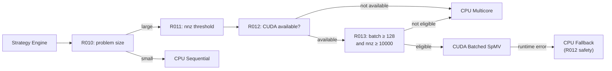
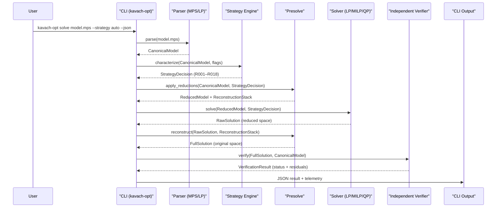
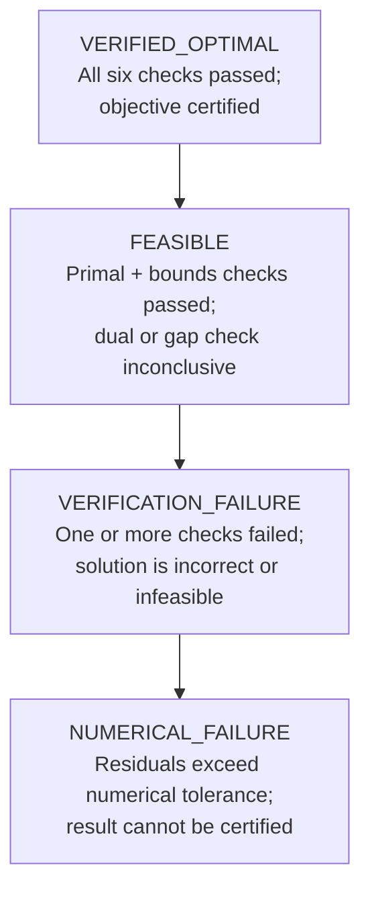

# Kavach-Opt: Architecture Reference

**Project:** SIH26119 — Kavach-Opt Sovereign Optimization Engine  
**Organization:** MRPL (Mangalore Refinery and Petrochemicals Limited)  
**Document revision:** 2026-09-26

---

## Table of Contents

1. [Overview](#1-overview)
2. [Design Principles](#2-design-principles)
3. [System Architecture](#3-system-architecture)
4. [Module Descriptions](#4-module-descriptions)
   - 4.1 [Model Layer](#41-model-layer)
   - 4.2 [Parsers](#42-parsers)
   - 4.3 [Sparse Numerics](#43-sparse-numerics)
   - 4.4 [Presolve](#44-presolve)
   - 4.5 [LP Solver](#45-lp-solver)
   - 4.6 [MILP Solver](#46-milp-solver)
   - 4.7 [QP Solver](#47-qp-solver)
   - 4.8 [Verification Layer](#48-verification-layer)
   - 4.9 [Execution Backends](#49-execution-backends)
   - 4.10 [Strategy Engine](#410-strategy-engine)
   - 4.11 [Benchmark Framework](#411-benchmark-framework)
   - 4.12 [MRPL Case Study](#412-mrpl-case-study)
   - 4.13 [Public C++ API](#413-public-c-api)
   - 4.14 [CLI](#414-cli)
5. [Execution Pipeline Sequence](#5-execution-pipeline-sequence)
6. [Solver Selection Logic](#6-solver-selection-logic)
7. [Hardware Backends](#7-hardware-backends)
8. [Verification Architecture](#8-verification-architecture)
9. [Benchmark and Reproducibility Architecture](#9-benchmark-and-reproducibility-architecture)
10. [Build Configuration](#10-build-configuration)
11. [Dependency Policy](#11-dependency-policy)
12. [Repository Structure](#12-repository-structure)

---

## 1. Overview

Kavach-Opt is a sovereign mathematical optimization engine implementing Linear Programming (LP), Mixed-Integer Linear Programming (MILP), and Quadratic Programming (QP) solvers entirely in standard C++20. It is developed under SIH26119 for MRPL and is designed so that the complete solving path — from model ingestion through algorithmic solve to independent verification — carries no dependency on any foreign optimization library.

The architecture is organized in three primary layers:

| Layer | Responsibility |
|---|---|
| **Model** | Canonical problem representation; ingestion from MPS and LP file formats |
| **Algorithm** | Problem-class-specific solvers (LP, MILP, QP); presolve reductions; numerical backend |
| **Verification** | Independent, solver-isolated correctness checking; certified result emission |

**CPU-first execution** is the primary target. A scoped CUDA path accelerates batched sparse matrix–vector products where eligible hardware and problem size thresholds are met; CPU fallback is automatic and rule-governed. A 329-test unit suite and a multi-suite benchmark framework (Netlib, MIPLIB subset, QP instances) support continuous validation.

---

## 2. Design Principles

### 2.1 Sovereignty

No foreign optimization-engine dependencies exist in the solving path. All LP, MILP, and QP algorithms, numerical routines, and data structures are implemented within the project. This design isolates the engine from external license constraints, export controls, and supply-chain risks.

> [!IMPORTANT]
> The only external solver interaction permitted in the codebase is the optional, out-of-process HiGHS reference adapter used exclusively in the benchmark framework for comparative measurement. It is never invoked in the solving or verification path.

### 2.2 Independence (Verification Boundary)

The verification layer reuses zero internals from the solver layer. It independently reconstructs constraint satisfaction, dual feasibility, complementary slackness, integrality, and bounds checks from the raw solution vector and the original `CanonicalModel`. This guarantees that a solver defect cannot simultaneously corrupt the verification result.

### 2.3 Determinism

Strategy selection is governed by a rule set of 18 explicitly enumerated rules (R001–R018). No machine-learning models, probabilistic heuristics, or runtime-adaptive policies are involved. Given identical input and identical CLI flags, the strategy decision is reproducible.

### 2.4 Transparency

All strategy decisions are emittable in structured JSON (`--show-strategy`, `--explain-strategy`). Benchmark results are recorded as JSON/CSV/Markdown artifacts with explicit schemas and seeds. No opaque black-box decisions exist in the pipeline.

### 2.5 Modularity

Each subsystem exposes clean C++ interfaces. The `KavachSolver` public API (`src/api/`) is the sole intended integration surface. Internal modules interact through typed structs and explicit function signatures rather than shared global state.

---

## 3. System Architecture

### 3.1 Top-Level Data Flow

```mermaid
flowchart TD
    CLI["CLI (kavach-opt)"]
    Parser["Parser\n(MPS / LP)"]
    CM["CanonicalModel"]
    SE["Strategy Engine\n(R001–R018)"]
    PRE["Presolve Suite"]
    LP["Revised Simplex\n(LP Solver)"]
    BB["Branch-and-Bound\n+ Dual Simplex\n(MILP Solver)"]
    QP["Primal Active-Set\n(QP Solver)"]
    VER["Independent Verifier"]
    OUT["Certified Result\n+ JSON Telemetry"]
    CPUSEQ["CPU Sequential Backend"]
    CPUMC["CPU Multicore\nThread Pool"]
    CUDA["CUDA Batched SpMV\n(optional, compile-gated)"]

    CLI --> Parser
    Parser --> CM
    CM --> SE
    SE --> PRE
    PRE --> LP
    PRE --> BB["Branch-and-Cut\n(B&B + Gomory & MIR Cuts)\n(MILP Solver)"]
    PRE --> QP["Primal Active-Set\n(QP Solver)"]    BB -->|"warm-start LP sub-problems"| LP
    LP --> VER
    BB --> VER
    QP --> VER
    VER --> OUT

    CPUSEQ -->|"SpMV / factorization"| LP
    CPUMC  -->|"batched SpMV"| LP
    CPUMC  -->|"batched SpMV"| BB
    CUDA   -->|"batched SpMV (eligible)"| LP
    CUDA   -->|"batched SpMV (eligible)"| BB
```

### 3.2 Backend Routing



---

## 4. Module Descriptions

### 4.1 Model Layer

**Path:** `src/model/`

The `CanonicalModel` is the central data structure of Kavach-Opt. All parsers write into it; all solvers, presolvers, and verifiers read from it. It stores:

- **Variable metadata:** count, types (`CONTINUOUS`, `BINARY`, `INTEGER`), lower and upper bounds.
- **Objective:** sense (minimize / maximize), dense coefficient vector, optional quadratic term matrix.
- **Constraints:** sparse coefficient matrix in CSR form, sense (`≤`, `=`, `≥`), right-hand-side vector, and RANGES data when present.
- **Problem classification:** LP, MILP, or QP, determined structurally from the model contents.

The model layer has no algorithmic code; it is a pure data container with well-defined accessors.

**Internal dependencies:** None (foundation layer).

---

### 4.2 Parsers

**Path:** `src/io/`

| File | Format handled |
|---|---|
| `mps_parser.cpp/hpp` | MPS fixed-format and free-format |
| `lp_parser.cpp/hpp` | Native LP format |

**MPS Parser** supports the full standard MPS fixed-column layout and the relaxed free-format variant. Sections handled: `ROWS`, `COLUMNS` (including integer markers `'MARKER' 'INTORG'/'INTEND'`), `RHS`, `BOUNDS` (all bound types: `LO`, `UP`, `FX`, `FR`, `MI`, `BV`, `LI`, `UI`), `RANGES`, and `ENDATA`.

**LP Parser** supports objective sense declaration (`minimize` / `maximize`), linear constraints with named rows, `Bounds` section with open and closed intervals, and quadratic objective terms in bracket notation.

Both parsers validate structure on read and populate `CanonicalModel` directly.

**Internal dependencies:** `src/model/`.

---

### 4.3 Sparse Numerics

**Path:** `src/numerics/`

| File | Responsibility |
|---|---|
| `sparse_matrix.cpp/hpp` | CSR and CSC sparse matrix storage, transpose, SpMV |
| `lu_factorization.cpp/hpp` | Sparse LU with Markowitz pivot selection, iterative refinement |
| `scaling.cpp/hpp` | Ruiz equilibration scaling |

**Sparse Matrix:** Both Compressed Sparse Row (CSR) and Compressed Sparse Column (CSC) representations are maintained. Explicit transpose construction supports column-oriented access patterns required by the revised simplex basis operations. SpMV is the primary operation dispatched to hardware backends.

**LU Factorization:** Markowitz pivot selection minimises fill-in during factorization of the basis matrix. Iterative refinement is applied to reduce accumulated floating-point error in basis solutions. The factorizer is the numerical core of both the LP and MILP solvers.

**Ruiz Scaling:** Row and column equilibration via the Ruiz algorithm is applied as a preprocessing step when `--scaling on|auto` is in effect. Scaling is invertible; solution vectors are unscaled before output.

**Internal dependencies:** None beyond the C++ standard library.

---

### 4.4 Presolve

**Path:** `src/presolve/`

The presolve suite applies a sequence of problem reductions before the primary solver is invoked. Reductions shrink the effective problem dimensions, tighten bounds, and eliminate redundant structure, reducing solver iteration counts on amenable instances.

Reductions performed include (but are not limited to):

- Fixed-variable elimination
- Singleton row and singleton column removal
- Redundant constraint detection and removal
- Bound tightening via constraint propagation
- Free-row removal
- Forcing and dominated-constraint detection

Each reduction step records an inverse operation. After the solver returns a solution in the reduced space, the presolve stack is unwound in reverse order to reconstruct a valid solution for the original problem. This reconstruction is exact and lossless.

**Internal dependencies:** `src/model/`, `src/numerics/`.

---

### 4.5 LP Solver

**Path:** `src/algorithms/lp/`

| File | Responsibility |
|---|---|
| `revised_simplex.cpp/hpp` | Revised Simplex Method, Two-Phase initialization |
| `dual_simplex.cpp/hpp` | Dual Simplex Method |
| `basis.cpp/hpp` | Basis management, factorization interface |

**Revised Simplex** operates on the basis representation of the LP. Pricing selects the entering variable; ratio test selects the leaving variable. Two-Phase initialization (Phase I artificial variable method) establishes an initial basic feasible solution when no trivial starting point exists.

**Bland's Anti-Cycling Rule** is applied when degeneracy is detected, guaranteeing finite termination by enforcing strict index ordering in variable selection.

**Basis Management** wraps the LU factorizer from `src/numerics/`. Basis refactorization is performed at configurable intervals to control numerical drift.

**Dual Simplex** is the primary sub-problem solver invoked by the MILP Branch-and-Bound engine at each node, exploiting the warm-started dual-feasible basis inherited from the parent node.

**Internal dependencies:** `src/model/`, `src/numerics/`, `src/backend/`.

---

### 4.6 MILP Solver, Search Engine & Cutting Planes

**Path:** `src/algorithms/milp/`

| File | Responsibility |
|---|---|
| `branch_and_bound.cpp/hpp` | Branch-and-Cut tree search, node queue with depth diving, branch selection |
| `search_types.hpp` | Search data structures (`BranchingStrategy`, `IncumbentSource`, `BranchCandidate`, `SearchTelemetry`) |
| `pseudocost.hpp/cpp` | Directional unit degradation tracking ($\Psi^-, \Psi^+$), observation counts, Achterberg product scoring |
| `strong_branching.hpp/cpp` | Top-$K$ candidate LP probing, dual simplex warm starts, exact bound restoration, child infeasibility detection |
| `primal_heuristic.hpp/cpp` | Feasibility-oriented integer rounding and bounded continuous slack deficit repair with strict verification |
| `cut_types.hpp` | Cut representation (`LinearCut`), `CutType`, `CutStrategy`, `CutOptions`, `CutTelemetry` |
| `cut_pool.hpp/cpp` | Bounded candidate pool, cosine parallelism deduplication, Euclidean efficacy ranking |
| `gomory_separator.hpp/cpp` | Gomory fractional / GMI cuts from simplex tableau rows ($B^T u = e_i$) |
| `mir_separator.hpp/cpp` | Mixed-Integer Rounding (MIR) cuts from mixed-integer constraints with multi-scaling |
| `cutting_plane_engine.hpp/cpp` | Separation loop orchestration, tail-off detection, constraint injection, LP re-solving |

#### Advanced Branch-and-Cut Search Engine
The MILP solver implements a high-performance Branch-and-Cut search architecture:
- **Pseudocost Branching:** Accumulates directional objective degradation per unit of fractional change ($\Psi_j^- = \Delta z^- / f_j$, $\Psi_j^+ = \Delta z^+ / (1 - f_j)$) from both tree solves and candidate probes. Computes candidate priority using the Achterberg product score $\text{score}_j = \max(\Psi_j^- f_j, 10^{-6}) \cdot \max(\Psi_j^+ (1 - f_j), 10^{-6})$.
- **Strong Branching:** Probes top-$K$ fractional candidates by executing speculative dual simplex warm starts on temporary child bounds ($\lfloor x_j^* \rfloor$ and $\lceil x_j^* \rceil$). Caches true dual degradations directly into pseudocost history and prunes nodes proved infeasible in both directions. Restores model state with zero side-effects.
- **Reliability Branching (Default):** Hybrid branching policy that applies strong branching only to unreliably observed variables ($N_j < \eta_{\text{rel}}$, default $\eta_{\text{rel}} = 4$), transitioning seamlessly to zero-solve pseudocosts once reliable statistics are established.
- **Deterministic Node Prioritization:** Min/Max-heap node selection with a secondary diving key: when multiple unexplored nodes have identical LP relaxation bounds, the search prioritizes deeper nodes (`depth`) to discover integer-feasible incumbents faster, tie-breaking deterministically on ascending node ID.
- **Feasibility-Oriented Primal Heuristics:** Executes periodic rounding passes and bounded continuous slack deficit repair to satisfy equality and inequality constraints without waiting for tree exhaustion. All heuristic candidates undergo strict independent feasibility checks before updating the incumbent.

#### Cutting-Plane Separation Engine
To tighten the polyhedral relaxation before and during tree search, Kavach-Opt provides an indigenous cutting-plane engine supporting:
- **Gomory Fractional Cuts:** Derived from fractional basic variables in the optimal LP tableau row ($B^{-1} A$). Generates both pure integer Gomory cuts and Gomory Mixed-Integer (GMI) cuts, projecting back to the original model variable space via explicit affine transformations.
- **Mixed-Integer Rounding (MIR) Cuts:** Generated directly from mixed-integer linear inequalities after non-negative lower-bound variable shifts ($x' = x - l$), utilizing multi-scaling factors ($\delta \in \{1.0, 0.5, 2.0, 1/a_k\}$) and continuous variable penalty terms.
- **Cut Pool & Filtering:** Manages cut storage up to a bounded capacity (`max_pool_size = 500`). Deduplicates parallel cuts using cosine similarity ($\cos\theta > 0.999$), filters by Euclidean efficacy ($\gamma = (a^T x^* - b) / \|a\|_2 \ge 10^{-4}$), and enforces strict coefficient dynamic range limits ($\max |a_j| / \min |a_j| \le 10^6$) for numerical stability.
- **Separation Pipeline:** Executes configurable separation rounds at the root node (and optionally periodic tree nodes), re-solving the tightened LP relaxation, detecting objective tail-off, and injecting valid cuts directly into the working model.

**Internal dependencies:** `src/model/`, `src/numerics/`, `src/algorithms/lp/`, `src/backend/`.

---

### 4.7 QP Solver

**Path:** `src/algorithms/qp/`

| File | Responsibility |
|---|---|
| `active_set.cpp/hpp` | Primal Active-Set QP solver |

The QP solver implements the Primal Active-Set method for convex quadratic programs with linear constraints. At each iteration, the active constraint set is maintained; a quadratic sub-problem over the active set is solved to compute the search direction.

**PSD Validation:** The solver validates that the quadratic objective matrix is positive semi-definite before beginning iteration, detecting non-convex instances and reporting them as unsupported rather than returning incorrect results.

**KKT Convergence:** Termination is based on satisfaction of the Karush–Kuhn–Tucker first-order optimality conditions to a configurable tolerance.

**Internal dependencies:** `src/model/`, `src/numerics/`, `src/backend/`.

---

### 4.8 Convex MIQP Solver

**Path:** `src/algorithms/miqp/`

| File | Responsibility |
|---|---|
| `miqp_solver.cpp/hpp` | Convex Mixed-Integer Quadratic Programming branch-and-bound solver |
| `miqp_types.hpp` | MIQP options, telemetry, and solution representation |

The Convex MIQP solver addresses optimization problems with mixed-integer variables and convex quadratic objectives:
$$\min / \max \quad \frac{1}{2} x^T Q x + c^T x + c_0 \quad \text{s.t.} \quad A x \le b, \quad l \le x \le u, \quad x_j \in \mathbb{Z} \; (j \in I)$$
where $Q$ is symmetric positive semidefinite (PSD).

Key features:
- **Convex Active-Set Relaxations:** Solves continuous convex QP relaxations at the root and child nodes using `PrimalActiveSetQPSolver`.
- **Advanced Branching Policies:** Supports pseudocost branching, strong branching (evaluating candidate QP bounds), and reliability branching (default) to direct the search tree efficiently.
- **True Quadratic Primal Heuristics:** Employs integer rounding and bounded continuous slack deficit repair, evaluating candidate solutions with full $\frac{1}{2} x^T Q x + c^T x + c_0$ objective calculations.
- **Empty Integer Domain Elimination:** Early detection and pruning of integer variables whose restricted interval contains no integral points ($\lceil l_j \rceil > \lfloor u_j \rfloor$).
- **Maximization Canonicalization:** Seamlessly transforms concave quadratic maximization ($\max f(x)$ with $-Q \succeq 0$) into canonical minimization ($\min -f(x)$) for branch-and-bound exploration, restoring original objective senses upon completion.
- **Non-Convex Rejection:** Explicitly rejects non-convex/indefinite quadratic objectives via diagonal and complete pivoted Cholesky factorization checks with `NUMERICAL_FAILURE`.
- **Zero-Q / Pure Continuous Bypasses:** Automatically routes $Q = 0$ instances to the MILP engine and purely continuous instances to the active-set QP solver.

**Internal dependencies:** `src/model/`, `src/numerics/`, `src/algorithms/qp/`, `src/algorithms/milp/`, `src/verification/`.

---

### 4.9 Verification Layer

**Path:** `src/verification/`

| File | Responsibility |
|---|---|
| `verifier.hpp` | Verification interface and status hierarchy |
| `lp_verifier.cpp/hpp` | LP solution verification |
| `milp_verifier.cpp/hpp` | MILP solution verification |
| `qp_verifier.cpp/hpp` | QP solution verification |
| `miqp_verifier.cpp/hpp` | Convex MIQP solution verification |

Full description in [Section 8](#8-verification-architecture).

**Internal dependencies:** `src/model/` only. Zero reuse of solver internals.

---

### 4.9 Execution Backends

**Path:** `src/backend/`

| Subdirectory | Files | Purpose |
|---|---|---|
| `cpu/` | `thread_pool.cpp/hpp`, `cpu_backend.cpp/hpp` | Sequential and multicore CPU SpMV dispatch |
| `cuda/` | `cuda_backend.cpp/hpp`, `cuda_spmv.cu`, `cuda_device.cpp/hpp` | CUDA batched SpMV (compile-time optional) |

Full description in [Section 7](#7-hardware-backends).

**Internal dependencies:** `src/numerics/`.

---

### 4.10 Strategy Engine

**Path:** `src/strategy/`

| File | Responsibility |
|---|---|
| `strategy.cpp/hpp` | Problem characterization, 18-rule strategy selection, JSON emission |

The Strategy Engine inspects the `CanonicalModel` and emits a fully determined execution plan before any solver is invoked. It applies 18 explicitly enumerated rules (R001–R018) covering problem class identification, numerical risk classification, backend routing, warm-start eligibility, user override integration, and safety precedence. Rules are evaluated in order; later rules may override earlier ones only within the defined precedence hierarchy.

Output is a typed `StrategyDecision` struct. When `--show-strategy` or `--explain-strategy` is specified, the struct is serialized to JSON and written to stdout alongside the solve result.

Full rule descriptions are in [Section 6](#6-solver-selection-logic).

**Internal dependencies:** `src/model/`.

---

### 4.11 Benchmark Framework

**Path:** `src/benchmark/`, `benchmarks/`, `benchmark_results/`

| File / Directory | Purpose |
|---|---|
| `benchmark_runner.cpp/hpp` | Suite enumeration, per-instance solve dispatch, timing |
| `benchmark_io.cpp/hpp` | Result serialization (JSON, CSV, Markdown) |
| `reference/reference_adapter.cpp/hpp` | Out-of-process HiGHS invocation wrapper |
| `benchmarks/netlib/` | Netlib LP model files |
| `benchmarks/miplib/` | MIPLIB subset model files |
| `benchmarks/qp/` | QP instance files |
| `benchmark_results/` | Output JSON/CSV artifacts |

The benchmark runner accepts a suite name or individual instance path, a random seed for any stochastic tie-breaking, an optional output directory, and an optional instance filter pattern. Results include objective value, solve time, iteration count, and verification status.

The **reference adapter** invokes HiGHS as a separate operating-system process. It does not link against HiGHS libraries. Objective values returned by HiGHS are recorded in the result artifact for comparison; HiGHS is never consulted during Kavach-Opt's own solving or verification.

**Internal dependencies:** `src/model/`, `src/io/`, `src/api/`.

---

### 4.12 MRPL Case Study

**Path:** `src/case_study/mrpl/`

| File | Purpose |
|---|---|
| `mrpl_model.cpp/hpp` | MRPL MILP model construction and scenario definitions |

The MRPL case study implements a MILP formulation derived from a refinery operations planning scenario specific to MRPL. Five named scenarios are defined, selectable via `--scenario <name>`. Problem data used in the case study is synthetic and illustrative; it is not sourced from live MRPL operational systems.

The case study is exercised through the `kavach-opt mrpl` subcommand. Output includes the scenario solve result, verification status, and optional JSON telemetry.

**Internal dependencies:** `src/model/`, `src/algorithms/milp/`, `src/verification/`, `src/api/`.

---

### 4.13 Public C++ API

**Path:** `src/api/`

| File | Purpose |
|---|---|
| `solver.hpp` | `KavachSolver` class declaration, result types |
| `solver.cpp` | `KavachSolver` implementation |

`KavachSolver` is the sole intended programmatic integration surface for embedding Kavach-Opt in host applications. It exposes methods to:

- Load a model from a file path or a `CanonicalModel` object.
- Configure strategy, presolve, scaling, cutting-plane strategy (`CutOptions`), and backend options.
- Execute the solve.
- Retrieve a typed `SolverResult` containing status, objective value, solution vector, verification status, solver telemetry, and cutting-plane telemetry (`CutTelemetry`).

All internal modules are accessed exclusively through this API in the CLI. Direct inclusion of internal headers by external consumers is not supported.

**Internal dependencies:** All internal modules (transitively).

---

### 4.14 CLI

**Path:** `src/cli/`

| File | Purpose |
|---|---|
| `main.cpp` | Entry point; subcommand dispatch |

The `kavach-opt` CLI provides the following subcommands:

| Subcommand | Purpose |
|---|---|
| `solve <model>` | Solve an LP, MILP, or QP model file |
| `inspect <model>` | Report model structure without solving |
| `verify <model>` | Run independent verification on an existing solution |
| `presolve <model>` | Apply presolve reductions and report statistics |
| `benchmark` | Execute a benchmark suite or single instance |
| `mrpl` | Execute the MRPL case study scenario |

**`solve` options:**

| Flag | Values | Effect |
|---|---|---|
| `--strategy` | `auto` \| `conservative` \| `fast` | Override automatic strategy tier |
| `--cuts` | `off` \| `root` \| `periodic` | Cutting-plane strategy (default: root) |
| `--presolve` | `full` \| `none` \| `auto` | Presolve level |
| `--scaling` | `on` \| `off` \| `auto` | Ruiz scaling control |
| `--backend` | `cpu` \| `multicore` \| `cuda` | Execution backend override |
| `--gpu` / `--no-gpu` | — | Enable or disable CUDA path |
| `--time-limit N` | integer seconds | Solver time budget |
| `--json` | — | Emit full result as JSON |
| `--show-strategy` | — | Emit strategy decision as JSON |
| `--explain-strategy` | — | Emit human-readable strategy explanation |

**Internal dependencies:** `src/api/`.

---

## 5. Execution Pipeline Sequence



---

## 6. Solver Selection Logic

The Strategy Engine evaluates rules R001–R018 in sequence. The following table describes each rule's role and the decision it produces.

### 6.1 Problem Class Rules (R001–R006)

| Rule | Condition | Decision |
|---|---|---|
| R001 | No integer variables, no quadratic term | Classify as LP |
| R002 | Integer or binary variables present | Classify as MILP |
| R003 | Quadratic objective term present, no integers | Classify as QP |
| R004 | LP with bounded variables and dense columns | Flag for dual simplex initialization |
| R005 | MILP with few integer variables relative to continuous | Flag for LP-relaxation-first B&B |
| R006 | QP matrix detected as diagonal | Flag for simplified active-set path |

### 6.2 Numerical Risk Rules (R007–R009)

| Rule | Condition | Decision |
|---|---|---|
| R007 | Constraint matrix condition estimate low | Numerical risk: LOW |
| R008 | Constraint matrix condition estimate moderate | Numerical risk: MEDIUM; enable Ruiz scaling |
| R009 | Constraint matrix condition estimate high | Numerical risk: HIGH; enable scaling + conservative pivoting |

### 6.3 Backend Routing Rules (R010–R013)

| Rule | Condition | Decision |
|---|---|---|
| R010 | Problem size below sequential threshold | Route to CPU sequential |
| R011 | Problem size above sequential threshold | Evaluate multicore or CUDA eligibility |
| R012 | CUDA not available or disabled | Route to CPU multicore; enforce CPU fallback |
| R013 | CUDA available AND batch ≥ 128 AND nnz ≥ 10,000 | Route eligible SpMV batches to CUDA |

### 6.4 Warm-Start Rule (R014)

| Rule | Condition | Decision |
|---|---|---|
| R014 | MILP B&B node inherits parent basis | Enable dual simplex warm start at node |

### 6.5 User Override Rules (R015–R017)

| Rule | Condition | Decision |
|---|---|---|
| R015 | `--strategy conservative` supplied | Force conservative pivot strategy, full scaling |
| R016 | `--strategy fast` supplied | Reduce refinement iterations, relax restart thresholds |
| R017 | `--backend` or `--gpu`/`--no-gpu` supplied | Override backend routing from R010–R013 |

### 6.6 Safety Precedence Rule (R018)

| Rule | Condition | Decision |
|---|---|---|
| R018 | Any user override conflicts with numerical risk HIGH | Safety takes precedence; conservative settings are preserved regardless of `--strategy fast` |

---

## 7. Hardware Backends

### 7.1 CPU Sequential Backend

**Path:** `src/backend/cpu/cpu_backend.cpp`

The default backend for small problems. All numerical operations — SpMV, triangular solves, basis updates — execute on a single thread. This is the baseline reference path and is active whenever R010 routes to sequential execution.

### 7.2 CPU Multicore Thread Pool

**Path:** `src/backend/cpu/thread_pool.cpp`

A fixed-size thread pool dispatches independent SpMV and numerical tasks in parallel across available CPU cores. The pool is created once at solver initialization; tasks are submitted via a lock-free work queue. This backend is activated by R011 when CUDA is unavailable or ineligible.

### 7.3 CUDA Batched SpMV

**Path:** `src/backend/cuda/cuda_backend.cpp`, `src/backend/cuda/cuda_spmv.cu`, `src/backend/cuda/cuda_device.cpp`

The CUDA backend accelerates batched sparse matrix–vector products. It is a compile-time optional component, gated by the `KAVACH_ENABLE_CUDA` CMake option. At runtime, the backend is active only when all of the following conditions hold (Rule R013):

- A CUDA-capable device is detected and initialized successfully.
- The SpMV batch size is at least **128**.
- The sparse matrix nonzero count (`nnz`) is at least **10,000**.

If a CUDA runtime error occurs after initialization, Rule R012 provides an automatic fallback to the CPU multicore backend. No error is propagated to the user unless both backends fail.

> [!NOTE]
> The primary development host for SIH26119 is Apple Silicon hardware, which does not provide CUDA capability. The CUDA path is implemented and structurally complete but is validated on CUDA-capable hardware only. All CI and correctness tests run on the CPU path.

---

## 8. Verification Architecture

### 8.1 Independence Boundary

The verifier accesses exactly two inputs: the raw solution vector returned by the solver, and the original `CanonicalModel`. It does not call any function from `src/algorithms/`, does not access basis state, and does not link against any solver-internal translation unit. This boundary is enforced by the module's include graph.

### 8.2 Six Orthogonal Checks

Each verifier (`lp_verifier`, `milp_verifier`, `qp_verifier`) performs the following checks independently:

| # | Check | Description |
|---|---|---|
| 1 | **Primal feasibility** | All constraints satisfied to tolerance: `Ax ≤ b`, `Ax = b`, `Ax ≥ b` as appropriate |
| 2 | **Variable bounds** | All variables within declared lower and upper bounds |
| 3 | **Dual feasibility** | Dual variables satisfy dual constraints (LP/QP) |
| 4 | **Complementary slackness** | For each constraint: either dual variable is zero or constraint is active |
| 5 | **Integrality** (MILP only) | All integer-declared variables are integer-valued to tolerance |
| 6 | **Optimality gap** (MILP only) | Reported objective is within gap tolerance of the LP relaxation bound |

### 8.3 Certification Hierarchy

Results are classified into one of four statuses, in descending order of assurance:



| Status | Meaning |
|---|---|
| `VERIFIED_OPTIMAL` | All applicable checks passed; the solution is certified optimal |
| `FEASIBLE` | Primal feasibility and bounds are confirmed; optimality cannot be certified |
| `VERIFICATION_FAILURE` | At least one check failed; the solution is incorrect or violates problem constraints |
| `NUMERICAL_FAILURE` | Residuals exceed the configured numerical tolerance; the result is not certifiable |

---

## 9. Benchmark and Reproducibility Architecture

### 9.1 Benchmark Runner

`src/benchmark/benchmark_runner.cpp` enumerates instances from the selected suite (Netlib, MIPLIB subset, or QP), dispatches each to `KavachSolver`, records timing and result data, and writes output artifacts.

Suite manifests are JSON files describing instance paths, known reference objectives, and expected problem classes. The runner validates manifest structure at startup.

### 9.2 Determinism via Seed

Wherever tie-breaking or perturbation requires a pseudorandom element, the benchmark runner accepts `--seed N`. The same seed produces the same result ordering and tie-breaking sequence across runs on the same hardware configuration. This supports reproducible benchmark artifacts.

### 9.3 Result Schema

| Artifact format | Contents |
|---|---|
| JSON | Per-instance: objective value, solve time (ms), iteration count, verification status, strategy decision, Kavach-Opt version |
| CSV | Tabular summary: instance name, objective, time, status |
| Markdown | Human-readable table suitable for inclusion in reports |

Artifacts are written to the directory specified by `--output <dir>` (default: `benchmark_results/`).

### 9.4 Reference Adapter Isolation

`src/benchmark/reference/reference_adapter.cpp` invokes HiGHS as a separate operating-system process via `execvp` / `popen`. It parses HiGHS stdout to extract the reported objective value. HiGHS is never `dlopen`'d or statically linked. The adapter result is recorded as `reference_objective` in the JSON artifact and is never read by any solver or verifier.

---

## 10. Build Configuration

### 10.1 Requirements

| Tool / Version | Requirement |
|---|---|
| CMake | ≥ 3.20 |
| C++ compiler | C++20 conformant (GCC ≥ 11, Clang ≥ 14, MSVC ≥ 19.29) |
| CUDA Toolkit | Optional; required only when `KAVACH_ENABLE_CUDA=ON` |

### 10.2 CMake Options

| Option | Default | Effect |
|---|---|---|
| `KAVACH_ENABLE_CUDA` | `OFF` | Compile the CUDA backend; requires CUDA Toolkit |
| `KAVACH_ENABLE_SANITIZERS` | `OFF` | Enable AddressSanitizer and UndefinedBehaviorSanitizer |
| `KAVACH_BUILD_TESTS` | `ON` | Build the unit test binary |

### 10.3 Build Targets

| Target | Artifact | Description |
|---|---|---|
| `kavach-opt` | Executable | Primary CLI binary |
| `kavach_unit_tests` | Executable | 337-test unit suite |
| `kavach_api_example` | Executable | Reference integration example using the public C++ API |

### 10.4 Standard Build

```bash
cmake -B build -DCMAKE_BUILD_TYPE=Release
cmake --build build --parallel
```

### 10.5 Build with CUDA

```bash
cmake -B build -DCMAKE_BUILD_TYPE=Release -DKAVACH_ENABLE_CUDA=ON
cmake --build build --parallel
```

### 10.6 Build with Tests and Sanitizers

```bash
cmake -B build -DCMAKE_BUILD_TYPE=Debug \
      -DKAVACH_BUILD_TESTS=ON \
      -DKAVACH_ENABLE_SANITIZERS=ON
cmake --build build --parallel
./build/kavach_unit_tests
```

---

## 11. Dependency Policy

| Component | Dependency | Justification |
|---|---|---|
| Solving path (LP, MILP, QP, presolve, numerics, verification) | C++ Standard Library only | Sovereignty requirement; no foreign optimization-engine dependencies in the solving path |
| CUDA backend | NVIDIA CUDA Toolkit | Optional; compile-time gated via `KAVACH_ENABLE_CUDA`; only SpMV kernels are off-loaded |
| Benchmark reference adapter | HiGHS (external process) | Reference comparison only; never linked; out-of-process invocation exclusively |
| Test framework | (project unit test harness) | Testing only; not linked into production binaries |

No optimization engine, LP/IP library, or numerical solver library is linked into the `kavach-opt` binary or the `KavachSolver` library. This is an explicit, enforced architectural constraint, not a project-phase limitation.

---

## 12. Repository Structure

```
SIH26119/
│
├── src/
│   ├── model/                  # CanonicalModel: variables, constraints, objective
│   ├── io/                     # MPS parser (fixed/free), LP parser
│   ├── numerics/               # Sparse CSR/CSC, SparseLU (Markowitz), Ruiz scaling
│   ├── presolve/               # Presolve reduction suite and reconstruction stack
│   ├── algorithms/
│   │   ├── lp/                 # Revised Simplex, Dual Simplex, Bland anti-cycling, basis
│   │   ├── milp/               # Branch-and-Cut: B&B, CutPool, Gomory & MIR Separators
│   │   └── qp/                 # Primal Active-Set QP, PSD validation, KKT convergence
│   ├── verification/           # Independent verifier (LP, MILP, QP); six-check protocol
│   ├── backend/
│   │   ├── cpu/                # Sequential backend, multicore thread pool
│   │   └── cuda/               # Batched SpMV CUDA backend (compile-time optional)
│   ├── strategy/               # 18-rule strategy engine, JSON emission
│   ├── benchmark/              # Benchmark runner, I/O, reference adapter
│   ├── case_study/
│   │   └── mrpl/               # MRPL MILP model, 5 scenarios (synthetic data)
│   ├── api/                    # KavachSolver public C++ API (solver.hpp / solver.cpp)
│   └── cli/                    # kavach-opt CLI entry point (main.cpp)
│
├── tests/                      # 337 unit tests
│
├── benchmarks/
│   ├── netlib/                 # Netlib LP model files
│   ├── miplib/                 # MIPLIB subset model files
│   └── qp/                     # QP instance files
│
├── benchmark_results/          # JSON / CSV / Markdown benchmark artifacts
│
├── docs/
│   └── ARCHITECTURE.md         # This document
│
└── CMakeLists.txt              # Build system root (CMake ≥ 3.20, C++20)
```

---

*Document generated for SIH26119 — Kavach-Opt Sovereign Optimization Engine, MRPL.*
