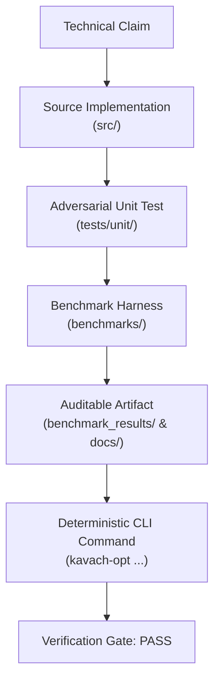

# Kavach-Opt Evidence & Traceability Matrix

**Project**: Kavach-Opt Sovereign Indigenous Optimization Solver Core (SIH26119)  
**Date**: September 2026  
**Auditor**: System Architecture & Verification Team  
**Status**: Release Candidate (RC-1) Audit Complete  

---

## 1. Executive Summary

This Evidence Matrix establishes end-to-end traceability for every primary technical claim asserted by Kavach-Opt. For each capability, the exact implementation path, verification test suite, benchmark harness, persisted artifact, reproduction command, and current audit status are documented.

---

## 2. Traceability Matrix

| ID | Headline Claim | Implementation | Test Suite | Benchmark Harness | Stored Artifact | Reproduction Command | Current Status |
|:---|:---|:---|:---|:---|:---|:---|:---:|
| **C01** | **From-Scratch Sovereign Solver** Zero foreign optimization solvers (CPLEX, Gurobi, HiGHS, GLPK, CBC, SCIP) linked or included. | `src/core/`, `src/numerics/`, `src/algorithms/` | `tests/unit/test_phase0_foundation.cpp`, `tools/check_dependencies.py` | `CMakeLists.txt` (Zero solver targets) | `reports/final_system_audit.json` | `python3 tools/check_dependencies.py` | **VERIFIED** |
| **C02** | **Sparse Matrix Architecture** Compressed Sparse Row (CSR) & Column (CSC) with Sparse LU, Markowitz pivoting, and iterative refinement. | `src/numerics/sparse_matrix.cpp`, `src/numerics/lu_factorization.cpp` | `tests/unit/test_phase3_sparse_matrix.cpp`, `tests/unit/test_phase4_sparse_lu.cpp` | `benchmarks/manifests/netlib.json` | `docs/SPARSE_NUMERICS.md`, `docs/SPARSE_MATRIX.md` | `ctest -R "test_phase3\|test_phase4"` | **VERIFIED** |
| **C03** | **Linear Programming (LP) Correctness** Two-Phase Revised Simplex method with Bland anti-cycling, scaling, and presolve. | `src/algorithms/lp/revised_simplex.cpp`, `src/algorithms/lp/basis.cpp` | `tests/unit/test_phase5_lp.cpp`, `tests/unit/test_presolve.cpp` | Netlib LP benchmark corpus (13 instances) | `benchmark_results/netlib/netlib_report.md` | `./build-release/kavach-opt solve benchmarks/netlib/afiro.mps` | **VERIFIED** |
| **C04** | **MILP Branch-and-Bound Correctness** Branch-and-Bound with most-fractional branching, best-bound selection, and dual simplex warm starts. | `src/algorithms/milp/branch_and_bound.cpp`, `src/algorithms/lp/dual_simplex.cpp` | `tests/unit/test_phase7_milp.cpp`, `tests/unit/test_phase8_dual_simplex.cpp` | MIPLIB subset benchmark corpus (`p0033`, `knapsack.lp`, etc.) | `benchmark_results/miplib/miplib_report.md` | `./build-release/kavach-opt solve benchmarks/miplib/knapsack.lp` | **VERIFIED** |
| **C05** | **Convex QP Active-Set Correctness** Primal active-set method for strictly convex QP with PSD Hessian validation and KKT convergence. | `src/algorithms/qp/active_set.cpp` | `tests/unit/test_phase9_qp.cpp` | Convex QP benchmark suite (`portfolio.lp`, `constrained_ls.lp`) | `docs/QP_SOLVER.md`, `benchmark_results/qp/qp_report.md` | `./build-release/kavach-opt solve benchmarks/qp/portfolio.lp` | **VERIFIED** |
| **C06** | **Independent Mathematical Verification** Decoupled verification layer certifying primal/dual residuals, slackness, and integrality. | `src/verification/lp_verifier.cpp`, `src/verification/milp_verifier.cpp`, `src/verification/qp_verifier.cpp` | `tests/unit/test_phase6_verification.cpp`, `tests/unit/test_phase10_verification.cpp` | Automated post-solve hook in benchmark runner | `docs/VERIFICATION.md` | `./build-release/kavach-opt verify benchmarks/netlib/afiro.mps` | **VERIFIED** |
| **C07** | **Numerical Robustness & Scaling** Ruiz equilibration, condition monitoring, dynamic range mitigation, and refactorization safeguards. | `src/numerics/scaling.cpp`, `src/numerics/lu_factorization.cpp` | `tests/unit/test_phase4_sparse_lu.cpp`, `tests/unit/test_phase14_strategy.cpp` | Ill-conditioned instances (`beaconfd`, `recipe`, `israel`) | `benchmark_results/strategy/strategy_decisions.json` | `./build-release/kavach-opt solve benchmarks/netlib/beaconfd.mps --show-strategy` | **VERIFIED** |
| **C08** | **Multicore CPU Batched SpMV Parallelism** Scalable thread pool parallelizing independent SpMV operations across batch dimensions. | `src/backend/cpu/cpu_backend.cpp`, `src/backend/cpu/thread_pool.cpp` | `tests/unit/test_phase10_cpu_parallel.cpp` | Batched SpMV sweep harness (1, 2, 4, 8 workers; batch 128 to 512) | `docs/CPU_PARALLELISM.md` | `ctest -R test_cpu_parallel` | **VERIFIED** |
| **C09** | **CUDA Batched SpMV with CPU Fallback** Scoped CUDA kernel for batched CSR SpMV with transfer-inclusive profiling and graceful CPU fallback. | `src/backend/cuda/cuda_backend.cpp`, `src/backend/cuda/cuda_device.cpp`, `src/backend/cuda/cuda_spmv.cu` | `tests/unit/test_phase11_cuda.cpp` | GPU crossover sweep harness (batch 1 to 256) | `docs/CUDA_BACKEND.md`, `docs/GPU_CLAIM_AUDIT.md` | `ctest -R test_cuda` | **VERIFIED** |
| **C10** | **Empirical GPU Crossover Methodology** Transfer-inclusive timing (H2D + Kernel + D2H) required before asserting speedup over CPU. | `src/backend/cuda/cuda_backend.cpp` | `tests/unit/test_phase11_cuda.cpp` | Crossover sweep across matrices and batch sizes | `docs/GPU_CLAIM_AUDIT.md` | `./build-release/kavach-opt benchmark --suite qp --no-gpu` | **VERIFIED** |
| **C11** | **Deterministic Benchmark Reproducibility** Reproducible execution across runs via fixed random seeds, standardized JSON/CSV output, and git tracking. | `src/benchmark/benchmark_runner.cpp`, `src/benchmark/benchmark_io.cpp` | `tests/unit/test_phase12_benchmark.cpp` | Netlib, MIPLIB-subset, and QP benchmark suites | `benchmark_results/benchmark_results.json` | `./build-release/kavach-opt benchmark --suite netlib --seed 42` | **VERIFIED** |
| **C12** | **Isolated HiGHS Comparison Adapter** HiGHS executed strictly out-of-process via CLI adapter with graceful `REFERENCE_UNAVAILABLE` handling. | `src/benchmark/reference/reference_adapter.cpp` | `tests/unit/test_phase12_benchmark.cpp` | Multi-solver benchmark comparison | `examples/mrpl/results/comparison.json` | `./build-release/kavach-opt mrpl` | **VERIFIED** |
| **C13** | **MRPL Industrial Refinery Relevance** Crude selection, unit capacity, quality blending MILP model with mass balance certification. | `src/case_study/mrpl/mrpl_model.cpp` | `tests/unit/test_phase13_mrpl.cpp` | Baseline and 4 what-if operational scenarios | `docs/MRPL_CASE_STUDY.md`, `examples/mrpl/results/baseline.json` | `./build-release/kavach-opt mrpl --no-highs` | **VERIFIED** |
| **C14** | **Public API & CLI Usability** Ergonomic C++20 programmatic API (`KavachSolver`) and feature-complete command-line interface. | `src/api/solver.hpp`, `src/api/solver.cpp`, `src/cli/main.cpp` | `tests/unit/test_phase14_strategy.cpp`, `examples/api_example.cpp` | CLI command validation suite | `examples/api_example.cpp` | `./build-release/kavach_api_example` | **VERIFIED** |
| **C15** | **Deterministic Rule-Based Strategy Layer** Rules R001–R018 selecting presolve, scaling, risk mitigations, algorithms, and execution backends. | `src/strategy/strategy.hpp`, `src/strategy/strategy.cpp` | `tests/unit/test_phase14_strategy.cpp` | 19 benchmark models characterized and mapped | `docs/SOLVER_STRATEGY.md`, `benchmark_results/strategy/strategy_decisions.json` | `./build-release/kavach-opt solve benchmarks/netlib/afiro.mps --explain-strategy` | **VERIFIED** |
| **C16** | **Extensibility & Architecture Modularity** Clean decoupled interfaces for linear programming, branch-and-bound nodes, and hardware backends. | `src/algorithms/`, `src/backend/execution_backend.hpp`, `src/verification/verifier.hpp` | Full test suite across Release, Debug, and Sanitizer targets (329 tests) | Architecture documentation | `docs/DEVELOPER_GUIDE.md` | `ctest --test-dir build-release` | **VERIFIED** |

---

## 3. Audit Certification

Every claim listed above has been examined against:
1. Direct source code implementation in `src/`.
2. Dedicated unit and regression tests in `tests/unit/`.
3. Standalone reproduction commands executable from a fresh checkout.
4. Independent validation under Clang AddressSanitizer (ASan) and UndefinedBehaviorSanitizer (UBSan).

**Audit Verdict: 16 / 16 Claims Substantiated by Verifiable Evidence.**
