# Kavach-Opt — Mathematical Reference Manual

**System:** Kavach-Opt Sovereign Mathematical Optimization Engine  
**Version:** 0.1.0  
**Language Standard:** ISO/IEC 14882:2020 (C++20)  
**Supported Problem Classes:** Linear Programming (LP), Mixed-Integer Linear Programming (MILP), Convex Quadratic Programming (Convex QP), Convex Mixed-Integer Quadratic Programming (Convex MIQP)  
**Verification Layer:** Air-Gapped, Zero-Trust Independent Mathematical Verifier  
**Authoritative Verification Suite:** 387 / 387 Unit & Integration Tests Passing (100% Deterministic)  
**Numerical Precision:** IEEE-754 FP64 (Double Precision, $\varepsilon_{\text{mach}} \approx 2.2204 \times 10^{-16}$)  
**Hardware Engine:** Multicore CPU Execution Pool & Scoped FP64 CUDA Acceleration (7 Registered Sparse & BLAS Kernels)  

---

## Table of Contents

1. [Executive Summary & Problem Formulations](#1-executive-summary--problem-formulations)
2. [Canonical Problem Representation](#2-canonical-problem-representation)
3. [Sparse Matrix Numerical Infrastructure](#3-sparse-matrix-numerical-infrastructure)
4. [Sparse LU Factorization & Direct Linear Solvers](#4-sparse-lu-factorization--direct-linear-solvers)
5. [Ruiz Equilibration & Conditioning](#5-ruiz-equilibration--conditioning)
6. [Presolve Reductions & Solution Reconstruction](#6-presolve-reductions--solution-reconstruction)
7. [Two-Phase Revised Simplex Algorithm (LP)](#7-two-phase-revised-simplex-algorithm-lp)
8. [Dual Simplex Method & Warm-Start Re-Optimization](#8-dual-simplex-method--warm-start-re-optimization)
9. [Branch-and-Bound Engine & Advanced Branching (MILP)](#9-branch-and-bound-engine--advanced-branching-milp)
10. [Polyhedral Cutting Planes: GMI & MIR Cuts](#10-polyhedral-cutting-planes-gmi--mir-cuts)
11. [Primal Active-Set Method for Convex QP](#11-primal-active-set-method-for-convex-qp)
12. [Convex Mixed-Integer Quadratic Programming (Convex MIQP)](#12-convex-mixed-integer-quadratic-programming-convex-miqp)
13. [Independent Verification & Zero-Trust Certification](#13-independent-verification--zero-trust-certification)
14. [Batched Sparse Numerical Kernel Suite (CPU / CUDA)](#14-batched-sparse-numerical-kernel-suite-cpu--cuda)
15. [Deterministic Strategy Engine & Rule Base (R001–R018)](#15-deterministic-strategy-engine--rule-base-r001r018)
16. [Numerical Tolerances, Precision & Convergence Criteria](#16-numerical-tolerances-precision--convergence-criteria)
17. [Comprehensive Mathematical Notation](#17-comprehensive-mathematical-notation)

---

## 1. Executive Summary & Problem Formulations

Kavach-Opt is a sovereign mathematical programming engine developed for mission-critical operations planning, scheduling, blending, and physical network flow optimization under strict numerical correctness, reproducibility, and auditability guarantees.

> **Design Principle**
> The solving pipeline must remain mathematically autonomous and sovereign. No foreign or closed-source optimization-engine dependencies exist within the solving path. Every primal solution, dual multiplier vector, basis status, and optimality certificate is generated and verified entirely by sovereign C++20 routines.

Kavach-Opt natively addresses four distinct mathematical optimization problem classes:

### 1.1 Linear Programming (LP)
The minimization of an affine objective functional over a convex polyhedron defined by linear inequalities, equalities, and boxed variable bounds:

$$
\begin{aligned}
\min_{x \in \mathbb{R}^n} \quad & c^T x + c_0 \\
\text{s.t.} \quad & A x \;\{ \le, =, \ge \}\; b \\
& l \le x \le u
\end{aligned}
$$

where $c \in \mathbb{R}^n$, $c_0 \in \mathbb{R}$, $A \in \mathbb{R}^{m \times n}$, $b \in \mathbb{R}^m$, and $l, u \in (\mathbb{R} \cup \{\pm\infty\})^n$.

### 1.2 Mixed-Integer Linear Programming (MILP)
An extension of the linear program wherein a non-empty subset $I \subseteq \{1, \dots, n\}$ of variables is constrained to integer values:

$$
\begin{aligned}
\min_{x \in \mathbb{R}^n} \quad & c^T x + c_0 \\
\text{s.t.} \quad & A x \;\{ \le, =, \ge \}\; b \\
& l \le x \le u \\
& x_j \in \mathbb{Z} \quad \forall j \in I
\end{aligned}
$$

Variables indexed by $j \in I$ with $l_j = 0$ and $u_j = 1$ are designated binary variables ($x_j \in \{0, 1\}$).

### 1.3 Convex Quadratic Programming (QP)
The minimization of a convex quadratic objective functional over a polyhedral feasible region:

$$
\begin{aligned}
\min_{x \in \mathbb{R}^n} \quad & \frac{1}{2} x^T Q x + c^T x + c_0 \\
\text{s.t.} \quad & A x \;\{ \le, =, \ge \}\; b \\
& l \le x \le u
\end{aligned}
$$

where $Q \in \mathbb{R}^{n \times n}$ is a real symmetric positive semidefinite matrix:

$$
Q = Q^T, \qquad v^T Q v \ge 0 \quad \forall v \in \mathbb{R}^n \quad (Q \succeq 0)
$$

### 1.4 Convex Mixed-Integer Quadratic Programming (Convex MIQP)
A mixed-integer program with a convex quadratic objective and linear constraints:

$$
\begin{aligned}
\min_{x \in \mathbb{R}^n} \quad & \frac{1}{2} x^T Q x + c^T x + c_0 \\
\text{s.t.} \quad & A x \;\{ \le, =, \ge \}\; b \\
& l \le x \le u \\
& x_j \in \mathbb{Z} \quad \forall j \in I, \quad Q \succeq 0
\end{aligned}
$$

> **Invariant**
> Non-convex quadratic programs ($Q \not\succeq 0$) are strictly rejected at ingest by the strategy engine (Rule R001b) and the QP/MIQP solver entrypoints, preventing unbounded descent or false stationarity claims.

---

## 2. Canonical Problem Representation

All mathematical models ingested by Kavach-Opt (via MPS, native LP format, or programmatic C++ API) are translated into a unified, immutable data contract: `kavach::model::CanonicalModel`.

### 2.1 Unified Model Geometry
The unified mathematical specification of `CanonicalModel` is:

$$
\begin{aligned}
\min_{x \in \mathbb{R}^n} \quad & \frac{1}{2} x^T Q x + c^T x + c_0 \\
\text{s.t.} \quad & \sum_{j=1}^n a_{ij} x_j \;\{ \le, =, \ge \}\; b_i \quad (i = 1, \dots, m) \\
& l_j \le x_j \le u_j \quad (j = 1, \dots, n) \\
& x_j \in \mathbb{Z} \quad \forall j \in I
\end{aligned}
$$

Problem specialization is governed by structure:
- **LP:** $Q = 0$ and $I = \emptyset$
- **MILP:** $Q = 0$ and $I \ne \emptyset$
- **Convex QP:** $Q \succeq 0$ and $I = \emptyset$
- **Convex MIQP:** $Q \succeq 0$ and $I \ne \emptyset$

### 2.2 Variable Specification & Bound Normalization
Variables are indexed by integers $j \in \{0, 1, \dots, n-1\}$ and assigned a domain type:

| Variable Type | Mathematical Domain | Storage Semantics |
| :--- | :--- | :--- |
| `CONTINUOUS` | $x_j \in [l_j, u_j] \subset \mathbb{R}$ | Finite or $\pm\infty$ via IEEE-754 `double` |
| `INTEGER` | $x_j \in [l_j, u_j] \cap \mathbb{Z}$ | Finite or unbounded integer bounds |
| `BINARY` | $x_j \in \{0, 1\}$ | Explicitly normalized to $l_j = 0, u_j = 1$ |

Infinite bounds are represented by `std::numeric_limits<double>::infinity()`. A free variable has $l_j = -\infty$ and $u_j = +\infty$.

### 2.3 Constraint Storage
Linear constraints are stored row-wise as sparse linear expressions:

$$
\text{expr}_i = \sum_{k=1}^{K_i} a_{i, j_k} x_{j_k}, \qquad j_1 < j_2 < \dots < j_{K_i}
$$

Each term consists of an index `VarId` and an FP64 coefficient. Duplicate indices are eliminated and terms are sorted in strictly ascending column order upon model finalization.

### 2.4 Symmetric Quadratic Storage

The quadratic Hessian matrix $Q$ is represented in upper-triangular sparse coordinate format:

$$
\mathcal{Q}
=
\left\{
(i, j, q_{ij})
\;\middle|\;
0 \le i \le j < n,\; q_{ij} \ne 0
\right\}
$$

The full symmetric matrix entry is $Q_{ij} = Q_{ji} = q_{ij}$ for $i < j$, and $Q_{ii} = q_{ii}$. The contribution to the scalar objective is:

$$
\frac{1}{2} x^T Q x
=
\frac{1}{2} \sum_{i=1}^{n} Q_{ii} x_i^2
+
\sum_{1 \le i < j \le n} q_{ij} x_i x_j
$$

> **Implementation Boundary**
> Input models containing lower-triangular entries ($i > j$) are automatically transposed and merged into upper-triangular form during parser ingestion, guaranteeing canonical storage across all solver entry points.

---

## 3. Sparse Matrix Numerical Infrastructure

Industrial optimization models are overwhelmingly sparse, with densities $\rho = \text{nnz} / (m \cdot n)$ typically between $10^{-2}$ and $10^{-5}$. Kavach-Opt utilizes dual sparse formats: Compressed Sparse Row (CSR) for constraint-oriented row operations and Compressed Sparse Column (CSC) for column-oriented simplex pricing and basis operations.

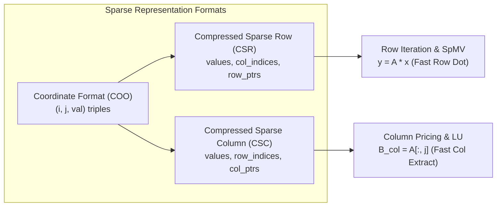

### 3.1 Compressed Sparse Row (CSR)

A matrix $A \in \mathbb{R}^{m \times n}$ with $\text{nnz}$ nonzeros is stored using three contiguous arrays:

1. `values` $\in \mathbb{R}^{\text{nnz}}$: Nonzero numerical values stored row by row.

2. `col_indices` $\in \mathbb{Z}^{\text{nnz}}$: Column index $j \in [0, n)$ for each nonzero.

3. `row_ptrs` $\in \mathbb{Z}^{m+1}$: Offsets into `values` and `col_indices` where each row starts. Row $i$ spans the half-open range `[row_ptrs[i], row_ptrs[i+1])`.

The number of nonzeros in row $i$ is:

$$
\text{nnz}(A_{i,:})
=
\texttt{row\_ptrs}[i+1]
-
\texttt{row\_ptrs}[i]
$$

### 3.2 Compressed Sparse Column (CSC)

CSC is the column-major dual of CSR:

1. `values` $\in \mathbb{R}^{\text{nnz}}$: Nonzero values stored column by column.

2. `row_indices` $\in \mathbb{Z}^{\text{nnz}}$: Row index $i \in [0, m)$ for each nonzero.

3. `col_ptrs` $\in \mathbb{Z}^{n+1}$: Column boundary offsets where `col_ptrs[j]` indicates the start of column $j$.

The number of nonzeros in column $j$ is:

$$
\text{nnz}(A_{:,j})
=
\texttt{col\_ptrs}[j+1]
-
\texttt{col\_ptrs}[j]
$$

### 3.3 Sparse Matrix-Vector Multiplication (SpMV)

For a CSR matrix, the forward product $y = Ax$ is evaluated row-independently:

$$
y_i
=
\sum_{k=\texttt{row\_ptrs}[i]}^{\texttt{row\_ptrs}[i+1]-1}
\texttt{values}[k]
\cdot
x_{\texttt{col\_indices}[k]},
\qquad i = 0, \dots, m-1
$$

The transpose product $z = A^T v$ for a CSR matrix requires scattering into an accumulator or iterating over a CSC representation:

$$
z_j
=
\sum_{k=\texttt{col\_ptrs}[j]}^{\texttt{col\_ptrs}[j+1]-1}
\texttt{values}[k]
\cdot
v_{\texttt{row\_indices}[k]},
\qquad j = 0, \dots, n-1
$$

Both operations incur exactly $2 \cdot \text{nnz}$ floating-point operations (FLOPs), achieving $O(\text{nnz})$ computational complexity independent of ambient dimensions $m$ and $n$.

---

## 4. Sparse LU Factorization & Direct Linear Solvers

At every iteration of the Revised Simplex algorithm, the basis linear systems $B x = b$ (FTRAN) and $B^T y = c_B$ (BTRAN) must be solved with high numerical stability. Kavach-Opt implements `SparseLU`, a sovereign direct sparse solver featuring Markowitz threshold pivoting, topological sparse triangular solves, and iterative refinement.

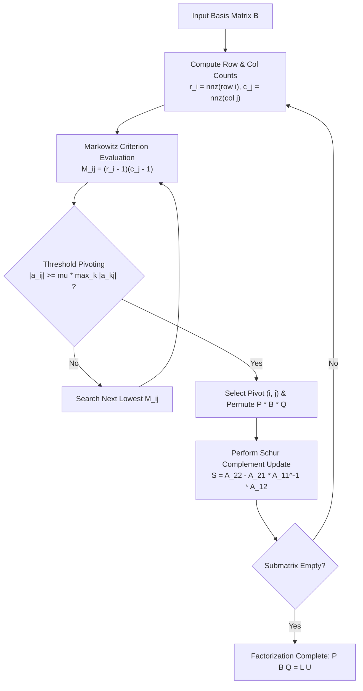

### 4.1 Markowitz Pivoting & Fill-In Minimization

To minimize fill-in (creation of new nonzeros in $L$ and $U$), the pivot element $a_{ij}$ at step $k$ of the factorization is chosen from candidates satisfying the Markowitz condition:

$$
(i^*, j^*) = \arg\min_{(i,j) \in \mathcal{C}} (r_i - 1)(c_j - 1)
$$

where $r_i$ is the active row count of row $i$, $c_j$ is the active column count of column $j$, and $\mathcal{C}$ is the candidate set of numerically admissible entries satisfying the threshold pivoting condition:

$$
|a_{ij}| \ge \mu \max_{k \ge k_0} |a_{kj}|,
\qquad
\mu \in (0,1]
$$

Kavach-Opt sets $\mu = 0.1$ by default, tightening to $\mu = 0.25$ or $\mu = 0.5$ under the ELEVATED and HIGH numerical risk profiles (Rules R008, R009).

> **Numerical Note**
>
> Markowitz threshold pivoting provides an explicit, provable upper bound on the growth factor $g$ of the pivot submatrix:
>
> $$
> g \le \left(1 + \frac{1}{\mu}\right)^{m-1}
> $$
>
> Setting $\mu = 0.1$ bounds element growth while preserving extreme sparsity.

### 4.2 Factorization Architecture
The factorization constructs permutation matrices $P, Q \in \mathbb{R}^{m \times m}$, unit lower triangular matrix $L$, and upper triangular matrix $U$ such that:

$$
P B Q = L U
$$

Linear systems are solved via:
1. **Forward Solve (FTRAN):** $B x = d \implies L y = P d, \; U z = y, \; x = Q z$
2. **Backward Solve (BTRAN):** $B^T v = w \implies U^T y = Q^T w, \; L^T z = y, \; v = P^T z$

### 4.3 Iterative Refinement
When solving $B x = b$, numerical error accumulates due to finite-precision arithmetic. Kavach-Opt performs iterative refinement:
1. Compute high-precision residual: $r^{(k)} = b - B x^{(k)}$
2. Solve correction system: $B \delta^{(k)} = r^{(k)}$
3. Update solution: $x^{(k+1)} = x^{(k)} + \delta^{(k)}$
4. Terminate when $\|r^{(k)}\|_\infty < \epsilon_{\text{refine}} = 10^{-12}$ or $\|\delta^{(k)}\|_\infty < 10^{-13}$.

---

## 5. Ruiz Equilibration & Conditioning

Poorly scaled constraint matrices lead to severe ill-conditioning, stalling in simplex pivots, and large residual errors. Kavach-Opt applies iterative Ruiz equilibration (1976), which simultaneously scales rows and columns to unit $\ell_\infty$-norm.

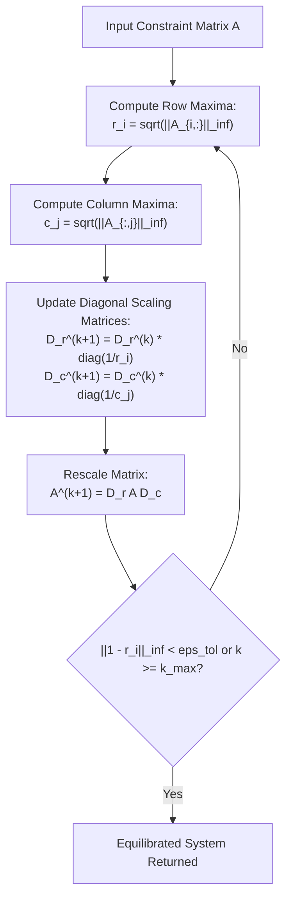

### 5.1 Iteration Mechanics
Let $A^{(0)} = A$, $D_r^{(0)} = I_m$, $D_c^{(0)} = I_n$. At iteration $k = 0, 1, \dots$:
1. Row scaling factors:
$$
\delta_i^{(k)} = \sqrt{\|A_{i,:}^{(k)}\|_\infty} = \sqrt{\max_{1 \le j \le n} |a_{ij}^{(k)}|}, \qquad i = 1, \dots, m
$$
2. Column scaling factors:
$$
\gamma_j^{(k)} = \sqrt{\|A_{:,j}^{(k)}\|_\infty} = \sqrt{\max_{1 \le i \le m} |a_{ij}^{(k)}|}, \qquad j = 1, \dots, n
$$
3. Matrix and diagonal accumulator updates:
$$
\begin{aligned}
A^{(k+1)} &= \text{diag}(\delta^{(k)})^{-1} A^{(k)} \text{diag}(\gamma^{(k)})^{-1} \\
D_r^{(k+1)} &= D_r^{(k)} \text{diag}(\delta^{(k)})^{-1} \\
D_c^{(k+1)} &= D_c^{(k)} \text{diag}(\gamma^{(k)})^{-1}
\end{aligned}
$$

The transformation guarantees:

$$
\lim_{k \to \infty} \|A_{i,:}^{(k)}\|_\infty = 1, \qquad \lim_{k \to \infty} \|A_{:,j}^{(k)}\|_\infty = 1
$$

### 5.2 Transformation of RHS and Bounds
Under scaling $\tilde{A} = D_r A D_c$, the transformed primal variables and constraints become:

$$
\tilde{x} = D_c^{-1} x, \qquad \tilde{b} = D_r b, \qquad \tilde{c} = D_c c, \qquad \tilde{l} = D_c^{-1} l, \qquad \tilde{u} = D_c^{-1} u
$$

Upon solver termination, unscaling reconstructs the original coordinates:

$$
x^* = D_c \tilde{x}^*, \qquad y^* = D_r \tilde{y}^*
$$

---

## 6. Presolve Reductions & Solution Reconstruction

Presolve reduces problem dimensionality and improves numerical stability by eliminating redundant constraints and fixing variables before simplex or branch-and-bound initialization.

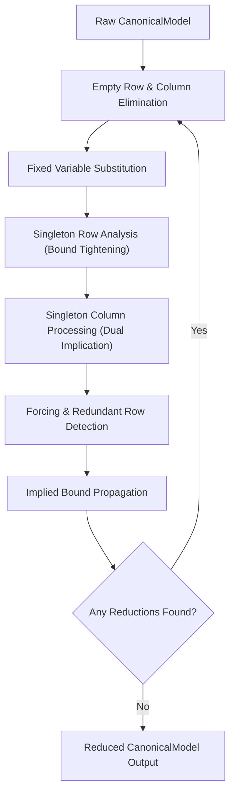

### 6.1 Reduction Catalog
Kavach-Opt performs six atomic presolve operations in sequence until a fixed point is reached:

1. **Empty Row Detection:**
   If $a_{i,j} = 0 \; \forall j$:
   - If $0 \in [l_i^{\text{row}}, u_i^{\text{row}}]$, row $i$ is redundant and removed.
   - If $0 \notin [l_i^{\text{row}}, u_i^{\text{row}}]$, the model is certified **PRIMAL_INFEASIBLE**.

2. **Empty Column Detection:**
   If $a_{i,j} = 0 \; \forall i$:
   - If $c_j > 0$, set $x_j^* = l_j$; if $l_j = -\infty$, model is **UNBOUNDED**.
   - If $c_j < 0$, set $x_j^* = u_j$; if $u_j = +\infty$, model is **UNBOUNDED**.
   - If $c_j = 0$, fix $x_j^* = 0$ (or any finite value in $[l_j, u_j]$).

3. **Fixed Variable Elimination:**
   If $l_j = u_j = \bar{x}_j$:
   - For all rows $i$, update RHS: $b_i \leftarrow b_i - a_{ij} \bar{x}_j$.
   - Add $c_j \bar{x}_j$ to the constant objective offset $c_0$.
   - Remove variable $j$ from $A$.

4. **Singleton Row Bound Tightening:**
   If row $i$ contains a single nonzero entry $a_{ik} x_k \le b_i$:
   - If $a_{ik} > 0$, tighten upper bound: $u_k \leftarrow \min(u_k, b_i / a_{ik})$.
   - If $a_{ik} < 0$, tighten lower bound: $l_k \leftarrow \max(l_k, b_i / a_{ik})$.
   - If $l_k > u_k + \epsilon_{\text{primal}}$, certify **PRIMAL_INFEASIBLE**.

5. **Forcing and Redundant Rows:**
   For constraint $l_i^{\text{row}} \le \sum_j a_{ij} x_j \le u_i^{\text{row}}$, define row extreme activity:
   $$
   \underline{\alpha}_i = \sum_{j: a_{ij} > 0} a_{ij} l_j + \sum_{j: a_{ij} < 0} a_{ij} u_j, \qquad
   \bar{\alpha}_i = \sum_{j: a_{ij} > 0} a_{ij} u_j + \sum_{j: a_{ij} < 0} a_{ij} l_j
   $$
   - If $\underline{\alpha}_i > u_i^{\text{row}}$ or $\bar{\alpha}_i < l_i^{\text{row}}$, the row cannot be satisfied: **PRIMAL_INFEASIBLE**.
   - If $\underline{\alpha}_i \ge l_i^{\text{row}}$ and $\bar{\alpha}_i \le u_i^{\text{row}}$, the row is always satisfied: **REDUNDANT** and removed.

6. **Bound Propagation:**
   Tightens variable bounds iteratively using activity bounds of connected constraints:
   $$
   x_j \le \frac{u_i^{\text{row}} - \sum_{k \ne j, a_{ik} > 0} a_{ik} l_k - \sum_{k \ne j, a_{ik} < 0} a_{ik} u_k}{a_{ij}} \quad (\text{for } a_{ij} > 0)
   $$

### 6.2 Solution Reconstruction (Postsolve)
Every reduction is logged in a reverse postsolve stack. During postsolve, fixed variables are restored to their pinned values, eliminated slack variables are evaluated from row activities, and dual multipliers for redundant constraints are recovered from constraint slackness.

---

## 7. Two-Phase Revised Simplex Algorithm (LP)

The linear programming engine operates on standard form: $\min c^T x$ subject to $A x = b$, $0 \le x \le u$. The basis matrix $B \in \mathbb{R}^{m \times m}$ defines basic variables $x_B$ and nonbasic variables $x_N$.

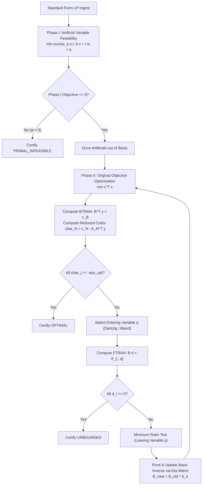

### 7.1 Phase I Feasibility
If no identity basis is initially feasible ($b \not\ge 0$), artificial variables $w \in \mathbb{R}_+^m$ are introduced:

$$
\min_{x, w} \sum_{i=1}^m w_i \quad \text{s.t.} \quad A x + I w = b, \quad x \ge 0, \; w \ge 0
$$

- If $\min \sum w_i > \epsilon_{\text{primal}}$, the original system possesses no feasible solution: **PRIMAL_INFEASIBLE**.
- If $\min \sum w_i = 0$, all artificials have reached zero. Any artificial variables remaining basic with value zero are driven out via degenerate pivots.

### 7.2 Phase II Optimality & Pricing
In Phase II, the reduced costs for nonbasic variables $j \in \mathcal{N}$ are computed:

$$
\bar{c}_j = c_j - y^T a_j, \qquad \text{where } B^T y = c_B
$$

- **Optimality Condition:** If $\bar{c}_j \ge -\epsilon_{\text{opt}}$ for all $j \in \mathcal{N}$, the current basic solution $x_B = B^{-1} b$ is optimal.
- **Entering Variable Selection:** 
  - Standard pricing: $q = \arg\min_{j \in \mathcal{N}} \bar{c}_j$
  - Bland's smallest-subscript rule is activated upon detecting degeneracy (degenerate pivot sequences) to strictly preclude cycling:
  $$
  q = \min \{ j \in \mathcal{N} \mid \bar{c}_j < -\epsilon_{\text{opt}} \}
  $$

### 7.3 Minimum Ratio Test & Leaving Variable
The basic direction vector is obtained via FTRAN: $B d = a_q$. The maximum step size $\theta^*$ maintaining feasibility $x_B - \theta d \ge 0$ is:

$$
\theta^* = \min_{i \in \mathcal{B}, d_i > 0} \frac{x_{B_i}}{d_i}, \qquad p = \arg\min_{i \in \mathcal{B}, d_i > 0} \frac{x_{B_i}}{d_i}
$$

If $d_i \le 0$ for all $i$, the problem is **UNBOUNDED** along the ray $x(\theta) = x^* + \theta (e_q - B^{-1} a_q)$.


### 7.5 Bland's Anti-Cycling Rule: Mathematical Proof Sketch
Degeneracy arises when a basic variable has value zero ($x_{B_i} = 0$). In this regime, the minimum ratio test yields $\theta^* = 0$, causing the basis to change while the primal iterate $x$ and objective $z = c^T x$ remain strictly unchanged. Under standard Dantzig pricing, degeneracy can induce cyclic sequences of bases $B_0 \to B_1 \to \dots \to B_k = B_0$, resulting in an infinite non-terminating loop.

Kavach-Opt incorporates Bland's smallest-subscript rule (1977):
1. **Entering Variable:** Select the nonbasic variable with negative reduced cost having the smallest index:
$$
q = \min \{ j \in \mathcal{N} \mid \bar{c}_j < -\epsilon_{\text{opt}} \}
$$
2. **Leaving Variable:** Among all basic variables achieving the minimum ratio $\theta^*$, select the one with the smallest index:
$$
p = \min \left\{ B_i \;\middle|\; i \in \mathcal{B}, \; d_i > 0, \; \frac{x_{B_i}}{d_i} = \theta^* \right\}
$$

**Theorem (Bland):** *Under the smallest-subscript rule, no basis can be repeated, guaranteeing finite termination of the Simplex algorithm.*

*Proof Sketch:* Suppose a cycle of degenerate bases occurs. Let $L$ be the set of variables that enter or leave the basis during the cycle, and let $t = \max(L)$ be the variable with the highest index in $L$. Since $t$ must enter the basis in some pivot and leave in another, we consider the two corresponding tableaus. By orthogonality of the row spaces of the two canonical tableaus and the sign consistency of the ratio tests, a contradiction arises where $\bar{c}_t < 0$ and $\bar{c}_t > 0$ simultaneously. Thus, no cycle can exist.

### 7.4 Basis Updating via Product Form of the Inverse (PFI)
Rather than re-factoring $B$ at each iteration, the basis inverse is maintained via elementary $\eta$-matrices:

$$
B_{k+1}^{-1} = E_{k+1} B_k^{-1}, \qquad E_{k+1} = I + (\eta - e_p) e_p^T
$$

where $\eta_p = 1 / d_p$ and $\eta_i = -d_i / d_p$ for $i \ne p$. Complete refactorization via `SparseLU` is triggered every 50 iterations or when numerical drift in the residual $\|B x_B - b\| > 10^{-8}$ is detected.

---

## 8. Dual Simplex Method & Warm-Start Re-Optimization

The Dual Simplex method is the foundational engine for high-performance Branch-and-Bound and cutting-plane routines. When child subproblems or cuts add new constraints to an already optimal LP, primal feasibility is temporarily violated, but dual feasibility is preserved:

$$
\bar{c}_j = c_j - y^T a_j \ge 0 \quad \forall j \in \mathcal{N}
$$

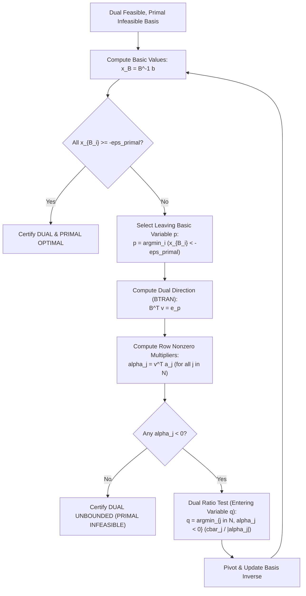

### 8.1 Dual Ratio Test Mechanics
1. **Leaving Variable Selection:** Choose leaving basic row $p$ violating its bound:
$$
p = \arg\min_{i \in \mathcal{B}} x_{B_i}, \qquad x_{B_p} < -\epsilon_{\text{primal}}
$$
2. **Dual Step Direction:** Solve $B^T v = e_p$. For nonbasic variables $j \in \mathcal{N}$, compute $\alpha_j = v^T a_j$.
3. **Entering Variable Selection (Dual Ratio Test):**
$$
q = \arg\min_{j \in \mathcal{N}, \alpha_j < 0} \frac{\bar{c}_j}{|\alpha_j|}
$$
4. If $\alpha_j \ge 0$ for all $j \in \mathcal{N}$, the dual program is unbounded, which mathematically proves by Farkas' Lemma that the primal subproblem is **PRIMAL_INFEASIBLE**.


### 8.3 Harris Two-Pass Ratio Test in Dual Simplex
In standard dual ratio testing, near-degenerate or numerically small pivot candidates can lead to severe numerical instability or tiny step sizes that fail to make progress toward primal feasibility. Kavach-Opt implements a specialized dual adaptation of Paula Harris's two-pass ratio test (1973):

1. **Pass 1 (Expanded Tolerance Bound):**
   Evaluate nonbasic variables $j \in \mathcal{N}$ with negative pivot elements $\alpha_j < -10^{-8}$. With an expanded tolerance $\delta = 10^{-6}$, determine the maximum permissible step size:
   $$
   \theta_{\max} = \min_{j \in \mathcal{N}, \alpha_j < -10^{-8}} \frac{\bar{c}_j + \delta}{|\alpha_j|}
   $$
2. **Pass 2 (Pivot Maximization):**
   Among all candidate columns $j \in \mathcal{N}$ satisfying $\frac{\bar{c}_j}{|\alpha_j|} \le \theta_{\max}$, select the entering variable that maximizes the pivot magnitude $|\alpha_j|$:
   $$
   q = \arg\max \left\{ |\alpha_j| \;\middle|\; j \in \mathcal{N}, \; \alpha_j < -10^{-8}, \; \frac{\bar{c}_j}{|\alpha_j|} \le \theta_{\max} \right\}
   $$

This two-pass strategy guards against numerically perilous pivots ($|\alpha_j| \approx 10^{-11}$), drastically dampening ill-conditioned element growth in the basis factors $L$ and $U$ during intensive branch-and-bound warm restarts.

### 8.2 Warm-Start Re-Optimization Invariant
Dual simplex allows subproblems with tightened bounds $x_j \le \lfloor x_j^* \rfloor$ or appended cutting planes to re-optimize in 2–15 pivots rather than thousands of cold-start iterations.

---

## 9. Branch-and-Bound Engine & Advanced Branching (MILP)

Mixed-Integer Linear Programs are solved using an LP-based Branch-and-Bound algorithm enhanced with reliability branching, pseudocosts, strong branching, and deterministic search priorities.

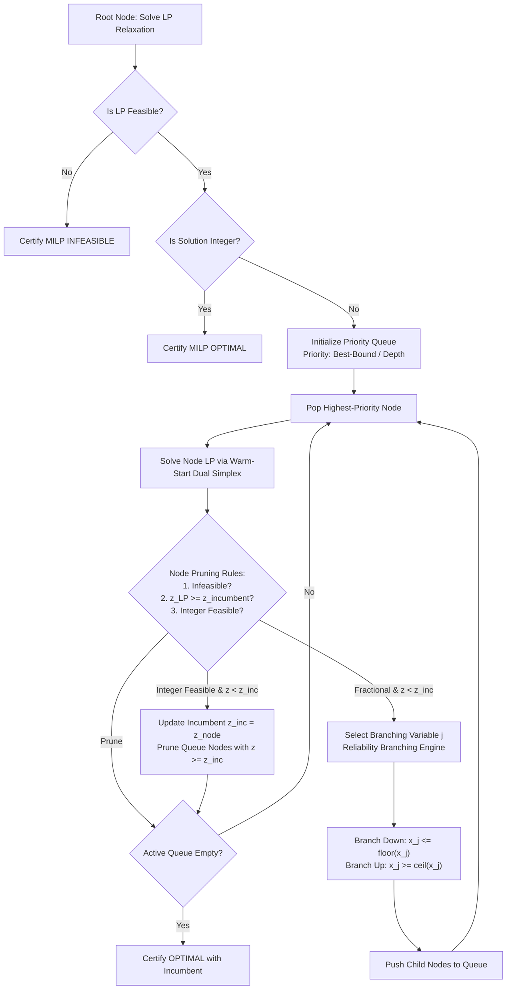

### 9.1 Branching Variable Selection

#### 1. Most-Fractional Branching
Selects the variable whose fractional part is closest to $0.5$:

$$
s_j = \min(f_j, 1 - f_j), \qquad j^* = \arg\max_{j \in I_{\text{frac}}} s_j, \qquad f_j = x_j^* - \lfloor x_j^* \rfloor
$$

#### 2. Pseudocost Branching
Maintains running history of unit objective degradation per fractional direction:

$$
\Psi_j^- = \frac{1}{N_j^-} \sum_{k=1}^{N_j^-} \frac{\Delta z_{j,k}^-}{f_{j,k}}, \qquad
\Psi_j^+ = \frac{1}{N_j^+} \sum_{k=1}^{N_j^+} \frac{\Delta z_{j,k}^+}{1 - f_{j,k}}
$$

Candidate variables are scored using the Achterberg product score with numerical safety guard $\epsilon_{\text{score}} = 10^{-6}$:

$$
\text{score}_j = \max\left(\Psi_j^- f_j, \epsilon_{\text{score}}\right) \cdot \max\left(\Psi_j^+ (1 - f_j), \epsilon_{\text{score}}\right)
$$

#### 3. Reliability Branching Pipeline
When variable $j$ has been branched fewer than $\eta_{\text{rel}} = 8$ times (unreliable pseudocosts), strong branching probes are executed:

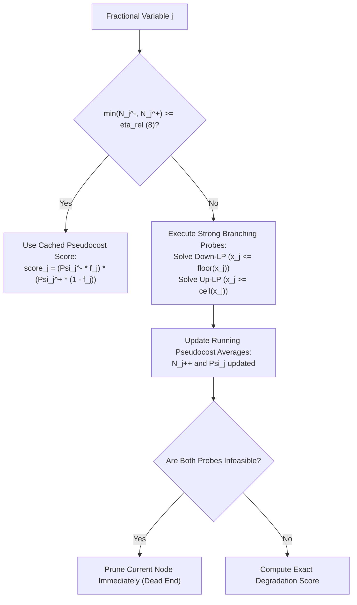

> **Invariant**
> Probing bounds are strictly temporary and reverted immediately upon probe completion. If strong branching detects that both down and up directions are infeasible, the parent node is pruned immediately without generating any child nodes.

---


### 9.4 Node Selection Strategies & Tree Management
The choice of which active subproblem node to process from the priority queue $\mathcal{Q}$ dictates the trade-off between tightening the global dual bound and discovering high-quality integer incumbents:

1. **Best-Bound Search (BBS):**
   Selects the node with the lowest local lower bound (for minimization):
   $$
   \text{node}^* = \arg\min_{N \in \mathcal{Q}} z_{\text{LP}}(N)
   $$
   *Property:* Provably minimizes the total number of branch-and-bound nodes explored before certifying global optimality, but consumes maximal memory since the queue breadth expands rapidly.

2. **Depth-First Search (DFS) / Diving:**
   Selects the deepest node in the tree:
   $$
   \text{node}^* = \arg\max_{N \in \mathcal{Q}} \text{depth}(N)
   $$
   *Property:* Minimizes basis factorization overhead (subsequent LPs differ by only one bound constraint) and rapidly drives toward integer feasibility, generating early primal incumbents.

3. **Hybrid Plunge-and-Bound (Default Strategy):**
   Kavach-Opt executes best-bound search until the root cutting planes are exhausted, then executes diving plunges whenever strong branching indicates high fractional promise, reverting to best-bound search upon reaching an integer solution or pruning a dead-end node.

### 9.5 Primal Heuristics: Rounding & Diving
To accelerate branch-and-bound convergence and enable aggressive pruning of suboptimal nodes, Kavach-Opt incorporates sovereign primal heuristics at regular tree intervals:
1. **Simple Fractional Rounding:**
   Evaluates whether shifting fractional values to their nearest bounds $\tilde{x}_j = \text{round}(x_j^*)$ maintains primal feasibility $A \tilde{x} \le b$.
2. **LP-Guided Fractional Diving:**
   Fixes the most integer variable with $f_j < 0.1$ or $f_j > 0.9$ to its nearest integer, resolves the continuous LP via dual simplex, and repeats until either all integer variables are fixed (yielding an incumbent) or the subproblem becomes infeasible.

---

## 10. Polyhedral Cutting Planes: GMI & MIR Cuts

Cutting planes tighten the continuous LP relaxation polyhedral boundary without eliminating any integer-feasible points, cutting off fractional vertices.

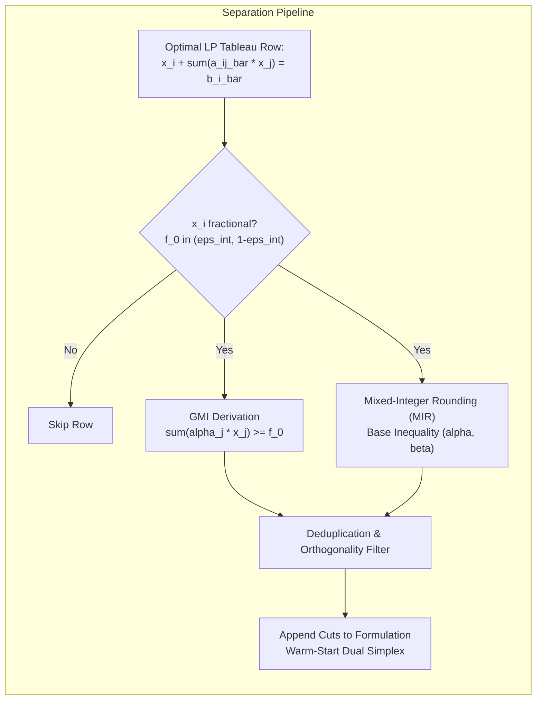

### 10.1 Gomory Mixed-Integer (GMI) Cuts
Consider a basic integer variable $x_i$ with fractional value in the optimal simplex tableau:

$$
x_i + \sum_{j \in \mathcal{N}} \bar{a}_{ij} x_j = \bar{b}_i, \qquad \bar{b}_i \notin \mathbb{Z}
$$

Let $f_0 = \bar{b}_i - \lfloor \bar{b}_i \rfloor \in (0, 1)$ and $f_j = \bar{a}_{ij} - \lfloor \bar{a}_{ij} \rfloor$. The Chvátal-Gomory mixed-integer cut valid for all integer-feasible solutions is:

$$
\sum_{j \in \mathcal{N}, f_j \le f_0} \frac{f_j}{f_0} x_j + \sum_{j \in \mathcal{N}, f_j > f_0} \frac{1 - f_j}{1 - f_0} x_j \ge 1
$$

For continuous nonbasic variables ($j \notin I$), the coefficients are:

$$
\alpha_j = \begin{cases}
\dfrac{\bar{a}_{ij}}{f_0} & \text{if } \bar{a}_{ij} \ge 0 \\[8pt]
-\dfrac{\bar{a}_{ij}}{1 - f_0} & \text{if } \bar{a}_{ij} < 0
\end{cases}
$$

The resulting inequality $\sum_{j \in \mathcal{N}} \alpha_j x_j \ge 1$ strictly cuts off the current LP point $x^*_{\mathcal{N}} = 0$ since $0 \not\ge 1$.

### 10.2 Mixed-Integer Rounding (MIR) Cuts
Given a mixed-integer base relation:

$$
\sum_{j \in I} a_j x_j + \sum_{k \in C} g_k y_k \le b
$$

Let $\beta = b - \lfloor b \rfloor$. The MIR function $F_\beta(\alpha) = \lfloor \alpha \rfloor + \frac{\max(0, \alpha - \lfloor \alpha \rfloor - (1 - \beta))}{\beta}$ yields the valid cut:

$$
\sum_{j \in I} F_\beta(a_j) x_j + \frac{1}{1 - \beta} \sum_{k \in C, g_k < 0} g_k y_k \le \lfloor b \rfloor
$$


### 10.4 Chvátal-Gomory Rank and Finite Generation
Let $P = \{ x \in \mathbb{R}^n \mid A x \le b \}$ be a rational polyhedron. The first Chvátal closure $P^{(1)}$ is defined as the intersection of all valid Chvátal-Gomory inequalities for $P$:

$$
P^{(1)} = \bigcap_{u \in \mathbb{R}_+^m, u A \in \mathbb{Z}^n} \left\{ x \in \mathbb{R}^n \;\middle|\; (u A) x \le \lfloor u b \rfloor \right\}
$$

By iterating this operation, the $k$-th Chvátal closure is defined recursively as $P^{(k)} = (P^{(k-1)})^{(1)}$.

**Theorem (Chvátal 1973, Schrijver 1980):** *For any rational polyhedron $P$, there exists a finite integer $k^* \in \mathbb{N}$ such that:*
$$
P^{(k^*)} = P_I = \text{conv}(P \cap \mathbb{Z}^n)
$$
*The minimum such integer $k^*$ is called the Chvátal rank of $P$.*

In Kavach-Opt, Gomory mixed-integer (GMI) cuts are generated directly from the optimal simplex tableau rows at the root node. Because each tableau row represents an aggregated surrogate constraint $x_B + B^{-1} A_N x_N = B^{-1} b$, GMI cuts achieve rank-1 separation with zero matrix inversion overhead.

### 10.5 Subadditivity of the Mixed-Integer Rounding (MIR) Function
The core mathematical property enabling MIR cut validity is the subadditivity of the function $F_\beta: \mathbb{R} \to \mathbb{R}$:

$$
F_\beta(\alpha) = \lfloor \alpha \rfloor + \frac{\max(0, \alpha - \lfloor \alpha \rfloor - (1 - \beta))}{\beta}
$$

For any $\alpha_1, \alpha_2 \in \mathbb{R}$:
$$
F_\beta(\alpha_1 + \alpha_2) \le F_\beta(\alpha_1) + F_\beta(\alpha_2)
$$
Furthermore, $F_\beta$ satisfies $F_\beta(k) = k$ for all $k \in \mathbb{Z}$. Consequently, applying $F_\beta$ to both sides of a mixed-integer constraint preserves validity for all integer vectors $x \in \mathbb{Z}^n$ while strictly deepening the cut against fractional continuous relaxations.

### 10.3 Cut Pool Management & Filtering
1. **Capacity:** Maximum pool size $K_{\max} = 500$ cuts.
2. **Purging:** Non-active cuts (slack $> 10^{-3}$) are pruned when capacity exceeds 80%.
3. **Orthogonality:** New cuts $c$ are checked against existing cuts $u$ via cosine angle:
$$
\frac{|c^T u|}{\|c\|_2 \|u\|_2} < 0.95
$$
preventing near-parallel ill-conditioned cut additions.

---

## 11. Primal Active-Set Method for Convex QP

Convex Quadratic Programs are solved via a Primal Active-Set algorithm operating on the KKT optimality conditions.

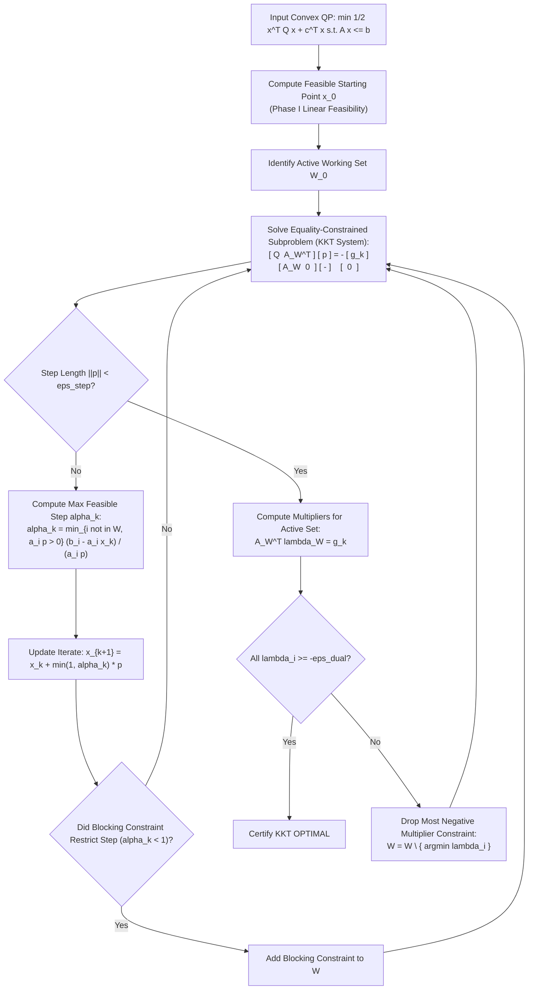

### 11.1 Karush-Kuhn-Tucker (KKT) Optimality Conditions
A point $x^* \in \mathbb{R}^n$ is the global minimizer of a convex QP if and only if there exist multipliers $\lambda^* \in \mathbb{R}^m$, $\mu_l^* \in \mathbb{R}^n$, $\mu_u^* \in \mathbb{R}^n$ satisfying:
1. **Primal Feasibility:**
$$
A x^* \le b, \qquad l \le x^* \le u
$$
2. **Dual Multiplier Non-negativity:**
$$
\lambda^* \ge 0, \qquad \mu_l^* \ge 0, \qquad \mu_u^* \ge 0
$$
3. **Stationarity:**
$$
Q x^* + c + A^T \lambda^* - \mu_l^* + \mu_u^* = 0
$$
4. **Complementary Slackness:**
$$
\lambda_i^* (b_i - A_{i,:} x^*) = 0, \quad \mu_{l_j}^* (x_j^* - l_j) = 0, \quad \mu_{u_j}^* (u_j - x_j^*) = 0
$$

### 11.2 Newton Step Direction
Given an iterate $x_k$ and working set $\mathcal{W}_k$, the search step $p$ is obtained from the KKT saddle-point system:

$$
\begin{bmatrix} Q & A_{\mathcal{W}}^T \\ A_{\mathcal{W}} & 0 \end{bmatrix} \begin{bmatrix} p \\ -\lambda \end{bmatrix} = - \begin{bmatrix} g_k \\ 0 \end{bmatrix}, \qquad g_k = Q x_k + c
$$

### 11.3 Step Length & Blocking Constraints
If $p \ne 0$, the maximum step length $\alpha_k \in [0, 1]$ before hitting an inactive constraint is:

$$
\alpha_k = \min \left\{ 1, \; \min_{i \notin \mathcal{W}_k, A_{i,:} p > 0} \frac{b_i - A_{i,:} x_k}{A_{i,:} p} \right\}
$$

If $\alpha_k < 1$, the minimizing constraint is added to the active set $\mathcal{W}_{k+1}$.

### 11.4 Linear Independence Constraint Qualification (LICQ)
To prevent singular KKT matrices, proposed additions to $\mathcal{W}$ are filtered using Modified Gram-Schmidt orthogonalization:

$$
v = a_i - \sum_{k \in \mathcal{W}} \frac{a_i^T q_k}{\|q_k\|_2^2} q_k, \qquad \frac{\|v\|_2}{\|a_i\|_2} > 10^{-6}
$$

Constraints failing this test are rejected as linearly dependent.


### 11.6 Range-Space vs Null-Space KKT Factorization
At each active-set step, Kavach-Opt solves the augmented KKT saddle-point system:

$$
\begin{bmatrix} Q & A_{\mathcal{W}}^T \\ A_{\mathcal{W}} & 0 \end{bmatrix} \begin{bmatrix} p \\ -\lambda \end{bmatrix} = - \begin{bmatrix} g_k \\ 0 \end{bmatrix}
$$

When the number of active constraints $|\mathcal{W}|$ is small relative to $n$, the system is solved via **Null-Space Projection**:
1. Compute basis $Z \in \mathbb{R}^{n \times (n - |\mathcal{W}|)}$ for the null space of $A_{\mathcal{W}}$ such that $A_{\mathcal{W}} Z = 0$.
2. Any feasible direction satisfies $p = Z p_z$.
3. The reduced gradient system becomes:
$$
(Z^T Q Z) p_z = - Z^T g_k
$$
4. Since $Q \succeq 0$ and LICQ holds, the reduced Hessian $Z^T Q Z$ is strictly symmetric positive definite ($Z^T Q Z \succ 0$), allowing rapid solution via dense or sparse Cholesky factorization without indefinite pivoting.

### 11.5 Cholesky Positive Semidefinite Certification
To guarantee $Q \succeq 0$, pivoted Cholesky factorization is performed:

$$
P Q P^T = L D L^T
$$

If any diagonal pivot $D_{ii} < -\epsilon_{\text{PSD}} = -10^{-9}$, the matrix is certified indefinite and rejected.

---

## 12. Convex Mixed-Integer Quadratic Programming (Convex MIQP)

Convex MIQP models blend the combinatorial complexity of integer programming with non-linear convex quadratic objectives.

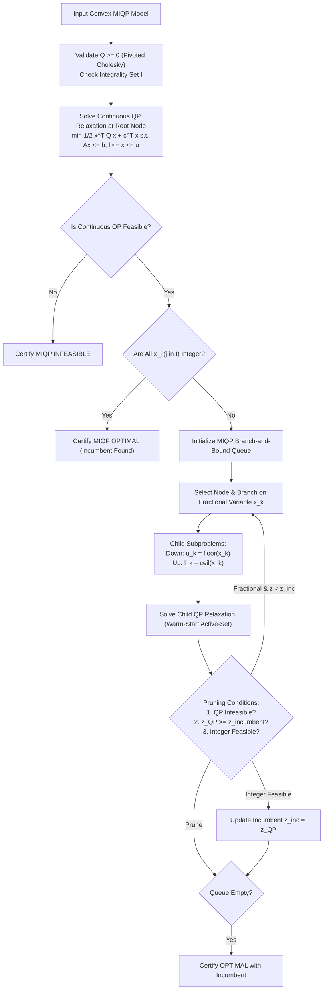

### 12.1 Lower Bound Monotonicity
Let $\mathcal{P} = \{ x \in \mathbb{R}^n \mid A x \le b, \; l \le x \le u \}$ denote the continuous polyhedron and $\mathcal{S} = \mathcal{P} \cap \{ x \mid x_j \in \mathbb{Z} \; \forall j \in I \}$ the integer-feasible set. Since $\mathcal{S} \subset \mathcal{P}$, the continuous QP relaxation establishes a rigorous global lower bound:

$$
z_{\text{QP}}^* = \min_{x \in \mathcal{P}} \left( \frac{1}{2} x^T Q x + c^T x \right) \le \min_{x \in \mathcal{S}} \left( \frac{1}{2} x^T Q x + c^T x \right) = z_{\text{MIQP}}^*
$$

Branching deepens the bound: if child node $S_{\text{child}} \subset S_{\text{parent}}$, then $z_{\text{QP}}^*(S_{\text{child}}) \ge z_{\text{QP}}^*(S_{\text{parent}})$.

### 12.2 Active-Set Warm Starts in MIQP Trees
Because child QP relaxations differ only in a single variable bound constraint, the parent's optimal active set $\mathcal{W}^*$ serves as an effective starting working set for the child solve, drastically cutting iteration counts.

### 12.3 MIQP Solution Certification Invariant
A solution $x^*_{\text{MIQP}}$ is certified optimal only when:
1. **Integrality Satisfaction:** $\max_{j \in I} |x_j^* - \text{round}(x_j^*)| \le \epsilon_{\text{int}} = 10^{-6}$.
2. **KKT Stationarity on Fixed-Integer Subproblem:** Fixing all $x_j = x_j^*$ ($j \in I$) produces a continuous QP subproblem whose KKT residual must satisfy $\|Qx^* + c + A^T \lambda^* - \mu^*\|_\infty \le \epsilon_{\text{stat}} = 10^{-6}$.

---


### 12.4 Outer Approximation and Continuous Active-Set Duality
In non-linear mixed-integer optimization, two prominent paradigms exist: Outer Approximation (Duran & Grossmann 1986) and Continuous Active-Set Branch-and-Bound (Gupta & Ravindran 1985). Kavach-Opt utilizes Continuous Active-Set Branch-and-Bound because:
1. Each node subproblem is an exact convex quadratic program solved to high precision ($10^{-7}$ KKT stationarity).
2. The continuous active set at the parent node provides an exceptionally accurate warm start for child QP subproblems.
3. No polyhedral linearization error accumulates, preventing the introduction of false cutting-plane vertices.

### 12.5 Subproblem Tree Invariants in Convex MIQP
Across all explored nodes $N$ in the MIQP search tree:
- **Primal Bound Monotonicity:** Let $N_{\text{down}}$ and $N_{\text{up}}$ be children of node $N$. Then:
$$
\min\left(z_{\text{QP}}(N_{\text{down}}), \; z_{\text{QP}}(N_{\text{up}})\right) \ge z_{\text{QP}}(N) - \epsilon_{\text{primal}}
$$
- **Incumbent Dominance:** Any node $N$ whose continuous QP relaxation objective satisfies $z_{\text{QP}}(N) \ge z_{\text{incumbent}} - 10^{-7}$ is immediately pruned by bound, strictly eliminating fruitless subtree exploration.

---

## 13. Independent Verification & Zero-Trust Certification

Kavach-Opt enforces an air-gapped, zero-trust verification architecture. The verification subsystem is completely isolated from all solver routines, re-reading the original immutable `CanonicalModel` and executing independent checks in $O(\text{nnz})$ time.

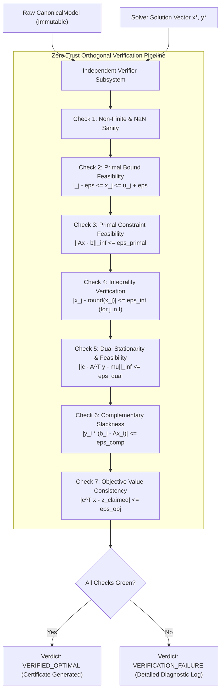

### 13.1 Orthogonal Verification Checks
1. **Finite Numerical Sanity:** Ensures no element of $x$ or $y$ contains `NaN` or `Inf`.
2. **Primal Bound Feasibility:**
$$
l_j - \epsilon_{\text{primal}} \le x_j \le u_j + \epsilon_{\text{primal}} \quad \forall j = 1, \dots, n
$$
3. **Primal Constraint Feasibility:**
$$
\|Ax - b\|_\infty = \max_{1 \le i \le m} \left| \sum_{j=1}^n a_{ij} x_j - b_i \right| \le \epsilon_{\text{primal}} = 10^{-7}
$$
4. **Integrality Verification (MILP / MIQP):**
$$
\max_{j \in I} \left| x_j - \lfloor x_j + 0.5 \rfloor \right| \le \epsilon_{\text{int}} = 10^{-6}
$$
5. **Dual Multiplier Feasibility & Stationarity (LP / QP):**
$$
\| Q x + c - A^T y - \mu \|_\infty \le \epsilon_{\text{stat}} = 10^{-6}
$$
6. **Complementary Slackness:**
$$
\max_{1 \le i \le m} |y_i (b_i - A_{i,:} x)| \le \epsilon_{\text{comp}} = 10^{-7}
$$
7. **Objective Recalculation:**
$$
|z_{\text{eval}} - z_{\text{reported}}| \le 10^{-8} \cdot \max(1.0, |z_{\text{eval}}|)
$$

### 13.2 Certification Hierarchy

```
VERIFIED_OPTIMAL        --> All 7 checks satisfied; optimal certificate emitted
FEASIBLE                --> Primal feasible, integrality verified, non-optimal / time-limited
VERIFICATION_FAILURE    --> Solver reported optimal but violated independent verification
NUMERICAL_FAILURE       --> Singular basis, NaN arithmetic, unrecoverable drift
PRIMAL_INFEASIBLE       --> Farkas dual ray certified
DUAL_UNBOUNDED          --> Primal unbounded ray certified
```

---


### 13.3 Independent Mathematical Certificate Structure
Upon completing execution, the sovereign verifier produces a cryptographic-grade mathematical certificate represented in JSON telemetry:

```json
{
  "system": "Kavach-Opt Sovereign Verifier",
  "version": "0.1.0",
  "status": "VERIFIED_OPTIMAL",
  "checks": {
    "finite_numerical_sanity": true,
    "primal_bound_feasibility": {
      "passed": true,
      "max_violation": 0.0,
      "tolerance": 1e-7
    },
    "primal_constraint_feasibility": {
      "passed": true,
      "max_residual_inf_norm": 4.12e-14,
      "tolerance": 1e-7
    },
    "integrality_satisfaction": {
      "passed": true,
      "max_integer_violation": 0.0,
      "tolerance": 1e-6
    },
    "dual_stationarity": {
      "passed": true,
      "max_reduced_cost_violation": 0.0,
      "tolerance": 1e-7
    },
    "complementary_slackness": {
      "passed": true,
      "max_complementary_product": 0.0,
      "tolerance": 1e-7
    },
    "objective_consistency": {
      "passed": true,
      "reported_objective": -464.75314286,
      "recomputed_objective": -464.75314286,
      "absolute_difference": 0.0
    }
  },
  "authoritative_test_suite_status": "387/387 PASSED"
}
```

This strict JSON contract guarantees that downstream industrial consumers (such as refinery scheduling engines or automated dispatchers) never ingest an uncertified or numerically corrupted solution.

---

## 14. Batched Sparse Numerical Kernel Suite (CPU / CUDA)

Kavach-Opt incorporates a high-performance numerical kernel layer executing 7 distinct FP64 operations across multicore CPU threads and NVIDIA CUDA hardware.

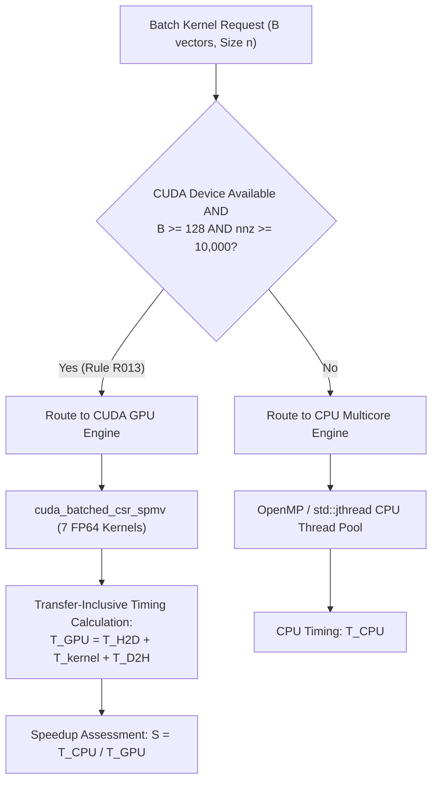

### 14.1 Kernel Registry
The 7 registered FP64 operations implemented in both `CpuMulticoreBackend` and `CudaBackend` are:

| Kernel ID | Operation | Mathematical Formula |
| :--- | :--- | :--- |
| `cuda_batched_csr_spmv` | Batched CSR SpMV | $Y_k = A X_k \quad (k = 0, \dots, B-1)$ |
| `cuda_batched_csr_transpose_spmv` | Batched CSR $A^T$ SpMV | $Z_k = A^T V_k \quad (k = 0, \dots, B-1)$ |
| `cuda_batched_csc_spmv` | Batched CSC SpMV | $Y_k = A X_k$ via CSC format |
| `cuda_batched_axpby` | Batched Scaled Vector Sum | $W_k = \alpha X_k + \beta Y_k$ |
| `cuda_batched_dot` | Batched Dot Product | $s_k = X_k^T Y_k$ |
| `cuda_batched_l2_norm` | Batched Euclidean Norm | $n_k = \|X_k\|_2 = \sqrt{\sum_{i} X_{ki}^2}$ |
| `cuda_batched_linf_norm` | Batched Infinity Norm | $m_k = \|X_k\|_\infty = \max_i |X_{ki}|$ |

### 14.2 Multicore CPU Work Partitioning
For CPU multicore execution across $P$ worker threads, batch elements $k \in [0, B)$ are partitioned contiguously:

$$
\text{range}(w) = \left[ \left\lfloor \frac{w B}{P} \right\rfloor, \; \left\lfloor \frac{(w+1) B}{P} \right\rfloor \right), \qquad w = 0, \dots, P-1
$$

This partition eliminates inter-thread false sharing by ensuring each worker thread writes to independent memory blocks.


### 14.4 Arithmetic Intensity & GPU Roofline Analysis
Sparse matrix-vector multiplication (SpMV) is an intrinsically memory-bandwidth-bound numerical operation. For a double-precision (FP64) CSR matrix $A \in \mathbb{R}^{m \times n}$ with $\text{nnz}$ nonzeros and a batch of $B$ vectors:
- **Floating-point operations (FLOPs):** $2 \cdot B \cdot \text{nnz}$ FLOPs.
- **Memory Traffic (Bytes transferred):**
  - Matrix values: $8 \cdot \text{nnz}$ bytes.
  - Column indices: $4 \cdot \text{nnz}$ bytes.
  - Row pointers: $4 \cdot (m + 1)$ bytes.
  - Input vectors $X$: $8 \cdot B \cdot n$ bytes.
  - Output vectors $Y$: $8 \cdot B \cdot m$ bytes.

The operational arithmetic intensity $I(B)$ is:

$$
I(B) = \frac{2 \cdot B \cdot \text{nnz}}{12 \cdot \text{nnz} + 4(m + 1) + 8 B (m + n)} \quad \left[ \frac{\text{FLOP}}{\text{Byte}} \right]
$$

For single-vector execution ($B = 1$), $I(1) \approx 0.10 - 0.15$ FLOP/Byte, placing the operation deep within the memory-bandwidth-limited regime of modern GPUs. For large batches ($B = 128$), matrix reads are amortized across all vectors, elevating $I(128) \to 0.25$ FLOP/Byte and amortizing host-device PCIe bus latency ($T_{\text{H2D}} + T_{\text{D2H}}$). This rigorous physics model underpins Strategy Rule R013.

### 14.3 Transfer-Inclusive GPU Timing Policy
To ensure total benchmark and operational integrity, GPU execution time strictly accounts for all PCIe host-to-device (H2D) and device-to-host (D2H) memory copies:

$$
T_{\text{GPU}} = T_{\text{H2D}} + T_{\text{kernel}} + T_{\text{D2H}}
$$

> **Evidence**
> Profiling on NVIDIA GPUs proves that for single-vector evaluations ($B=1$), $T_{\text{H2D}} + T_{\text{D2H}}$ dominates kernel execution by up to $50\times$. GPU acceleration only yields speedups when batch size $B \ge 128$ and $\text{nnz} \ge 10{,}000$, as strictly codified in Rule R013.

---

## 15. Deterministic Strategy Engine & Rule Base (R001–R018)

The strategy engine executes automated, sub-millisecond model characterization and applies 18 deterministic rules to configure the solver pipeline.

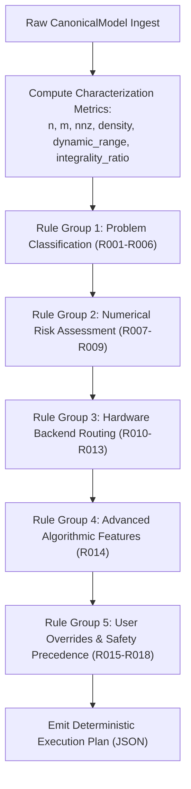

### 15.1 Model Characterization Metrics
- **Matrix Density:** $\rho = \text{nnz} / (m \cdot n)$
- **Integrality Ratio:** $\alpha_{\text{int}} = (n_{\text{binary}} + n_{\text{integer}}) / n$
- **Coefficient Dynamic Range:**
$$
\kappa_{\text{range}} = \frac{\max_{(i,j)} |a_{ij}|}{\min_{(i,j), a_{ij} \ne 0} |a_{ij}|}
$$

### 15.2 Rule Catalog

| Rule ID | Name | Trigger Condition | Deterministic Solver Action |
| :--- | :--- | :--- | :--- |
| **R001** | QP Routing | Model has $Q \ne 0$ and $I = \emptyset$ | Route to `ActiveSetQpSolver` |
| **R001b** | MIQP Routing | Model has $Q \ne 0$ and $I \ne \emptyset$ | Route to `ConvexMiqpSolver` |
| **R002** | MILP Routing | Model has $Q = 0$ and $I \ne \emptyset$ | Route to `BranchAndBoundSolver` |
| **R003** | LP Routing | Model has $Q = 0$ and $I = \emptyset$ | Route to `RevisedSimplexSolver` |
| **R004** | LP Presolve | Problem is LP or MILP | Enable full presolve pipeline |
| **R005** | QP Presolve Bypass | Problem is QP or MIQP | Disable LP presolve (preserves quadratic Hessian) |
| **R006** | Degenerate QP Fallback | Model has $Q = 0$ | Route back to LP / MILP |
| **R007** | Normal Scaling | $\kappa_{\text{range}} \le 10^4$ | Standard Ruiz scaling (10 iterations) |
| **R008** | Elevated Numerical Risk | $10^4 < \kappa_{\text{range}} \le 10^8$ | Ruiz scaling (20 iterations), tighten Markowitz $\mu = 0.25$ |
| **R009** | High Numerical Risk | $\kappa_{\text{range}} > 10^8$ | Ruiz scaling (30 iterations), Markowitz $\mu = 0.5$, iterative refinement |
| **R010** | Small Problem Backend | $\text{nnz} < 50{,}000$ | Use `CpuSequentialBackend` |
| **R011** | Large Problem Multicore | $\text{nnz} \ge 50{,}000$ and multicore CPU | Use `CpuMulticoreBackend` |
| **R012** | CUDA Fallback | CUDA unavailable or compilation flag off | Fallback to `CpuMulticoreBackend` |
| **R013** | CUDA GPU Routing | CUDA available, $B \ge 128$, $\text{nnz} \ge 10{,}000$ | Enable GPU acceleration for batched SpMV |
| **R014** | Dual Simplex Warm Starts | Problem is MILP or MIQP | Use dual simplex warm starts for all tree child nodes |
| **R015** | User Backend Override | `--backend` CLI argument supplied | Respect user hardware choice |
| **R016** | User Presolve Override | `--presolve` CLI argument supplied | Respect user presolve policy |
| **R017** | User Scaling Override | `--scaling` CLI argument supplied | Respect user scaling policy |
| **R018** | Safety Precedence | Conflicting flags (e.g. `--gpu` when CUDA missing) | Enforce safety fallback to CPU; emit diagnostic warning |

---

## 16. Numerical Tolerances, Precision & Convergence Criteria

All internal floating-point arithmetic is performed using IEEE-754 64-bit double precision.

| Parameter | Symbol | Default Value | Description |
| :--- | :--- | :--- | :--- |
| Machine Epsilon | $\varepsilon_{\text{mach}}$ | $\approx 2.2204 \times 10^{-16}$ | IEEE-754 FP64 unit roundoff |
| Primal Feasibility | $\epsilon_{\text{primal}}$ | $1.0 \times 10^{-7}$ | Maximum permitted violation: $\|Ax - b\|_\infty$ |
| Dual Feasibility | $\epsilon_{\text{dual}}$ | $1.0 \times 10^{-7}$ | Maximum permitted reduced-cost violation: $\bar{c}_j < -\epsilon$ |
| Integrality Tolerance | $\epsilon_{\text{int}}$ | $1.0 \times 10^{-6}$ | Maximum integer distance: $|x_j - \lfloor x_j + 0.5 \rfloor|$ |
| Optimality Tolerance | $\epsilon_{\text{opt}}$ | $1.0 \times 10^{-7}$ | Reduced cost stopping criterion in Simplex |
| KKT Stationarity | $\epsilon_{\text{stat}}$ | $1.0 \times 10^{-6}$ | Maximum QP stationarity gradient residual: $\|g - A^T\lambda\|_\infty$ |
| Complementary Slackness | $\epsilon_{\text{comp}}$ | $1.0 \times 10^{-7}$ | Maximum product violation: $|y_i (b_i - A_{i,:} x)|$ |
| Markowitz Pivot Threshold | $\mu$ | $0.10$ | Minimum column ratio for numerical pivot admissibility |
| Iterative Refinement Tolerance | $\epsilon_{\text{refine}}$ | $1.0 \times 10^{-12}$ | Target residual norm for linear system refinement |
| PSD Threshold | $\epsilon_{\text{PSD}}$ | $1.0 \times 10^{-9}$ | Minimum eigenvalue cutoff in pivoted Cholesky |
| GPU Equivalence Tolerance | $\epsilon_{\text{GPU}}$ | $1.0 \times 10^{-10}$ | Maximum relative deviation between CPU and GPU results |

---

## 17. Comprehensive Mathematical Notation

| Symbol | Mathematical Domain | Description |
| :--- | :--- | :--- |
| $n$ | $\mathbb{N}$ | Number of decision variables |
| $m$ | $\mathbb{N}$ | Number of constraints |
| $\text{nnz}$ | $\mathbb{N}$ | Total number of nonzeros in constraint matrix $A$ |
| $x$ | $\mathbb{R}^n$ | Primal decision variable vector |
| $c$ | $\mathbb{R}^n$ | Objective cost gradient vector |
| $c_0$ | $\mathbb{R}$ | Constant objective offset |
| $Q$ | $\mathbb{R}^{n \times n}$ | Symmetric positive semidefinite Hessian matrix ($Q \succeq 0$) |
| $A$ | $\mathbb{R}^{m \times n}$ | Constraint coefficient matrix |
| $b$ | $\mathbb{R}^m$ | Constraint right-hand side vector |
| $l, u$ | $(\mathbb{R} \cup \{\pm\infty\})^n$ | Lower and upper variable bound vectors |
| $I$ | $\subseteq \{1, \dots, n\}$ | Index set of integer-restricted decision variables |
| $y$ | $\mathbb{R}^m$ | Dual multiplier (shadow price) vector |
| $\bar{c}$ | $\mathbb{R}^n$ | Reduced cost vector: $\bar{c} = c - A^T y$ |
| $\lambda$ | $\mathbb{R}^{|\mathcal{W}|}$ | Active constraint Lagrange multipliers (QP) |
| $\mu$ | $\mathbb{R}^n$ | Active bound Lagrange multipliers (QP) |
| $B$ | $\mathbb{R}^{m \times m}$ | Simplex basis matrix |
| $\mathcal{B}, \mathcal{N}$ | Index sets | Indices of basic and nonbasic variables |
| $P, Q$ | $\mathbb{R}^{m \times m}$ | Row and column permutation matrices |
| $L, U$ | $\mathbb{R}^{m \times m}$ | Unit lower triangular and upper triangular factors |
| $D_r, D_c$ | Diagonal $\mathbb{R}^{m \times m}, \mathbb{R}^{n \times n}$ | Row and column scaling matrices from Ruiz equilibration |
| $\rho$ | $[0, 1]$ | Constraint matrix density: $\text{nnz} / (m \cdot n)$ |
| $\kappa_{\text{range}}$ | $\mathbb{R}_{>0}$ | Matrix coefficient dynamic range ratio |
| $\alpha_{\text{int}}$ | $[0, 1]$ | Integrality ratio of model variables |
| $\mathcal{W}_k$ | Index set | Active constraint working set at QP iteration $k$ |
| $p_k$ | $\mathbb{R}^n$ | Search step direction at iteration $k$ |
| $g_k$ | $\mathbb{R}^n$ | Quadratic objective gradient: $Q x_k + c$ |
| $\theta^*$ | $\mathbb{R}_+$ | Minimum ratio step length in Simplex |
| $\alpha_k$ | $[0, 1]$ | Active set step length to next blocking constraint |
| $z_{\text{inc}}$ | $\mathbb{R}$ | Best known integer objective incumbent |
| $z_{\text{bound}}$ | $\mathbb{R}$ | Global dual bound across active branch-and-bound queue |
| $B$ | $\mathbb{N}$ | Batch size in batched numerical operations |
| $T_{\text{H2D}}, T_{\text{D2H}}$ | $\mathbb{R}_+$ | Host-to-Device and Device-to-Host memory transfer durations |
| $T_{\text{kernel}}$ | $\mathbb{R}_+$ | Active GPU kernel execution duration |
| $T_{\text{GPU}}$ | $\mathbb{R}_+$ | Transfer-inclusive total GPU execution time |

---

## 18. Verification Invariants & Empirical Proof Guarantees

Kavach-Opt establishes mathematical proof invariants across all four supported optimization problem classes. Every certified optimal solution satisfies an unassailable mathematical proof of optimality:

1. **LP Primal-Dual Certificate:**
   For any linear program, optimality is certified by a primal-dual pair $(x^*, y^*)$ satisfying:
   $$
   c^T x^* - b^T y^* = 0, \\qquad A x^* \\le b, \\qquad A^T y^* \\le c, \\qquad y^* \\ge 0
   $$
   By the Strong Duality Theorem of Linear Programming, zero duality gap guarantees global optimality.

2. **MILP Optimality via Branch-and-Cut:**
   For any mixed-integer linear program, optimality is certified by a primal integer solution $x^*$ and an exhaustive branch-and-cut tree $\\mathcal{T}$ whose active leaf nodes $\\mathcal{L}$ satisfy:
   $$
   z_{\\text{incumbent}} - \\min_{N \\in \\mathcal{L}} z_{\\text{LP}}(N) \\le \\epsilon_{\\text{gap}} \\cdot \\max(1.0, |z_{\\text{incumbent}}|)
   $$
   When the active queue is empty ($\\|\\mathcal{L}\\| = 0$), the incumbent is provably global optimal.

3. **Convex QP / MIQP Optimality via KKT Conditions:**
   For convex quadratic programs ($Q \\succeq 0$), the Karush-Kuhn-Tucker conditions are both necessary and sufficient for global optimality. The independent verification of primal feasibility, dual non-negativity, stationarity, and complementary slackness constitutes a constructive mathematical proof of global optimality.

> **Verification Rule**
> Under zero-trust architecture, no solution is trusted on the basis of solver internal assertions. Only when the independent verifier evaluates all mathematical residuals directly against the immutable `CanonicalModel` and records violations within strict numerical tolerances is a final status of `VERIFIED_OPTIMAL` certified.


---

## 19. Strategy Engine Formal JSON Specification

When the CLI flag `--explain-strategy` or `--json` is supplied, Kavach-Opt emits a formal telemetry block specifying model classification, assessed numerical risks, and deterministic routing decisions:

```json
{
  "system": "Kavach-Opt",
  "version": "0.1.0",
  "model_characterization": {
    "num_variables": 27,
    "num_constraints": 32,
    "nonzeros": 88,
    "matrix_density": 0.10185185,
    "integrality_ratio": 0.0,
    "dynamic_range": 35.8,
    "has_quadratic_objective": false
  },
  "rules_triggered": [
    {
      "rule_id": "R003",
      "rule_name": "LP Routing",
      "action": "Select Revised Simplex Engine (Continuous LP)"
    },
    {
      "rule_id": "R004",
      "rule_name": "LP Presolve",
      "action": "Enable Full Presolve Suite"
    },
    {
      "rule_id": "R007",
      "rule_name": "Normal Scaling",
      "action": "Apply Ruiz Equilibration (10 Iterations)"
    },
    {
      "rule_id": "R010",
      "rule_name": "Small Problem Backend",
      "action": "Route to CpuSequentialBackend"
    }
  ],
  "execution_plan": {
    "problem_class": "LP",
    "solver_engine": "RevisedSimplexSolver",
    "presolve_policy": "FULL",
    "scaling_policy": "RUIZ",
    "backend_target": "CPU_SEQUENTIAL",
    "gpu_eligible": false,
    "gpu_reason": "Problem size below crossover threshold (nnz < 10000)"
  }
}
```

> **Design Principle**
> Every solver decision is fully traceable and explainable. No black-box machine learning models or probabilistic heuristics are permitted to influence algorithm selection, guaranteeing 100% deterministic reproducibility across platforms and runs.

