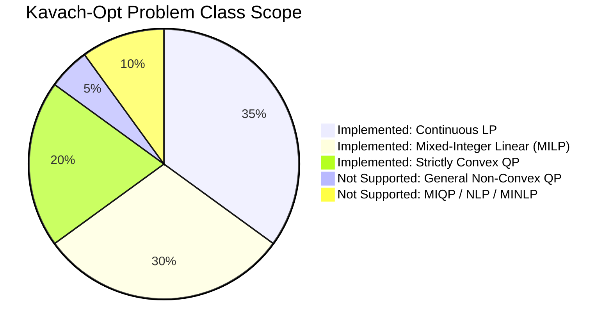

# Kavach-Opt Scope & Limitations Specification

**Project**: Kavach-Opt Sovereign Indigenous Optimization Solver Core (SIH26119)  
**Classification Date**: September 2026  
**Auditor**: Architecture Review Board  
**Target Release**: v0.1.0  

---

## 1. Purpose & Scope Boundary Principle

To ensure scientific honesty and judicial audit-readiness, this document formally demarcates what **Kavach-Opt** is engineered to solve, what remains experimental, and what is explicitly **NOT IMPLEMENTED**. Kavach-Opt does not claim universal parity with 40-year-old commercial solvers; rather, it provides a sovereign, transparent, independently verified optimization core designed for industrial and educational deployment.

---

## 2. Capability Classification

### 2.1. Implemented (Production Verified)
Capabilities fully implemented from mathematical first principles, covered by automated unit/adversarial tests, validated under ASan/UBSan, and certified by independent verification:

1. **Model Representation & Parsing**:
   - `CanonicalModel` with dense/sparse indexing, variable types (Continuous, Binary, Integer), bounds, linear constraints, and quadratic objective matrices.
   - Robust fixed-format and free-format MPS parser with bounds, ranges, and integer marker sections.
   - Native LP format parser supporting objective senses, linear constraints, and bounds.
2. **Sparse Numerics Core**:
   - CSR (Compressed Sparse Row) and CSC (Compressed Sparse Column) matrices.
   - Sparse LU factorization with Markowitz threshold pivoting for numerical stability and sparsity preservation.
   - Iterative refinement for linear systems ($Ax = b$).
   - Ruiz equilibration scaling for matrix condition improvement.
3. **Linear Programming (LP)**:
   - Two-Phase Primal Revised Simplex method.
   - Full standard presolve suite: fixed-variable elimination, empty row/column removal, singleton row bound tightening, redundant row detection, and bound propagation.
   - Exact primal reconstruction restoring presolved solutions to the original model.
   - Bland's smallest-subscript anti-cycling pivoting rule for degenerate bases.
4. **Mixed-Integer Linear Programming (MILP)**:
   - Branch-and-Bound algorithm.
   - Most-fractional variable selection branching rule.
   - Best-bound node selection queue.
   - Dual simplex warm starts accelerating child LP solves from parent bases.
   - Root-node LP presolve.
5. **Convex Quadratic Programming (QP)**:
   - Primal active-set method for strictly convex QP ($\min \frac{1}{2}x^T Q x + c^T x$ s.t. $Ax \le b$).
   - Positive Semi-Definite (PSD) Hessian validation and Cholesky/KKT-based solves.
   - Numerical KKT residual convergence checking.
6. **Independent Verification Layer**:
   - Independent mathematical certification of LP primal feasibility, dual feasibility, and complementary slackness residuals.
   - Independent MILP verification of integrality violations and constraint residuals.
   - Independent QP verification of Karush-Kuhn-Tucker (KKT) stationarity and complementarity residuals.
   - Structural invariant: A solution is labeled `OPTIMAL` if and only if independent verification returns `PASSED`.
7. **Hardware Acceleration & Execution Backends**:
   - Multicore CPU batched SpMV parallel execution engine via standard C++20 thread pool.
   - Scoped CUDA kernel for batched CSR SpMV.
   - Robust, automatic CPU fallback when CUDA hardware is absent or disabled via `--no-gpu`.
8. **Solver Intelligence & Strategy**:
   - Deterministic rule-based strategy layer (Rules `R001`–`R018`).
   - Dynamic range profiling and automated numerical risk mitigation (Bland's rule, refactorization interval clamping).
   - Machine-readable JSON decision output and step-by-step explainability.
9. **Industrial Case Study & Demonstration**:
   - MRPL-style refinery crude distillation, unit capacity, and quality blending MILP model with mass balance certification.

---

### 2.2. Experimental (Functional but Specialized)
Functionality present and tested in the codebase, but scoped to specific problem dimensions or experimental validation:

1. **Large-Scale Dense Matrix Factorization**: The solver is tuned for sparse matrices (density $\rho < 0.15$). Extremely dense constraint matrices experience higher LU factorization times.
2. **Deep Branch-and-Bound Search (> 50,000 Nodes)**: The current branch-and-bound engine is memory-bound in system RAM and does not yet spill open nodes to disk.
3. **Presolve Dual Multiplier Mapping**: While primal variables are fully reconstructed after presolve, dual multipliers on eliminated redundant constraints are not fully reconstituted, meaning dual verification is performed on the presolved formulation.

---

### 2.3. Not Implemented (Explicit Boundaries)
The following optimization paradigms and solver components are **NOT IMPLEMENTED** in Kavach-Opt. The software will reject or refuse to claim support for these problem classes:

| Capability | Status | Rationale / Behavior |
|---|:---:|---|
| **Mixed-Integer Quadratic Programming (MIQP)** | **NOT IMPLEMENTED** | Branch-and-Bound with quadratic objective relaxation is not supported. Models with both quadratic terms and integer variables are rejected. |
| **Nonlinear Programming (NLP)** | **NOT IMPLEMENTED** | General nonlinear functions (trigonometric, exponential, logarithmic) are not supported. Only linear and quadratic objective terms are permitted. |
| **Mixed-Integer Nonlinear Programming (MINLP)**| **NOT IMPLEMENTED** | Not supported. |
| **General Non-Convex QP** | **NOT IMPLEMENTED** | The active-set QP solver strictly requires a positive semi-definite (PSD) Hessian matrix $Q \succeq 0$. Non-PSD Hessians are detected and rejected. |
| **GPU Simplex Solver** | **NOT IMPLEMENTED** | The Revised Simplex algorithm executes entirely on CPU. The sequential nature of basis updates does not map efficiently to GPU architectures. |
| **GPU SparseLU Factorization** | **NOT IMPLEMENTED** | Sparse LU factorization with Markowitz pivoting executes entirely on CPU. |
| **GPU Branch-and-Bound Tree Search** | **NOT IMPLEMENTED** | Node exploration and tree management execute entirely on CPU. |
| **GPU QP Solver** | **NOT IMPLEMENTED** | Active-set QP algorithm executes on CPU. GPU is utilized solely for batched SpMV kernels. |
| **Distributed / Multi-Node Execution** | **NOT IMPLEMENTED** | Kavach-Opt runs within a single host process. MPI and cluster execution are not supported. |
| **Multi-GPU Orchestration** | **NOT IMPLEMENTED** | GPU acceleration targets a single CUDA device (Device 0). |
| **Advanced Cutting-Plane Suite** | **NOT IMPLEMENTED** | Advanced cutting planes (Gomory mixed-integer cuts, MIR, lift-and-project) are not yet integrated into the B&B loop. |
| **Machine Learning / Learned Strategy** | **NOT IMPLEMENTED** | Strategy selection is strictly deterministic and rule-based (`R001`–`R018`). No neural networks or heuristic classifiers are employed. |

---

### 2.4. Future Architectural Roadmap
Architectural extensions that fit within the clean design of Kavach-Opt for post-hackathon development:

1. **Gomory Fractional & Mixed-Integer Cuts**: Implementation of cut generators at the root node of the B&B tree.
2. **Pseudocost Branching & Strong Branching**: Historical pseudo-cost tracking for improved variable selection in large MILPs.
3. **Interior-Point (Barrier) LP/QP Solver**: Primal-dual interior point method with augmented system factorization for very large continuous problems.
4. **Multi-Period Refinery Scheduling**: Dynamic multi-time-step extension of the MRPL blending model with tankage dynamics and ship loading constraints.

---

## 3. Transparency Guarantee

Kavach-Opt will never output false claims of optimality for unsupported problem classes. Any input file containing unsupported features (e.g., non-linear functions, non-convex quadratic constraints, or integer variables in QP) will be rejected with an informative error message at parse time or strategy characterization time.
