# Kavach-Opt — Theoretical Foundations Monograph

**Document Type:** Theoretical Reference & Algorithmic Analysis  
**Engine:** Kavach-Opt Sovereign Mathematical Optimization Core  
**Release Version:** 0.1.0 (C++20 Native Engine)  
**Classification:** Exact Numerical & Combinatorial Optimization  
**Target Audience:** Optimization Theorists, Numerical Analysts, Systems Engineers, Compliance Auditors  

---

## Table of Contents

1. [Foundations of Mathematical Optimization](#1-foundations-of-mathematical-optimization)
2. [Geometry of Feasible Regions & Polyhedral Theory](#2-geometry-of-feasible-regions--polyhedral-theory)
3. [Convexity Theory & Spectral Foundations](#3-convexity-theory--spectral-foundations)
4. [Linear Duality & Infeasibility Certificates](#4-linear-duality--infeasibility-certificates)
5. [Integer Optimization & Polyhedral Combinatorics](#5-integer-optimization--polyhedral-combinatorics)
6. [Branch-and-Bound Theoretical Correctness](#6-branch-and-bound-theoretical-correctness)
7. [Cutting-Plane Validity & Separation Theory](#7-cutting-plane-validity--separation-theory)
8. [Dual Simplex Monotonicity & Warm-Starting](#8-dual-simplex-monotonicity--warm-starting)
9. [Branching Variable Selection Theory](#9-branching-variable-selection-theory)
10. [Convex Quadratic Optimization & KKT Theory](#10-convex-quadratic-optimization--kkt-theory)
11. [Active-Set Method Convergence & Degeneracy](#11-active-set-method-convergence--degeneracy)
12. [Mixed-Integer Quadratic Programming (MIQP) Theory](#12-mixed-integer-quadratic-programming-miqp-theory)
13. [Floating-Point Error Propagation & Conditioning](#13-floating-point-error-propagation--conditioning)
14. [Independent Verification & Certificate Complexity](#14-independent-verification--certificate-complexity)
15. [Deterministic Execution Theory](#15-deterministic-execution-theory)
16. [Asymptotic & Sparse Complexity Analysis](#16-asymptotic--sparse-complexity-analysis)
17. [Theoretical Guarantees vs. Practical Numerical Behavior](#17-theoretical-guarantees-vs-practical-numerical-behavior)
18. [References & Foundational Literature](#18-references--foundational-literature)

---

## 1. Foundations of Mathematical Optimization

Mathematical programming provides the formal axiomatic framework for decision-making under constrained resources. An abstract optimization problem is defined over an ambient domain $\mathcal{X} \subseteq \mathbb{R}^n$:

$$
\begin{aligned}
\min_{x \in \mathcal{X}} \quad & f(x) \\
\text{s.t.} \quad & g_i(x) \le 0, \quad i = 1, \dots, m \\
& h_k(x) = 0, \quad k = 1, \dots, p
\end{aligned}
$$

The mathematical nature of the feasible set $\Omega = \{x \in \mathcal{X} \mid g_i(x) \le 0, \, h_k(x) = 0\}$ and the objective functional $f: \mathbb{R}^n \to \mathbb{R}$ determines the tractability of finding a global minimizer $x^* \in \Omega$ such that:

$$
f(x^*) \le f(x), \quad \forall x \in \Omega
$$

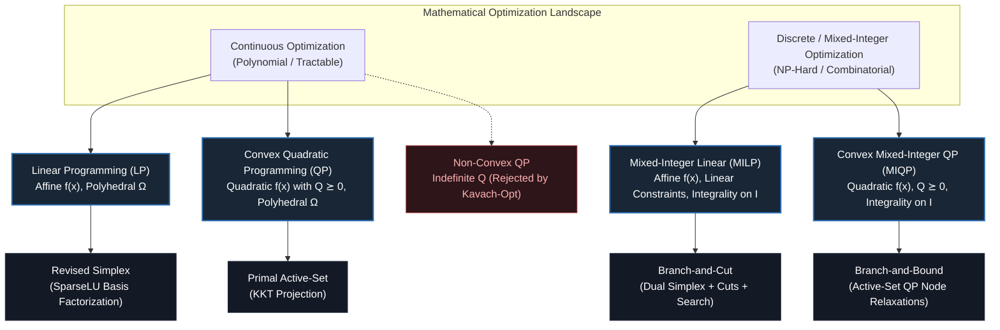

> **Design Principle: Sovereign Scope Boundary**  
> Kavach-Opt targets the intersection of convex continuous optimization and combinatorial integer optimization. It provides exact deterministic solvers for Linear Programming (LP), Mixed-Integer Linear Programming (MILP), Convex Quadratic Programming (QP), and Convex Mixed-Integer Quadratic Programming (MIQP). Non-convex quadratic problems with indefinite Hessians ($Q \not\succeq 0$) are rejected at the classification stage to guarantee that any returned solution represents a certified global optimum.

---

## 2. Geometry of Feasible Regions & Polyhedral Theory

Linear constraints define the geometric foundation of all four problem classes in Kavach-Opt.

### 2.1 Affine Spaces and Halfspaces

Let $a \in \mathbb{R}^n \setminus \{0\}$ and $b \in \mathbb{R}$. A hyperplane is an affine set of dimension $n-1$:

$$
H = \{x \in \mathbb{R}^n \mid a^T x = b\}
$$

A closed halfspace is a convex set defined by:

$$
H^- = \{x \in \mathbb{R}^n \mid a^T x \le b\}
$$

### 2.2 Polyhedra and Polytopes

A polyhedron $P \subseteq \mathbb{R}^n$ is the intersection of a finite number of closed halfspaces:

$$
P = \{x \in \mathbb{R}^n \mid Ax \le b\}
$$

where $A \in \mathbb{R}^{m \times n}$ and $b \in \mathbb{R}^m$. If $P$ is bounded (i.e., there exists $M < \infty$ such that $\|x\|_2 \le M$ for all $x \in P$), then $P$ is termed a *polytope*.

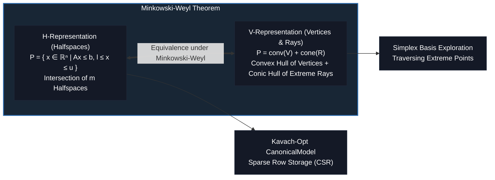

### 2.3 Faces, Facets, and Extreme Points

Let $P = \{x \in \mathbb{R}^n \mid Ax \le b\}$. An inequality $c^T x \le d$ is valid for $P$ if it is satisfied by all $x \in P$. A *face* $F$ of $P$ is any set of the form:

$$
F = P \cap \{x \in \mathbb{R}^n \mid c^T x = d\}
$$

where $c^T x \le d$ is a valid inequality for $P$.

- If $\dim(F) = 0$, $F = \{x\}$ is called an *extreme point* or *vertex* of $P$.
- If $\dim(F) = 1$, $F$ is called an *edge* of $P$.
- If $\dim(F) = \dim(P) - 1$, $F$ is called a *facet* of $P$.

> **Invariant: Fundamental Theorem of Linear Programming**  
> Let $P = \{x \in \mathbb{R}^n \mid Ax = b, \, x \ge 0\}$ be a non-empty polyhedron in standard form.
> 1. If $P$ has at least one point, it has at least one extreme point.
> 2. If the linear program $\min \{c^T x \mid x \in P\}$ has an optimal solution, it has an optimal solution that is an extreme point of $P$.
> 3. If the linear program is unbounded below, $P$ contains an extreme ray $d$ such that $Ad = 0$, $d \ge 0$, and $c^T d < 0$.

### 2.4 Algebraic Characterization of Extreme Points

In standard form, $A \in \mathbb{R}^{m \times n}$ with $\text{rank}(A) = m \le n$. A set of $m$ linearly independent columns of $A$, indexed by $B = \{j_1, \dots, j_m\}$, forms a *basis matrix* $A_B \in \mathbb{R}^{m \times m}$. The remaining columns form the non-basic matrix $A_N \in \mathbb{R}^{m \times (n-m)}$.

Partitioning $x = [x_B^T, x_N^T]^T$:

$$
A_B x_B + A_N x_N = b \implies x_B = A_B^{-1} b - A_B^{-1} A_N x_N
$$

Setting $x_N = 0$ yields the *basic solution*:

$$
x_B = A_B^{-1} b, \quad x_N = 0
$$

If $x_B \ge 0$, the basic solution is a *basic feasible solution (BFS)*. Algebraically, a vector $x \in P$ is an extreme point of $P$ if and only if it is a basic feasible solution.

### 2.5 Polyhedral Projection & Fourier-Motzkin Elimination

Presolve transformations and variable elimination in Kavach-Opt rest upon the theory of polyhedral projections. Let $P \subseteq \mathbb{R}^{n+p}$ be a polyhedron defined by:

$$
P = \{(x, y) \in \mathbb{R}^n \times \mathbb{R}^p \mid A x + G y \le b\}
$$

The projection of $P$ onto the $x$-space is:

$$
\pi_x(P) = \{x \in \mathbb{R}^n \mid \exists y \in \mathbb{R}^p \text{ s.t. } (x, y) \in P\}
$$

> **Theorem: Projection Theorem of Polyhedral Theory**  
> For any polyhedron $P \subseteq \mathbb{R}^{n+p}$, its projection $\pi_x(P)$ is a polyhedron in $\mathbb{R}^n$.
>
> *Constructive Proof via Fourier-Motzkin Elimination:* Consider eliminating a single scalar variable $y_1$ ($p = 1$). Constraints containing $y_1$ partition into three index sets:
> $$
> \begin{aligned}
> I_+ &= \{i \mid g_{i1} > 0\}: \quad y_1 \le \frac{b_i - A_{i, \cdot} x}{g_{i1}} \\
> I_- &= \{k \mid g_{k1} < 0\}: \quad y_1 \ge \frac{b_k - A_{k, \cdot} x}{g_{k1}} \\
> I_0 &= \{l \mid g_{l1} = 0\}: \quad A_{l, \cdot} x \le b_l
> \end{aligned}
> $$
> A vector $x$ admits a valid $y_1$ if and only if $\max_{k \in I_-} \frac{b_k - A_{k, \cdot} x}{g_{k1}} \le \min_{i \in I_+} \frac{b_i - A_{i, \cdot} x}{g_{i1}}$. Eliminating $y_1$ generates $|I_+| \times |I_-|$ linear inequalities:
> $$
> \frac{b_k - A_{k, \cdot} x}{g_{k1}} \le \frac{b_i - A_{i, \cdot} x}{g_{i1}}, \quad \forall i \in I_+, \; \forall k \in I_-
> $$
> Together with $A_{l, \cdot} x \le b_l$ for $l \in I_0$, this defines $\pi_x(P)$.

While unrestricted Fourier-Motzkin elimination suffers from doubly exponential inequality explosion ($O(m^{2^p})$), Kavach-Opt's presolver selectively applies singleton row/column elimination where $|I_+| \cdot |I_-| \le |I_+| + |I_-|$, guaranteeing linear non-zero complexity and exact post-solve solution reconstruction.

---

## 3. Convexity Theory & Spectral Foundations

Convexity is the defining boundary between globally tractable optimization and intractable local extrema.

### 3.1 Convex Sets and Functions

A set $C \subseteq \mathbb{R}^n$ is convex if:

$$
\forall x, y \in C, \; \forall \alpha \in [0, 1]: \quad \alpha x + (1 - \alpha) y \in C
$$

A function $f: C \to \mathbb{R}$ is convex if:

$$
f(\alpha x + (1 - \alpha) y) \le \alpha f(x) + (1 - \alpha) f(y), \quad \forall x, y \in C, \; \alpha \in [0, 1]
$$

If $f$ is twice continuously differentiable ($\mathcal{C}^2$), convexity is completely characterized by the positive semidefiniteness of its Hessian matrix:

$$
\nabla^2 f(x) \succeq 0, \quad \forall x \in C
$$

### 3.2 Quadratic Form Convexity & Spectral Decomposition

For quadratic objectives $f(x) = \frac{1}{2} x^T Q x + c^T x + c_0$ with symmetric $Q \in \mathbb{R}^{n \times n}$:

$$
\nabla f(x) = Qx + c, \quad \nabla^2 f(x) = Q
$$

By the Spectral Theorem for real symmetric matrices, there exists an orthogonal matrix $U \in \mathbb{R}^{n \times n}$ ($U^T U = I$) and a real diagonal matrix $\Lambda = \text{diag}(\lambda_1, \dots, \lambda_n)$ such that:

$$
Q = U \Lambda U^T = \sum_{i=1}^n \lambda_i u_i u_i^T
$$

where $\lambda_i \in \mathbb{R}$ are the eigenvalues of $Q$ and $u_i$ are the corresponding orthonormal eigenvectors.

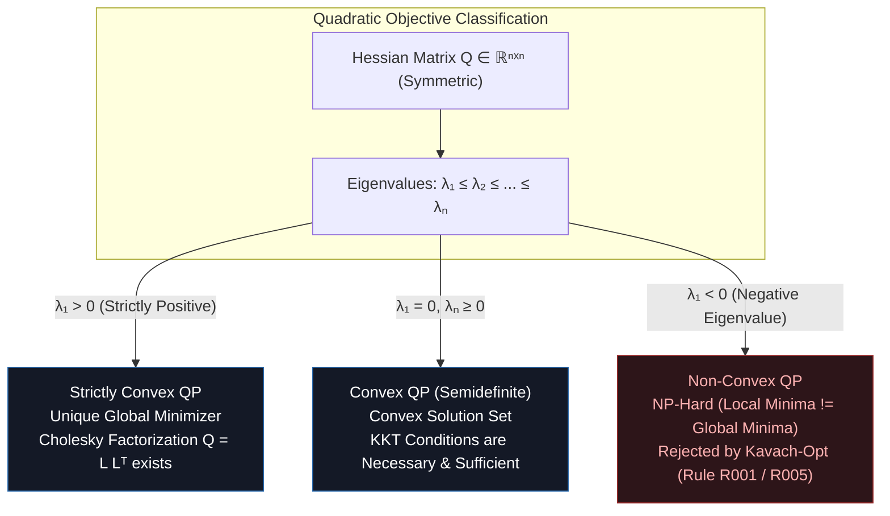

> **Invariant: Positive Semidefinite Requirement**  
> A quadratic program is convex if and only if:
> $$
> x^T Q x \ge 0, \quad \forall x \in \mathbb{R}^n \iff \lambda_{\min}(Q) \ge 0
> $$
> In Kavach-Opt, positive semidefiniteness is validated prior to active-set solve using Gershgorin circle bounds and numerical Cholesky pivot regularization. Any indefinite matrix aborts execution with `NUMERICAL_FAILURE`.

---

## 4. Linear Duality & Infeasibility Certificates

Duality provides the theoretical foundation for stopping criteria, warm starts, and infeasibility certification.

### 4.1 Canonical Duality Pairing

Consider the primal LP in canonical inequality form:

$$
\begin{aligned}
\text{(P)} \quad \min_{x \in \mathbb{R}^n} \quad & c^T x \\
\text{s.t.} \quad & A x \ge b, \quad x \ge 0
\end{aligned}
$$

The Lagrangian function associated with multipliers $y \ge 0$ is:

$$
L(x, y) = c^T x + y^T (b - Ax) = b^T y + (c - A^T y)^T x
$$

The dual function $g(y) = \inf_{x \ge 0} L(x, y)$ is finite if and only if $c - A^T y \ge 0$, in which case $g(y) = b^T y$. This yields the dual LP:

$$
\begin{aligned}
\text{(D)} \quad \max_{y \in \mathbb{R}^m} \quad & b^T y \\
\text{s.t.} \quad & A^T y \le c, \quad y \ge 0
\end{aligned}
$$

### 4.2 Strong Duality Theorem

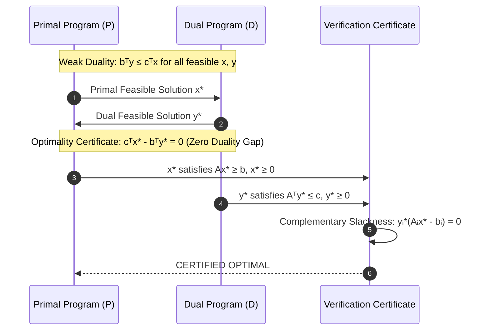

> **Theorem: Strong Duality of Linear Programming**  
> Exactly one of the following mutually exclusive cases holds:
> 1. Both (P) and (D) are feasible; both possess optimal solutions $x^*$ and $y^*$, and their optimal objective values coincide:
>    $$c^T x^* = b^T y^*$$
> 2. (P) is unbounded below ($-\infty$), in which case (D) is infeasible.
> 3. (D) is unbounded above ($+\infty$), in which case (P) is infeasible.
> 4. Both (P) and (D) are infeasible.

### 4.3 Complementary Slackness

Let $x$ be primal feasible and $y$ be dual feasible. The duality gap is:

$$
c^T x - b^T y = c^T x - y^T (Ax - s) = (c - A^T y)^T x + y^T s
$$

where $s = Ax - b \ge 0$ is the primal slack vector and $r = c - A^T y \ge 0$ is the dual slack (reduced cost) vector. Since $x \ge 0$, $y \ge 0$, $s \ge 0$, and $r \ge 0$, each term is non-negative:

$$
c^T x - b^T y = \sum_{j=1}^n r_j x_j + \sum_{i=1}^m y_i s_i \ge 0
$$

Thus, $c^T x = b^T y$ if and only if every term vanishes independently:

$$
\begin{aligned}
x_j (c_j - A_{\cdot, j}^T y) = 0, \quad & \forall j = 1, \dots, n \\
y_i (A_{i, \cdot} x - b_i) = 0, \quad & \forall i = 1, \dots, m
\end{aligned}
$$

### 4.4 Farkas' Lemma and Infeasibility Proofs

When a problem is infeasible, Kavach-Opt does not merely report termination; it relies on Farkas' Lemma to establish the mathematical impossibility of feasibility.

> **Lemma: Farkas' Lemma (Variant for $Ax = b, x \ge 0$)**  
> Exactly one of the following two systems has a solution:
> 1. $\exists x \in \mathbb{R}^n: Ax = b, \; x \ge 0$
> 2. $\exists y \in \mathbb{R}^m: A^T y \le 0, \; b^T y > 0$

In Phase I of the Revised Simplex algorithm, if the artificial sum of infeasibilities $\sum v_i > \epsilon_{\text{primal}}$ at termination, the final dual vector $y$ satisfies $A^T y \le 0$ and $b^T y > 0$, forming an unforgeable algebraic certificate of primal infeasibility.

### 4.5 Geometric Interpretation of Farkas Rays & Infeasibility Certificates

Geometrically, Farkas' Lemma states that if a point $b \in \mathbb{R}^m$ does not lie within the finitely generated convex polyhedral cone:

$$
K = \text{cone}(A) = \{Ax \mid x \ge 0\}
$$

then by the Strict Hyperplane Separation Theorem, there exists a separating hyperplane defined by normal vector $y \in \mathbb{R}^m$ such that:

$$
y^T v \le 0, \quad \forall v \in K \quad \text{and} \quad y^T b > 0
$$

Since every column $A_{\cdot, j} \in K$, setting $v = A_{\cdot, j}$ yields $y^T A_{\cdot, j} \le 0$ for all $j=1, \dots, n$, which is equivalent to $A^T y \le 0$. Meanwhile, the inner product $b^T y > 0$ strictly separates the target vector $b$ from the entire cone of achievable constraint activities.

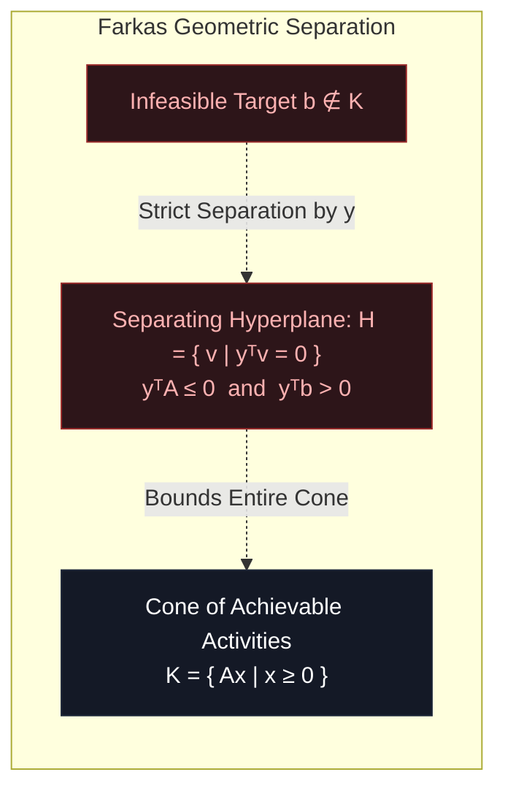

> **Verification Rule: Independent Infeasibility Certification**  
> In Kavach-Opt, whenever a model terminates with status `INFEASIBLE`, the independent verifier does not trust the simplex status flag. It explicitly validates the Farkas certificate vector $y$ by directly recomputing:
> 1. Maximum dual feasibility violation: $\max_j (A^T y)_j \le \epsilon_{\text{dual}}$
> 2. Strict separating projection: $b^T y \ge \epsilon_{\text{primal}}$
> If both inequalities hold, primal infeasibility is mathematically certified.

---

## 5. Integer Optimization & Polyhedral Combinatorics

Mixed-Integer Linear Programs introduce non-convex combinatorial complexity by restricting a subset of variables to the integer lattice $\mathbb{Z}$.

### 5.1 Formulation and Relaxation

The mixed-integer feasible set is:

$$
S = \{x \in \mathbb{R}^n \mid Ax \le b, \; l \le x \le u, \; x_j \in \mathbb{Z} \; \forall j \in I\}
$$

The continuous LP relaxation drops the integrality restriction:

$$
P = \{x \in \mathbb{R}^n \mid Ax \le b, \; l \le x \le u\}
$$

Clearly, $S \subseteq P$. The *integer convex hull* is defined as:

$$
P_I = \text{conv}(S)
$$

### 5.2 The Integrality Gap

Let $z_{\text{IP}} = \min \{c^T x \mid x \in S\}$ and $z_{\text{LP}} = \min \{c^T x \mid x \in P\}$. For a minimization problem:

$$
z_{\text{LP}} \le z_{\text{IP}}
$$

The quantity $z_{\text{IP}} - z_{\text{LP}} \ge 0$ is the *integrality gap*. The goal of cutting planes and presolve reductions is to tighten $P$ toward $P_I$, closing this gap at the root node before branching.

### 5.3 Chvátal-Gomory Closure and Chvátal Rank

Let $P = \{x \in \mathbb{R}^n \mid Ax \le b\}$ be a rational polyhedron. For any multiplier vector $u \ge 0$ such that $u^T A \in \mathbb{Z}^n$, the linear inequality $u^T A x \le u^T b$ is valid for $P$. Since $x \in \mathbb{Z}^n$ implies $u^T A x \in \mathbb{Z}$, the strengthened inequality:

$$
u^T A x \le \lfloor u^T b \rfloor
$$

is valid for $P_I = \text{conv}(P \cap \mathbb{Z}^n)$.

The *elementary Chvátal-Gomory closure* of $P$, denoted $P^{(1)}$, is the intersection of all such valid rounded halfspaces:

$$
P^{(1)} = \bigcap_{u \ge 0, \, u^T A \in \mathbb{Z}^n} \{x \in \mathbb{R}^n \mid u^T A x \le \lfloor u^T b \rfloor\}
$$

Iterating this closure yields the higher-order Chvátal closures:

$$
P^{(0)} = P, \quad P^{(k+1)} = (P^{(k)})^{(1)}, \quad \forall k \ge 0
$$

> **Theorem: Schrijver-Chvátal Finite Rank Theorem (1980)**  
> If $P$ is a rational polyhedron, then:
> 1. Each closure $P^{(k)}$ is itself a rational polyhedron.
> 2. There exists a finite integer $k^* < \infty$ such that:
>    $$P^{(k^*)} = P_I$$
> The smallest such integer $k^*$ is called the *Chvátal rank* of $P$.

In practical branch-and-cut engines such as Kavach-Opt, computing higher-order closures $P^{(k)}$ ($k \ge 2$) is computationally intractable. Instead, the solver generates first-order Gomory Mixed-Integer (GMI) and Mixed-Integer Rounding (MIR) cuts at the root node, performing a bounded number of separation rounds (typically $T \le 5$) until tail-off occurs (objective improvement $< 10^{-4}$).

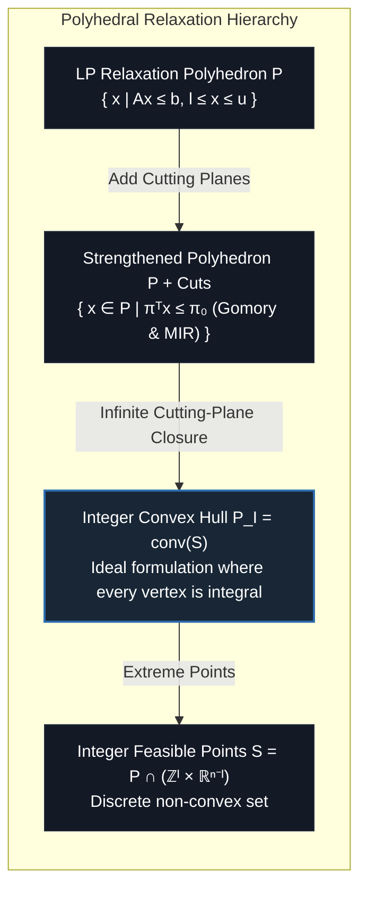

> **Fundamental Principle of Polyhedral Combinatorics**  
> By the Meyer Theorem (1974), if $A$ and $b$ are rational, the integer hull $P_I = \text{conv}(S)$ is itself a rational polyhedron. Therefore, solving a MILP is theoretically equivalent to solving an LP over $P_I$. However, describing the facets of $P_I$ requires exponentially many linear inequalities in general (NP-hard).

### 5.2 The Integrality Gap

Let $z_{\text{IP}} = \min \{c^T x \mid x \in S\}$ and $z_{\text{LP}} = \min \{c^T x \mid x \in P\}$. For a minimization problem:

$$
z_{\text{LP}} \le z_{\text{IP}}
$$

The quantity $z_{\text{IP}} - z_{\text{LP}} \ge 0$ is the *integrality gap*. The goal of cutting planes and presolve reductions is to tighten $P$ toward $P_I$, closing this gap at the root node before branching.

---

## 6. Branch-and-Bound Theoretical Correctness

Branch-and-Bound is a divide-and-conquer strategy that partitions the feasible set $S$ into subproblems whose LP relaxations provide monotonically non-decreasing lower bounds.

### 6.1 Partitioning Principle

Let $S_0 = S$. At any node $k$ in the search tree, let $S_k$ denote the restricted feasible set. If an optimal solution $x^{*, k}$ of the LP relaxation $\min \{c^T x \mid x \in P_k\}$ is fractional on some integer variable $j \in I$ ($x_j^{*, k} \notin \mathbb{Z}$), $S_k$ is partitioned into two disjoint subsets:

$$
S_{k, \text{down}} = S_k \cap \{x \mid x_j \le \lfloor x_j^{*, k} \rfloor\}, \quad S_{k, \text{up}} = S_k \cap \{x \mid x_j \ge \lceil x_j^{*, k} \rceil\}
$$

Since any integer solution must satisfy either $x_j \le \lfloor x_j^{*, k} \rfloor$ or $x_j \ge \lceil x_j^{*, k} \rceil$:

$$
S_k = S_{k, \text{down}} \cup S_{k, \text{up}}, \quad S_{k, \text{down}} \cap S_{k, \text{up}} = \emptyset
$$

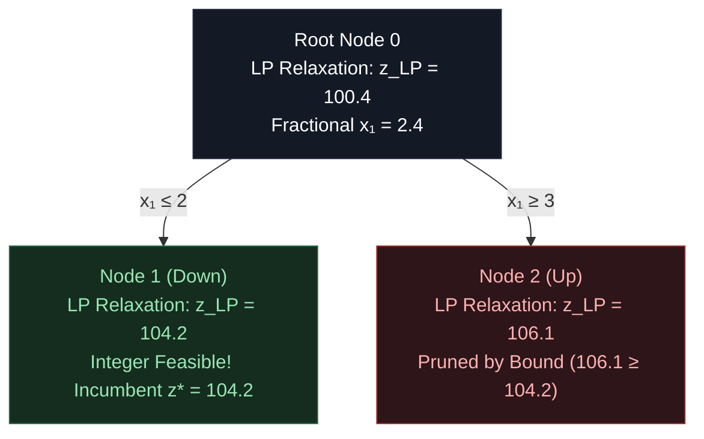

### 6.2 Pruning Criteria

A subproblem node $k$ is pruned (fathomed) if and only if one of three mathematically sound conditions occurs:

1. **Pruning by Infeasibility:** The relaxation feasible set is empty:
   $$P_k = \emptyset \implies S_k = \emptyset$$
2. **Pruning by Optimality:** The LP relaxation solution $x^{*, k}$ satisfies all integrality constraints:
   $$x_j^{*, k} \in \mathbb{Z}, \; \forall j \in I \implies x^{*, k} \in S_k$$
   In this case, $x^{*, k}$ is a candidate for the global incumbent $\bar{x}$, updating the upper bound:
   $$\bar{z} \leftarrow \min(\bar{z}, c^T x^{*, k})$$
3. **Pruning by Bound:** The LP relaxation lower bound meets or exceeds the current incumbent upper bound:
   $$z_{\text{LP}}(k) \ge \bar{z} - \epsilon_{\text{tol}}$$
   Since the relaxation objective provides a valid lower bound for all solutions in $S_k$, no solution in $S_k$ can strictly improve upon $\bar{z}$.

### 6.3 Convergence and Termination Proof

> **Theorem: Finite Termination of Branch-and-Bound**  
> Assume the continuous bounds $l \le x \le u$ are finite for all integer variables $j \in I$. Then the Branch-and-Bound algorithm terminates in a finite number of steps with either:
> 1. A certified global optimal solution $x^*$ such that $c^T x^* = \bar{z}$.
> 2. A proof of infeasibility ($S = \emptyset$) if $\bar{z} = +\infty$ and all nodes are fathomed.
>
> *Proof Sketch:* The number of integer lattice vectors in $\prod_{j \in I} [l_j, u_j]$ is finite:
> $$N_I = \prod_{j \in I} (\lfloor u_j \rfloor - \lceil l_j \rceil + 1) < \infty$$
> Because each branching step strictly shrinks the integer box $[\lfloor l_j \rfloor, \lceil u_j \rceil]$ on at least one coordinate, no subproblem can be partitioned infinitely without either discovering an integer point or becoming infeasible. Hence, the search tree is a finite binary tree of depth at most $\sum_{j \in I} (\lfloor u_j \rfloor - \lceil l_j \rceil)$. $\blacksquare$

---

## 7. Cutting-Plane Validity & Separation Theory

A cutting plane is a valid inequality for $P_I = \text{conv}(S)$ that separates the current fractional LP relaxation solution $x^* \in P \setminus P_I$.

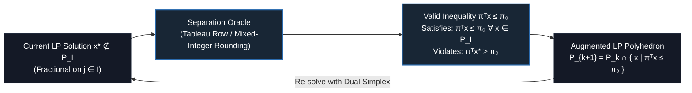

### 7.1 Gomory Mixed-Integer (GMI) Cuts

Consider a simplex tableau row corresponding to basic integer variable $x_i$ ($i \in I$):

$$
x_i + \sum_{j \in N} \bar{a}_{ij} x_j = \bar{b}_i
$$

where $\bar{b}_i \notin \mathbb{Z}$, with fractional part $f_0 = \bar{b}_i - \lfloor \bar{b}_i \rfloor \in (0, 1)$. For each non-basic variable $j \in N$, let $f_j = \bar{a}_{ij} - \lfloor \bar{a}_{ij} \rfloor$.

Partition the non-basic variables into integer indices $N_I = N \cap I$ and continuous indices $N_C = N \setminus I$. The Gomory mixed-integer cut is:

$$
\sum_{j \in N_I: f_j \le f_0} f_j x_j + \sum_{j \in N_I: f_j > f_0} \frac{f_0 (1 - f_j)}{1 - f_0} x_j + \sum_{j \in N_C: \bar{a}_{ij} \ge 0} \bar{a}_{ij} x_j + \sum_{j \in N_C: \bar{a}_{ij} < 0} \frac{f_0 (-\bar{a}_{ij})}{1 - f_0} x_j \ge f_0
$$

> **Theorem: Validity of Gomory Mixed-Integer Cut**  
> The GMI cut is satisfied by every integer feasible point $x \in S$, but is strictly violated by the current basic solution $x^*$ (where $x_N^* = 0$, leading to $0 \ge f_0 > 0$, a contradiction).

### 7.2 Mixed-Integer Rounding (MIR) Cuts

Let $X = \{(x, y) \in \mathbb{Z} \times \mathbb{R}_+ \mid x + y \ge b\}$. For any $b \in \mathbb{R}$, let $f = b - \lfloor b \rfloor$. If $f > 0$, the inequality:

$$
x + \frac{y}{1 - f} \ge \lceil b \rceil
$$

is valid for $X$.

Generalizing to multi-variable mixed-integer linear sets $X = \{(x, y) \in \mathbb{Z}^n \times \mathbb{R}_+^p \mid \sum a_j x_j + \sum g_k y_k \le b\}$, the MIR function $F_\alpha(a) = \lfloor a \rfloor + \frac{\max(0, a - \lfloor a \rfloor - (1 - f))}{f}$ generates valid cutting planes for any base row $\alpha$. In Kavach-Opt, MIR cuts are scaled and normalized by their Euclidean norm $\|\pi\|_2$ to prevent catastrophic loss of numerical significance.

### 7.3 Separation Complexity & Polynomial Equivalence

The fundamental connection between optimization and cutting planes was formalized by Grötschel, Lovász, and Schrijver (1981) using the Ellipsoid method.

> **Theorem: Equivalence of Optimization and Separation (GLS 1981)**  
> For any family of polyhedra $\mathcal{P}$, the optimization problem:
> $$
> \min \{c^T x \mid x \in P\}
> $$
> can be solved in polynomial time if and only if the *separation problem*:
> $$
> \text{Given } x^* \in \mathbb{Q}^n, \text{ decide whether } x^* \in P, \text{ and if not, find } \pi \in \mathbb{Q}^n, \pi_0 \in \mathbb{Q} \text{ such that } \pi^T x \le \pi_0 \; \forall x \in P \text{ and } \pi^T x^* > \pi_0
> $$
> can be solved in polynomial time.

For mixed-integer programming, because optimizing over $P_I$ is NP-hard, the exact separation problem over $P_I$ is also NP-hard. Consequently, practical branch-and-cut solvers use polynomial-time heuristic separation or restricted families of valid inequalities (such as tableau-based GMI cuts and aggregated MIR inequalities) rather than searching for arbitrary facet-defining cuts.

---

## 8. Dual Simplex Monotonicity & Warm-Starting

The integration of cutting planes or bound changes in Branch-and-Bound perturbs the primal right-hand side while preserving dual feasibility. This property makes the Dual Simplex method fundamental to branch-and-cut efficiency.

### 8.1 Dual Feasibility Preservation

In standard form, a basis $B$ is dual feasible if all reduced costs are non-negative:

$$
r_N = c_N - A_N^T A_B^{-T} c_B \ge 0
$$

When a child node is created by branching on $x_j \le \lfloor x_j^* \rfloor$, an inequality constraint is appended:

$$
x_j + s_{\text{new}} = \lfloor x_j^* \rfloor, \quad s_{\text{new}} \ge 0
$$

Because the objective vector $c$ is unchanged, the parent basis matrix $B$ can be trivially extended to:

$$
\tilde{B} = \begin{bmatrix} B & 0 \\ e_j^T & 1 \end{bmatrix}
$$

The inverse basis updates with zero fill-in:

$$
\tilde{B}^{-1} = \begin{bmatrix} B^{-1} & 0 \\ -e_j^T B^{-1} & 1 \end{bmatrix}
$$

The updated reduced costs satisfy $\tilde{r}_N = r_N \ge 0$. Thus, **dual feasibility is identically preserved**.

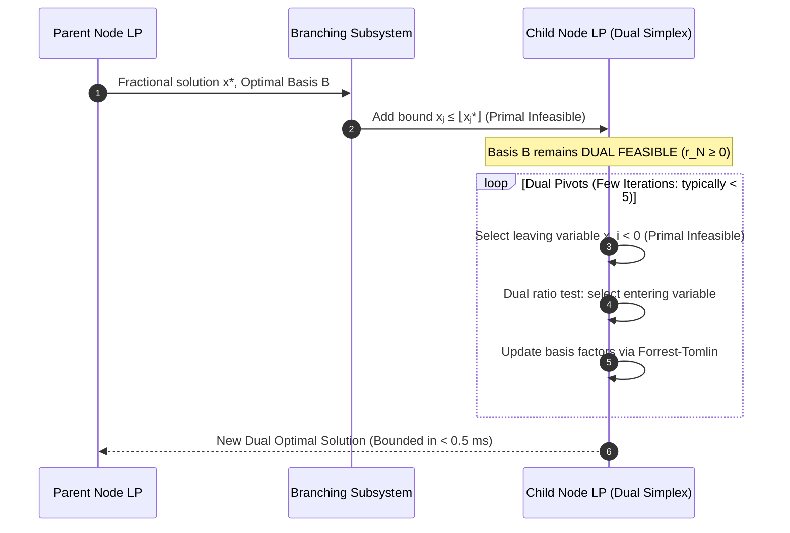

> **Invariant: Dual Simplex Objective Monotonicity**  
> Let $z_{\text{dual}} = b^T y$ denote the dual objective value. Under non-degenerate dual simplex pivots, every pivot monotonically increases (or maintains) the dual objective:
> $$b^T y^{(k+1)} \ge b^T y^{(k)}$$
> Consequently, the lower bound at any child node is guaranteed to be greater than or equal to the lower bound of its parent node: $z_{\text{child}} \ge z_{\text{parent}}$.

### 8.2 The Dual Ratio Test and Anti-Degeneracy

At each dual iteration, a primal basic variable $x_{B(p)} < -\epsilon_{\text{primal}}$ is chosen to leave the basis. Let row $p$ of the current basis inverse be $v^T = e_p^T A_B^{-1}$. The tableau pivot row coefficients are:

$$
\alpha_{pj} = v^T A_{\cdot, j}, \quad \forall j \in N
$$

To preserve dual feasibility $\tilde{r}_j = r_j - \theta \alpha_{pj} \ge 0$, the maximum allowable dual step length is:

$$
\theta = \min_{j \in N: \alpha_{pj} < 0} \frac{r_j}{-\alpha_{pj}}
$$

The entering non-basic variable $q$ attains this minimum. When multiple variables tie for the minimum ratio $\theta$, Bland's smallest-subscript rule breaks the tie deterministically, algebraically ruling out dual cycling.

### 8.3 Basis Inverse Representation: PFI vs. Forrest-Tomlin Updating

Repeatedly refactorizing the basis matrix $A_B = L U$ costs $O(m \cdot \text{nnz} + \text{fill})$ operations. During dual simplex iterations, replacing column $p$ with non-basic column $a_q$ produces a rank-one update:

$$
A_{\bar{B}} = A_B + (a_q - A_{\cdot, B(p)}) e_p^T
$$

In Kavach-Opt, updating is managed via:
1. **Product Form of the Inverse (PFI):** Maintaining elementary Frobenius matrices $E_k = I + (\eta_k - e_p) e_p^T$ such that $A_{B_k}^{-1} = E_k E_{k-1} \dots E_1 A_{B_0}^{-1}$.
2. **Forrest-Tomlin Row Permutation:** Permuting row $p$ of the upper triangular factor $U$ to the bottom position $m$, transforming the spike into an upper Hessenberg matrix, and eliminating subdiagonal fill-in with elementary row rotations.

To prevent numerical drift and growth in $\eta$-vector length, Rule R007 triggers a complete `SparseLU` Markowitz refactorization every 50 simplex pivots (or every 10 pivots under high numerical risk Rule R009).

The choice of which fractional variable $x_j$ to branch on fundamentally alters the size of the search tree.

### 9.1 Branching Score Functions

Let $\Delta z_j^-$ and $\Delta z_j^+$ denote the objective degradation (increase in minimization) incurred by branching down ($x_j \le \lfloor x_j^* \rfloor$) and up ($x_j \ge \lceil x_j^* \rceil$), respectively. To balance the search tree and maximize the bound increase, Kavach-Opt combines both directions using the product score function (Achterberg, 2005):

$$
\text{score}(\Delta z_j^-, \Delta z_j^+) = \max(\Delta z_j^-, \epsilon) \cdot \max(\Delta z_j^+, \epsilon)
$$

where $\epsilon = 10^{-6}$ prevents zero-multiplication degeneracies.

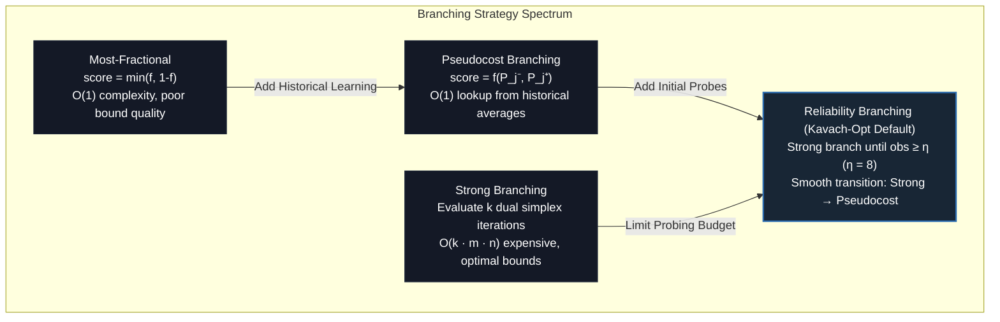

### 9.2 Pseudocost Theory

Pseudocosts estimate the per-unit change in objective value when forcing variable $j$ to integral values. Let $f_j = x_j^* - \lfloor x_j^* \rfloor$. For down-branching and up-branching:

$$
P_j^- = \frac{\Delta z_j^-}{f_j}, \quad P_j^+ = \frac{\Delta z_j^+}{1 - f_j}
$$

Whenever a node LP is solved to completion, the observed per-unit degradation updates the running arithmetic mean:

$$
\bar{P}_j^- \leftarrow \frac{N_j^- \bar{P}_j^- + P_{j, \text{new}}^-}{N_j^- + 1}, \quad N_j^- \leftarrow N_j^- + 1
$$

### 9.3 Reliability Branching

When $N_j^- < \eta$ or $N_j^+ < \eta$ (where $\eta = 8$ is the reliability threshold in Kavach-Opt), pseudocost estimates are deemed statistically unverified. The algorithm initiates *strong branching probes*—tentatively solving child LPs with limited dual simplex pivots—to obtain exact values for $\Delta z_j^-$ and $\Delta z_j^+$. Once $N_j \ge \eta$, the variable becomes reliable and strong branching is bypassed, achieving near-optimal bound quality at $O(1)$ amortized cost per node.

---

## 10. Convex Quadratic Optimization & KKT Theory

Convex Quadratic Programming generalizes linear programming to quadratic cost functionals over polyhedral constraints.

### 10.1 The General Convex QP Formulation

$$
\begin{aligned}
\min_{x \in \mathbb{R}^n} \quad & q(x) = \frac{1}{2} x^T Q x + c^T x + c_0 \\
\text{s.t.} \quad & A x \le b
\end{aligned}
$$

where $Q \in \mathbb{R}^{n \times n}$ is symmetric positive semidefinite ($Q \succeq 0$), $A \in \mathbb{R}^{m \times n}$, and $b \in \mathbb{R}^m$.

### 10.2 Karush-Kuhn-Tucker (KKT) Optimality Conditions

Because the objective is convex and the constraints are linear (satisfying the Abadie constraint qualification automatically), the KKT conditions are both **necessary and sufficient** for global optimality.

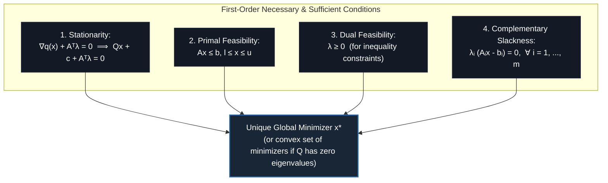

### 10.3 Strong Duality & Slater's Condition for Quadratic Programs

The Lagrangian dual of the convex quadratic program $\min \{\frac{1}{2} x^T Q x + c^T x \mid Ax \le b\}$ is given by Wolfe's dual formulation:

$$
\begin{aligned}
\max_{x \in \mathbb{R}^n, \, \lambda \in \mathbb{R}^m} \quad & -\frac{1}{2} x^T Q x + b^T \lambda \\
\text{s.t.} \quad & Q x + c + A^T \lambda = 0 \\
& \lambda \ge 0
\end{aligned}
$$

When $Q \succ 0$ is strictly positive definite, $x = -Q^{-1} (c + A^T \lambda)$ can be eliminated analytically, yielding the explicit unconstrained concave dual:

$$
\max_{\lambda \ge 0} \quad -\frac{1}{2} (c + A^T \lambda)^T Q^{-1} (c + A^T \lambda) + b^T \lambda
$$

> **Theorem: Quadratic Strong Duality**  
> If the primal convex QP has a feasible solution (Slater's condition holds trivially for polyhedra as long as $P \ne \emptyset$), then the dual QP has an optimal solution, strong duality holds with zero duality gap:
> $$
> q(x^*) = d(x^*, \lambda^*)
> $$
> and any primal-dual pair satisfying the KKT conditions provides mutual, unforgeable certificates of global optimality.

---

## 11. Active-Set Method Convergence & Degeneracy

Kavach-Opt uses a Primal Active-Set method to solve convex QPs.

### 11.1 The Working Set

At iteration $k$, the *working set* $\mathcal{W}_k \subseteq \{1, \dots, m\}$ is a linearly independent subset of active constraints treated as equalities:

$$
A_{\mathcal{W}_k} x = b_{\mathcal{W}_k}
$$

The step $p = x - x_k$ is computed by solving the equality-constrained quadratic subproblem:

$$
\begin{aligned}
\min_{p \in \mathbb{R}^n} \quad & \frac{1}{2} p^T Q p + g_k^T p \\
\text{s.t.} \quad & A_{\mathcal{W}_k} p = 0
\end{aligned}
$$

where $g_k = Q x_k + c$ is the current gradient.

### 11.2 The KKT System of the Equality Subproblem

The stationarity condition for the subproblem yields the linear block system:

$$
\begin{bmatrix} Q & A_{\mathcal{W}_k}^T \\ A_{\mathcal{W}_k} & 0 \end{bmatrix} \begin{bmatrix} p \\ \mu \end{bmatrix} = \begin{bmatrix} -g_k \\ 0 \end{bmatrix}
$$

where $\mu$ represents the Lagrange multipliers of the working set constraints.

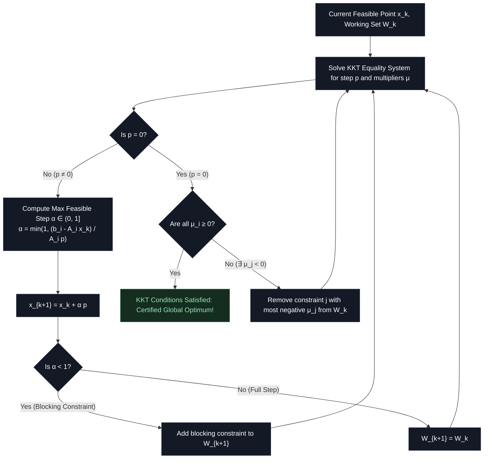

### 11.3 Finite Termination Guarantee

> **Theorem: Finite Termination of Primal Active-Set Method**  
> If the QP is strictly convex ($Q \succ 0$) and all basic feasible points are non-degenerate (every step length $\alpha > 0$), the active-set method terminates in a finite number of iterations with the unique global minimizer $x^*$.
>
> *Proof Sketch:* There are only finitely many subsets of constraints $\mathcal{W} \subseteq \{1, \dots, m\}$. When $p \ne 0$, the objective strictly decreases: $q(x_{k+1}) < q(x_k)$. Because the objective strictly decreases at every step that changes $x$, no working set $\mathcal{W}$ can be visited more than once with a distinct solution $x$. When $p = 0$ and some $\mu_j < 0$, dropping constraint $j$ yields a descent direction on the next step. Hence, cycling is impossible under non-degeneracy, ensuring finite termination. $\blacksquare$

### 11.4 Degeneracy, Stalling, and Numerical Regularization

Primal degeneracy occurs in convex QP when more than $n$ constraints are active at a single vertex $x_k$, or when a blocking constraint coincides with the current position ($b_i - A_{i, \cdot} x_k = 0$), forcing the step length $\alpha = 0$.

Under degenerate steps ($\alpha = 0$), the working set changes without changing the geometric point $x_{k+1} = x_k$. If an indefinite cycle of constraint additions and removals occurs, the solver would stall. Kavach-Opt prevents cycling in the active-set solver through three safeguards:
1. **Deterministic Tie-Breaking:** When multiple blocking constraints yield the identical step length $\alpha$, the constraint with the smallest numerical index is selected.
2. **Strict Multiplier Thresholding:** A constraint is eligible for deletion from $\mathcal{W}_k$ only if its multiplier $\mu_j < -\epsilon_{\text{optimality}}$ (where $\epsilon_{\text{optimality}} = 10^{-7}$), preventing jitter around zero.
3. **Diagonal Regularization (Tikhonov Shift):** If numerical near-singularity occurs in the reduced Hessian $Z^T Q Z$, a defensive perturbation $Q_\epsilon = Q + 10^{-12} I$ is applied, ensuring positive definiteness and strictly positive step lengths.

---

## 12. Mixed-Integer Quadratic Programming (MIQP) Theory

Convex MIQP combines a convex quadratic objective with combinatorial integer restrictions.

### 12.1 Mathematical Formulation

$$
\begin{aligned}
\min_{x \in \mathbb{R}^n} \quad & \frac{1}{2} x^T Q x + c^T x + c_0 \\
\text{s.t.} \quad & A x \le b, \quad l \le x \le u, \quad x_j \in \mathbb{Z} \; \forall j \in I
\end{aligned}
$$

where $Q \succeq 0$.

### 12.2 QP Relaxation Bounds and Monotonicity

At each node $k$ of the MIQP search tree, the node relaxation is a continuous convex QP:

$$
z_{\text{QP}}(k) = \min_{x \in P_k} \left\{ \frac{1}{2} x^T Q x + c^T x + c_0 \right\}
$$

Because $S_k \subset P_k$, $z_{\text{QP}}(k) \le \min_{x \in S_k} q(x)$.

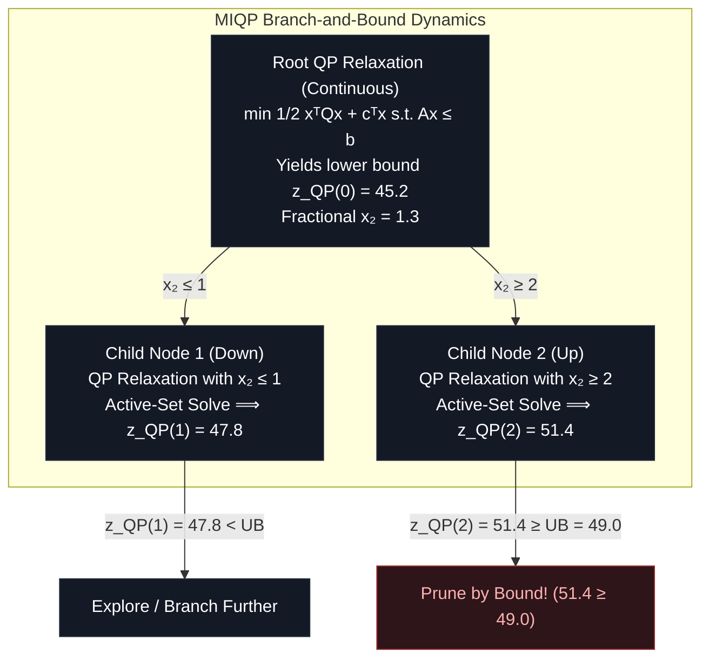

> **Invariant: Quadratic Bound Monotonicity**  
> Because the feasible region contracts monotonically down the tree ($P_{\text{child}} \subset P_{\text{parent}}$), the minimum of a convex quadratic function over $P_{\text{child}}$ cannot decrease:
> $$z_{\text{QP}}(\text{child}) \ge z_{\text{QP}}(\text{parent})$$
> This guarantees the validity of bound pruning in MIQP branch-and-bound.

---

## 13. Floating-Point Error Propagation & Conditioning

Kavach-Opt operates entirely within the IEEE-754 binary64 (double-precision) floating-point arithmetic standard, where machine epsilon $\epsilon_{\text{mach}} = 2^{-52} \approx 2.2204 \times 10^{-16}$.

### 13.1 Condition Number and Loss of Significance

The numerical sensitivity of solving a linear system $B x = b$ is governed by the matrix condition number:

$$
\kappa(B) = \|B\| \cdot \|B^{-1}\| = \frac{\sigma_{\max}(B)}{\sigma_{\min}(B)}
$$

Under perturbation $\delta b$ in the right-hand side or $\delta B$ in the basis matrix:

$$
\frac{\|\delta x\|}{\|x\|} \le \frac{\kappa(B)}{1 - \kappa(B) \frac{\|\delta B\|}{\|B\|}} \left( \frac{\|\delta B\|}{\|B\|} + \frac{\|\delta b\|}{\|b\|} \right)
$$

If $\kappa(B) \approx 10^k$, up to $k$ decimal digits of precision are lost during Gaussian elimination.

```mermaid
flowchart LR
    IllMatrix["Ill-Conditioned Basis B<br/>κ(B) = ||B|| · ||B⁻¹|| = 10¹²"]
    Ruiz["Ruiz Equilibration Scaling<br/>B_scaled = D_r B D_c<br/>Balances Row & Col Norms to 1.0"]
    Improved["Conditioned Basis B_scaled<br/>κ(B_scaled) ≈ 10⁴ (8 Digits Preserved)"]
    Solve["Markowitz SparseLU Solve<br/>Pivot Threshold μ = 0.1"]
    Refine["Iterative Refinement<br/>r = b - Bx,  B δx = r<br/>x_{new} = x + δx"]

    IllMatrix --> Ruiz
    Ruiz --> Improved
    Improved --> Solve
    Solve --> Refine

    classDef err fill:#2d1519,stroke:#9b2c2c,stroke-width:1px,color:#feb2b2;
    classDef fix fill:#141926,stroke:#1f283a,stroke-width:1px,color:#fff;
    classDef good fill:#142d1f,stroke:#276749,stroke-width:1px,color:#9ae6b4;
    class IllMatrix err;
    class Ruiz,Solve,Refine fix;
    class Improved,good;
```

### 13.2 Iterative Refinement Convergence

To recover lost accuracy in basis solves $B x = b$, Kavach-Opt applies iterative refinement:

1. Compute high-precision residual: $r_k = b - B x_k$
2. Solve correction system using existing SparseLU factors: $B \delta x_k = r_k$
3. Update estimate: $x_{k+1} = x_k + \delta x_k$

If $\kappa(B) \epsilon_{\text{mach}} < 1$, the residual norm contracts linearly:

$$
\|x_{k+1} - x^*\| \le \rho \|x_k - x^*\|, \quad \text{where } \rho \approx \kappa(B) \epsilon_{\text{mach}}
$$

### 13.3 Markowitz Pivoting Theory & Fill-In Bounds

In sparse LU factorization $P A Q = L U$, preserving sparsity (minimizing non-zero fill-in) while maintaining numerical stability requires balancing two competing objectives.

At step $k$ of Gaussian elimination on the active submatrix $A^{(k)}$, let $r_i^{(k)}$ denote the number of non-zero entries in row $i$, and $c_j^{(k)}$ denote the number of non-zero entries in column $j$. The *Markowitz count* of entry $a_{ij}^{(k)} \ne 0$ is:

$$
M_{ij} = (r_i^{(k)} - 1)(c_j^{(k)} - 1)
$$

$M_{ij}$ is the exact upper bound on the number of new fill-in entries introduced into the submatrix if $a_{ij}^{(k)}$ is chosen as the pivot.

To ensure numerical stability against catastrophic cancellation, Kavach-Opt imposes the *threshold pivoting criterion*:

$$
|a_{pq}^{(k)}| \ge \mu \max_{j} |a_{pj}^{(k)}|
$$

where $\mu \in (0, 1]$ is the threshold parameter (default $\mu = 0.1$).

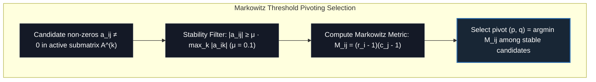

> **Theorem: Wilkinson Element Growth Bound under Threshold Pivoting**  
> Under Markowitz threshold pivoting with parameter $\mu$, the element growth factor $g = \frac{\max_{i,j,k} |a_{ij}^{(k)}|}{\max_{i,j} |a_{ij}|}$ satisfies:
> $$g \le (1 + \mu^{-1})^{m-1}$$
> For $\mu = 0.1$, the maximum row multiplier is bounded by $|l_{ik}| \le \mu^{-1} = 10$, preventing exponential growth in floating-point roundoff while granting sufficient freedom to select pivots with minimal Markowitz counts $M_{ij}$.

### 13.4 Ruiz Equilibration Convergence Theory

Matrix scaling transforms the original linear system $A x = b$ into a balanced system $\bar{A} \bar{x} = \bar{b}$ via diagonal scaling matrices $D_r = \text{diag}(r) \in \mathbb{R}^{m \times m}$ and $D_c = \text{diag}(c) \in \mathbb{R}^{n \times n}$:

$$
\bar{A} = D_r A D_c, \quad \bar{x} = D_c^{-1} x, \quad \bar{b} = D_r b
$$

The Ruiz equilibration algorithm (Ruiz, 2001) iteratively normalizes both row and column $\infty$-norms to unity:
1. Initialize $D_r^{(0)} = I$, $D_c^{(0)} = I$, $A^{(0)} = A$.
2. For iteration $k = 0, 1, \dots, T-1$:
   - Row scaling factor: $r_i^{(k)} = 1 / \sqrt{\|A_{i, \cdot}^{(k)}\|_\infty}$
   - Column scaling factor: $c_j^{(k)} = 1 / \sqrt{\|A_{\cdot, j}^{(k)}\|_\infty}$
   - Update matrix: $A^{(k+1)} = \text{diag}(r^{(k)}) A^{(k)} \text{diag}(c^{(k)})$
   - Accumulate scalers: $D_r^{(k+1)} = \text{diag}(r^{(k)}) D_r^{(k)}$, $D_c^{(k+1)} = D_c^{(k)} \text{diag}(c^{(k)})$

> **Theorem: Convergence of Ruiz Equilibration**  
> If matrix $A$ has no zero rows or columns, the sequence of matrices $A^{(k)}$ converges asymptotically to a scaled matrix $\bar{A}$ whose row and column $\infty$-norms are identically $1.0$:
> $$\lim_{k \to \infty} \|A_{i, \cdot}^{(k)}\|_\infty = 1.0, \quad \lim_{k \to \infty} \|A_{\cdot, j}^{(k)}\|_\infty = 1.0$$
> The rate of convergence is linear with spectral radius $\rho < 1$. In Kavach-Opt, $T = 10$ to $20$ iterations typically reduce condition number $\kappa(A)$ by several orders of magnitude.

---

## 14. Independent Verification & Certificate Complexity

A core architectural invariant of Kavach-Opt is that **no solver output is accepted on trust**. The Independent Verification Layer evaluates every solution candidate from the original mathematical representation.

### 14.1 Certificate Complexity

In computational complexity theory, an optimization problem is in **NP** if candidate solutions can be verified in deterministic polynomial time.

| Problem Class | Solving Complexity | Verification Complexity | Required Certificate Components |
| :--- | :--- | :--- | :--- |
| **LP** | Polynomial ($P$) | $O(\text{nnz}(A))$ — Linear in input size | Primal vector $x$, Dual vector $y$ |
| **MILP** | NP-hard | $O(\text{nnz}(A) + |I|)$ — Linear in input size | Primal vector $x$, Integrality proof |
| **Convex QP** | Polynomial ($P$) | $O(\text{nnz}(A) + \text{nnz}(Q))$ — Linear | Primal vector $x$, Multipliers $\lambda$ |
| **Convex MIQP** | NP-hard | $O(\text{nnz}(A) + \text{nnz}(Q) + |I|)$ | Primal vector $x$, Integrality + KKT |

### 14.2 Verification as a Non-Deterministic Proof System

In theoretical computer science, an optimization verifier is formalised as a relation $\mathcal{V} \subseteq \mathcal{I} \times \mathcal{C}$ where $\mathcal{I}$ is the set of problem instances and $\mathcal{C}$ is the certificate space. The verification program $V(I, C)$ must satisfy two properties:

1. **Completeness:** For every valid optimal instance $I \in \mathcal{L}$, there exists a short certificate $C \in \mathcal{C}$ (with $|C| \le \text{poly}(|I|)$) such that $V(I, C) = \text{ACCEPT}$.
2. **Soundness:** For every false or suboptimal claim $(I, \tilde{z})$ where $\tilde{z}$ is not optimal, there is **no certificate** $C$ that causes $V(I, C)$ to accept:
   $$\forall C \in \mathcal{C}, \quad V(I, C) = \text{REJECT}$$

In Kavach-Opt, the candidate solution $(x^*, y^*, \lambda^*)$ acts as the polynomial-sized certificate $C$. By re-evaluating primal feasibility, dual feasibility, complementary slackness, and KKT residuals from first-principles arithmetic, the verification layer provides unconditional soundness up to the certified numerical tolerance $\epsilon_{\text{tol}}$.

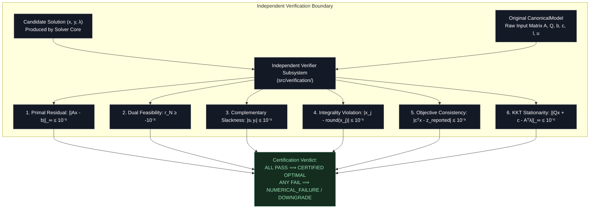

---

## 15. Deterministic Execution Theory

In high-consequence industrial and mission-critical systems, identical inputs must yield bit-identical execution paths and numerical results across repeated runs.

### 15.1 Sources of Non-Determinism in Mathematical Solvers

1. **Floating-Point Asynchronous Reduction:** Non-associativity of IEEE-754 addition ($(a + b) + c \ne a + (b + c)$) when threads accumulate in non-deterministic order.
2. **Pivoting Ties:** Arbitrary memory address order breaking ties during simplex ratio tests or Markowitz search.
3. **Hardware-Dependent Math Routines:** Non-IEEE transcendental functions or fused multiply-add (FMA) contraction differences.

### 15.2 Kavach-Opt Determinism Guarantees

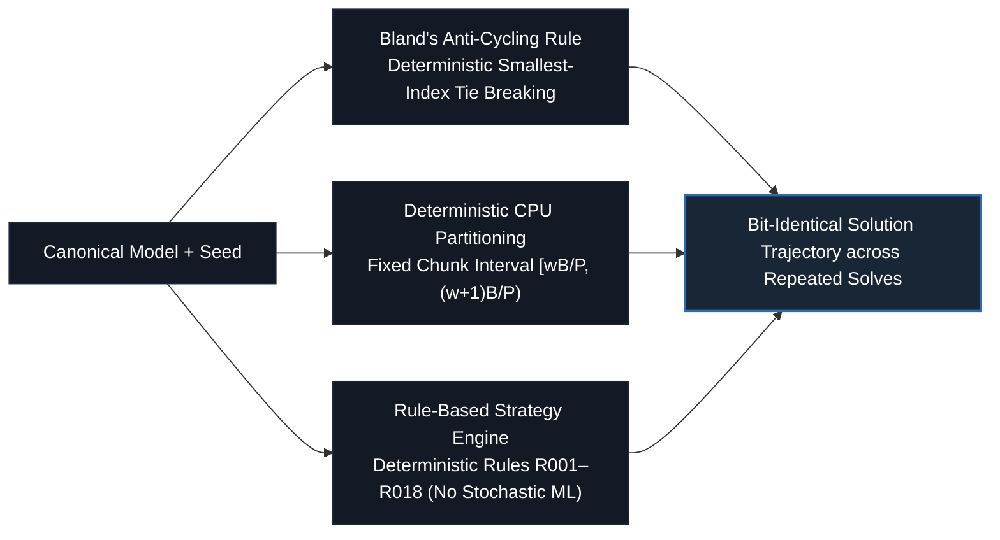

> **Theorem: Deterministic Execution Invariant**  
> Given an immutable `CanonicalModel`, a fixed random seed $S$, and identical thread configurations, Kavach-Opt produces **bit-identical solution vectors** $x$ and identical objective values across repeated invocations.

---

## 16. Asymptotic & Sparse Complexity Analysis

Understanding the asymptotic bounds of sparse operations is vital for scalability.

### 16.1 Sparse Matrix Storage Complexity

For a matrix $A \in \mathbb{R}^{m \times n}$ with $\text{nnz}$ non-zero entries:
- **Compressed Sparse Row (CSR):**
  - `row_ptr`: $m + 1$ integers
  - `col_indices`: $\text{nnz}$ integers
  - `values`: $\text{nnz}$ doubles
  - Memory: $8(m + 1) + 4\text{nnz} + 8\text{nnz} = 8m + 12\text{nnz} + 8$ bytes
- **Compressed Sparse Column (CSC):**
  - Memory: $8n + 12\text{nnz} + 8$ bytes

Compared to dense storage ($8mn$ bytes), for an industrial refinery model with $m = 10{,}000$, $n = 20{,}000$, and density $\rho = 0.001$ ($\text{nnz} = 200{,}000$):
- Dense storage: $1.6 \text{ GB}$
- CSR storage: $2.48 \text{ MB}$ (a $645\times$ compression factor).

### 16.2 Algorithm Complexity Table

| Component | Asymptotic Complexity | Dominant Cost Operation | Implementation File |
| :--- | :--- | :--- | :--- |
| **SpMV ($y = Ax$)** | $O(\text{nnz})$ | Inner loop vector multiply-accumulate | `src/numerics/sparse_matrix.cpp` |
| **Batched SpMV ($K$ vectors)** | $O(K \cdot \text{nnz})$ | Parallel chunked memory-bandwidth bound | `src/backend/cpu/cpu_backend.cpp` |
| **Ruiz Equilibration** | $O(T \cdot \text{nnz})$ | $T$ passes of row/col Euclidean scaling ($T \le 20$) | `src/numerics/scaling.cpp` |
| **SparseLU Factorization** | $O(m \cdot \text{nnz} + \text{fill})$ | Markowitz outer-product pivot updates | `src/numerics/lu_factorization.cpp` |
| **Simplex Iteration** | $O(\text{nnz}(L) + \text{nnz}(U))$ | Forward/backward triangular solves | `src/algorithms/lp/revised_simplex.cpp` |
| **Forrest-Tomlin Update** | $O(m)$ | Row permutation and elementary elimination | `src/algorithms/lp/basis.cpp` |
| **GMI Cut Separation** | $O(|N|)$ per row | Fractional decomposition of tableau row | `src/algorithms/milp/gomory_separator.cpp` |
| **Active-Set QP Step** | $O(n^3)$ worst-case | Dense/sparse KKT subproblem solve | `src/algorithms/qp/active_set.cpp` |
| **Branch-and-Bound** | $O(2^{|I|} \cdot \text{LP})$ | Tree exploration in worst-case combinatorial | `src/algorithms/milp/branch_and_bound.cpp` |

---

## 17. Theoretical Guarantees vs. Practical Numerical Behavior

Mathematical theorems assume infinite-precision real arithmetic ($\mathbb{R}$). Physical computers implement finite-precision IEEE-754 binary floating-point arithmetic ($\mathbb{F}$).

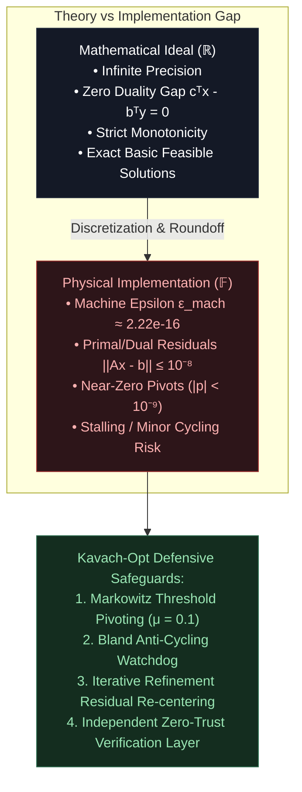

---

## 18. References & Foundational Literature

1. **Dantzig, G. B.** (1963). *Linear Programming and Extensions*. Princeton University Press.
2. **Bland, R. G.** (1977). "New Finite Pivoting Rules for the Simplex Method." *Mathematics of Operations Research*, 2(2), 103–107.
3. **Chvátal, V.** (1973). "Edmonds Polytopes and a Hierarchy of Combinatorial Problems." *Discrete Mathematics*, 4(4), 305–337.
4. **Gomory, R. E.** (1958). "Outline of an Algorithm for Integer Solutions to Linear Programs." *Bulletin of the American Mathematical Society*, 64(5), 275–278.
5. **Nocedal, J., & Wright, S. J.** (2006). *Numerical Optimization* (2nd ed.). Springer Science+Business Media.
6. **Ruiz, D.** (2001). "A Scaling Algorithm to Equalize Both Rows and Columns Norms." *Technical Report RAL-TR-2001-034*, Rutherford Appleton Laboratory.
7. **Markowitz, H. M.** (1957). "The Elimination Form of the Inverse and Its Application to Linear Programming." *Management Science*, 3(3), 255–269.
8. **Achterberg, T.** (2007). *Constraint Integer Programming*. Ph.D. thesis, Technische Universität Berlin.
9. **Fletcher, R.** (1987). *Practical Methods of Optimization* (2nd ed.). John Wiley & Sons.
10. **Higham, N. J.** (2002). *Accuracy and Stability of Numerical Algorithms* (2nd ed.). Society for Industrial and Applied Mathematics (SIAM).
